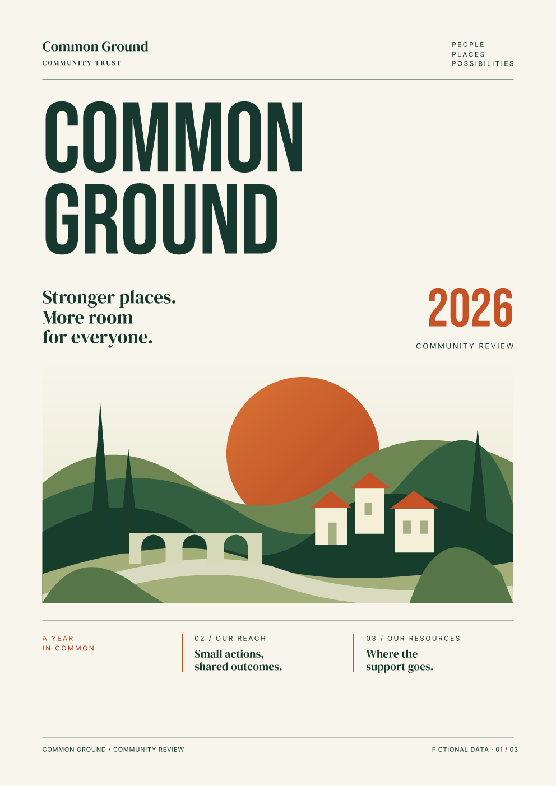
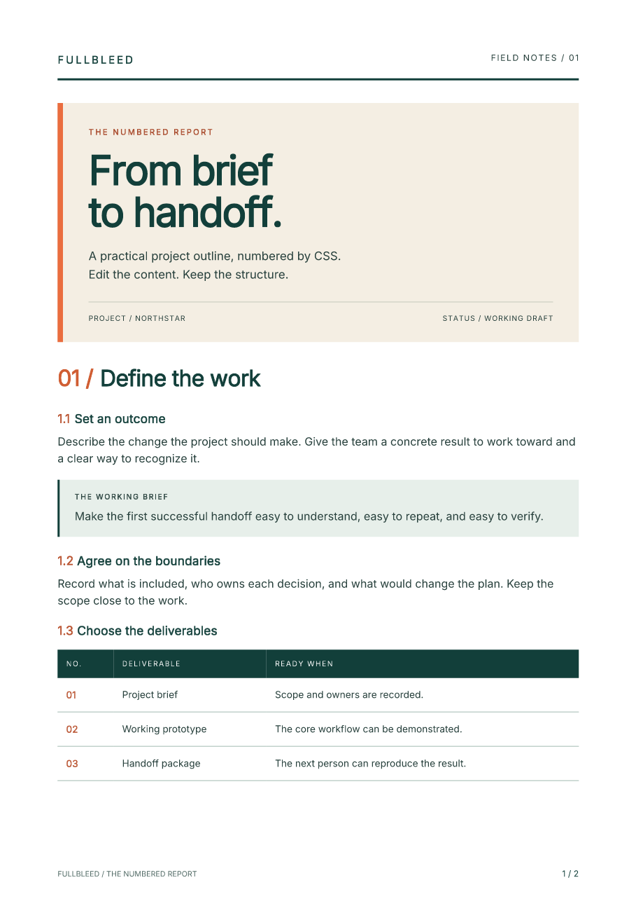
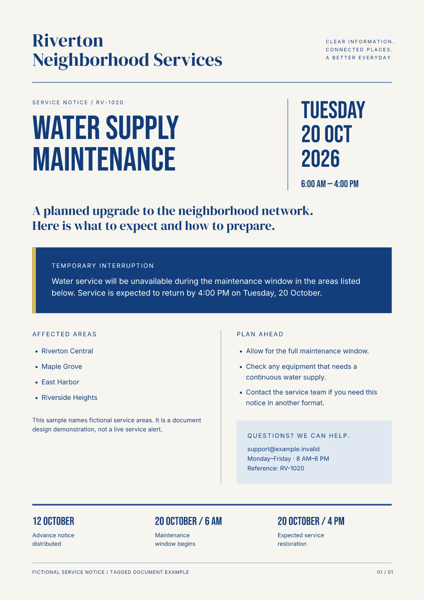
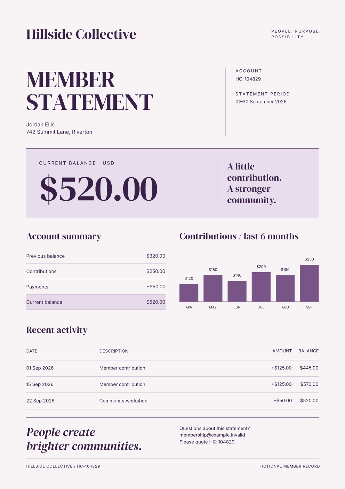
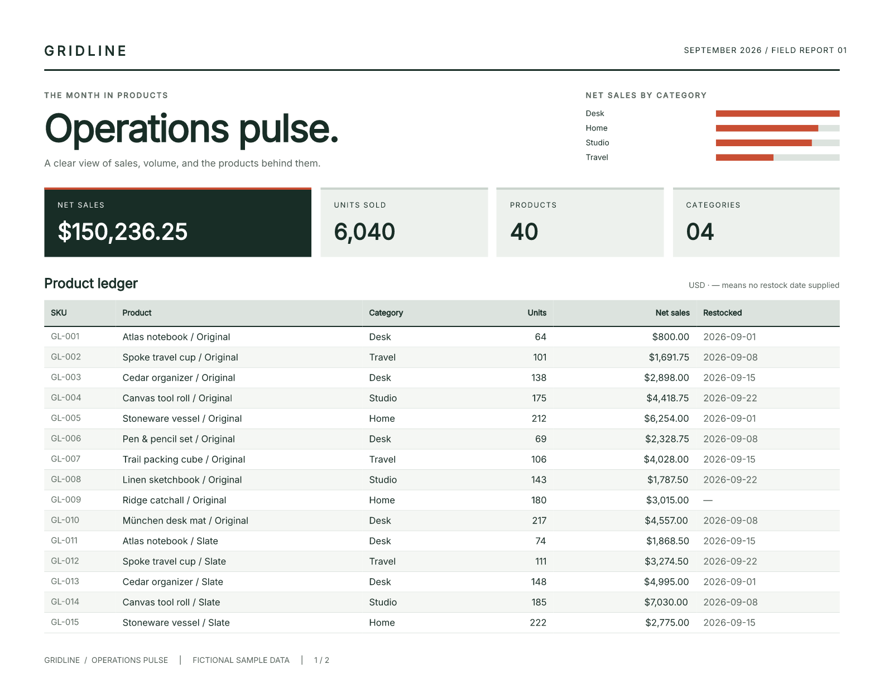
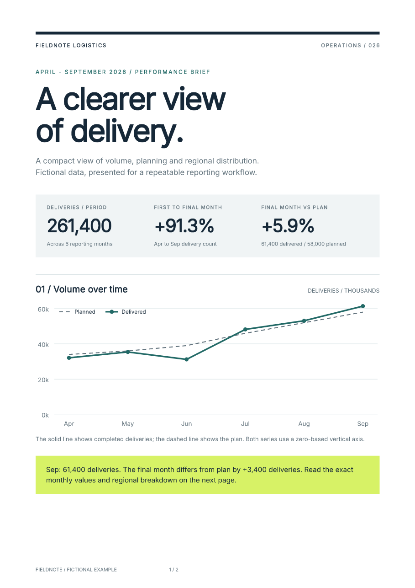
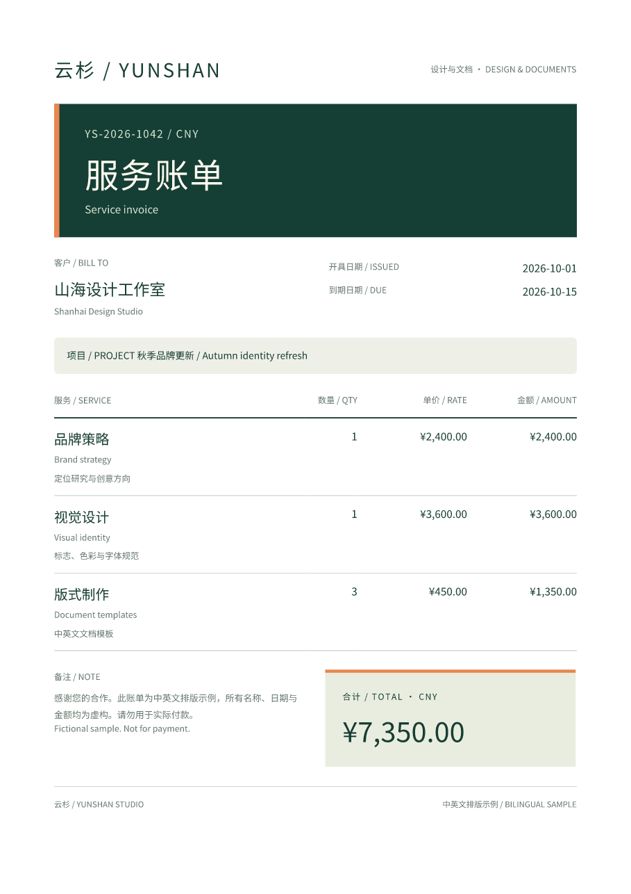
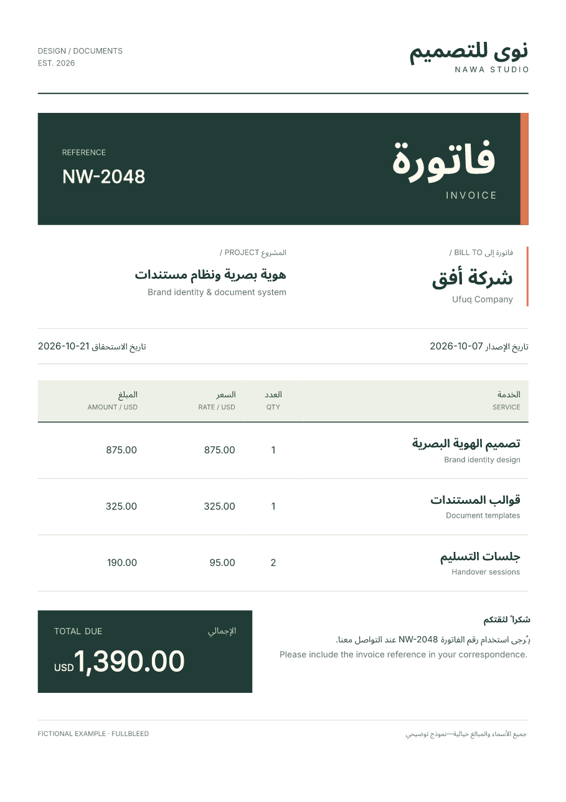
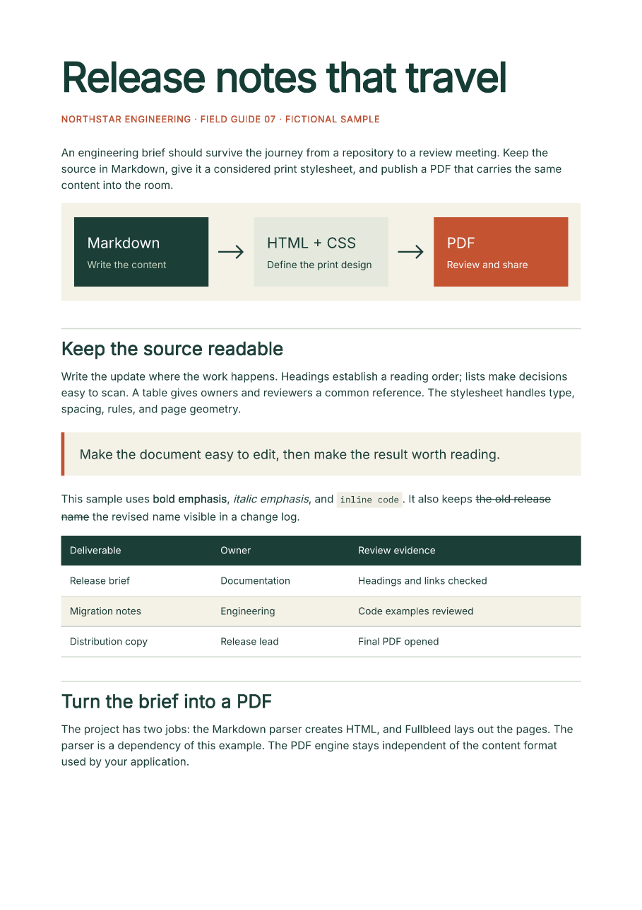
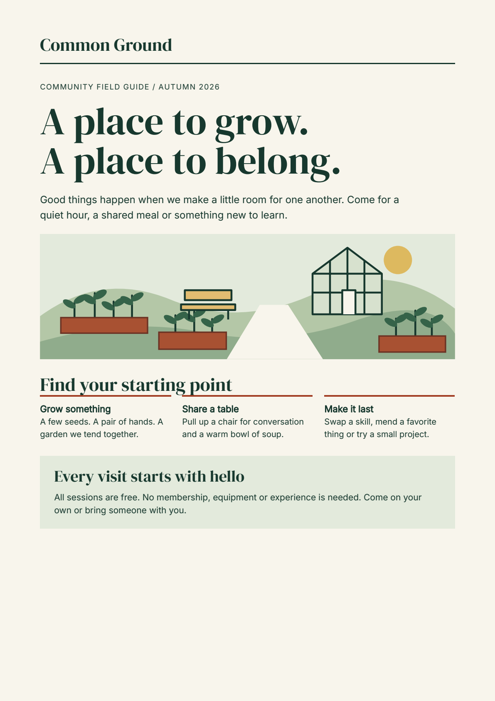

<span id="made-for-the-printed-page"></span>

# PDFs to build on. { .example-title }

Preview real PDFs and download editable sources. All examples use fictional data.

<div class="example-filters" role="group" aria-label="Filter examples by document type" hidden>
<button type="button" data-example-filter="all" aria-pressed="true" aria-controls="example-catalog">All examples</button>
<button type="button" data-example-filter="invoices" aria-pressed="false" aria-controls="example-catalog">Invoices</button>
<button type="button" data-example-filter="reports" aria-pressed="false" aria-controls="example-catalog">Reports &amp; guides</button>
<button type="button" data-example-filter="notices" aria-pressed="false" aria-controls="example-catalog">Notices</button>
<button type="button" data-example-filter="statements" aria-pressed="false" aria-controls="example-catalog">Statements</button>
<button type="button" data-example-filter="templates" aria-pressed="false" aria-controls="example-catalog">PDF templates</button>
</div>

<p class="example-count" role="status" aria-live="polite" aria-atomic="true">16 examples</p>

<div class="example-catalog" id="example-catalog" markdown="1">

<section class="example-card" data-example-kind="invoices" markdown="1">

## Northstar Studio invoice { #styled-invoice }

<figure markdown="1">
[{ loading="eager" decoding="async" width="992" height="1403" }](assets/showcase/invoice.pdf)
</figure>

<p class="example-label">Python · HTML/CSS</p>

Editorial typography, itemized work and a clear amount due.

<div class="example-actions" markdown="1">
[Open PDF](assets/showcase/invoice.pdf){ .md-button .example-pdf }
[Download source](assets/showcase/source.zip){ .md-button .example-source download="fullbleed-styled-invoice.zip" }
</div>

<details class="example-details" markdown="1">
<summary>Customization and verification</summary>

**One page · Editorial typography · Decimal totals**

A warm paper palette, a large condensed title, thin vermilion rules, and an
unmissable total. Three explicit typefaces give the brand, line items, and amounts
their own roles. Grid and table layouts keep the page ordered.

[Open the PDF](assets/showcase/invoice.pdf){ .md-button }
[Compare HTML and components](guides/showcase-authoring.md#northstar-studio){ .md-button }

[HTML](assets/showcase/invoice.html) · [CSS](assets/showcase/invoice.css) · [Data](assets/showcase/data.json)

Start with the [invoice guide](guides/invoices.md), or
[serve an invoice from FastAPI, Flask, or Django](guides/web-frameworks.md).
The Python starter also includes a [tested Docker image](guides/python-docker.md).
For Node applications, download the [six-invoice queue project](guides/node-render-queue.md)
with editable HTML/CSS and limits on active and waiting renders.
For Cloudflare Workers, try the [invoice endpoint with local runtime checks](guides/cloudflare-pdf.md).
For C# web applications, try the [ASP.NET Core download starter](guides/aspnet-pdf.md).
For Rust applications, use the [Axum PDF download starter](guides/axum-pdf.md)
with an editable invoice template and bounded rendering work.
For component authoring, the optional [Yew schedule example](getting-started/rust.md#use-yew-components)
exports PDF and styled or plain HTML from typed Rust props.
For PHP applications, use the [Laravel Blade and queue starter](guides/laravel-pdf.md)
with automatic rendering, private downloads, retries and expiry cleanup.
For a tagged document, use the [editable C# library notice](guides/csharp-tagged-pdf.md)
with PDF/UA profiles, embedded fonts and retained validation reports.

</details>
</section>


<section class="example-card" data-example-kind="reports" markdown="1">

## Common Ground community report { #business-report }

<figure markdown="1">
[{ loading="lazy" decoding="async" width="992" height="1403" }](assets/showcase/report.pdf)
</figure>

<p class="example-label">Python · HTML/CSS</p>

An illustrated cover, participation metrics and data-driven charts.

<div class="example-actions" markdown="1">
[Open PDF](assets/showcase/report.pdf){ .md-button .example-pdf }
[Download source](assets/showcase/source.zip){ .md-button .example-source download="fullbleed-business-report.zip" }
</div>

<details class="example-details" markdown="1">
<summary>Customization and verification</summary>

**Three pages · Native SVG · Data-driven charts**

An illustrated cover opens into a spread of participation metrics, gradient bar
charts, and budget allocations. The landscape stays vector artwork in the PDF;
chart heights and allocation shares come from the supplied JSON.

Each page has an explicit composition, with a consistent masthead, folio, and
typographic hierarchy.

[Open the three-page PDF](assets/showcase/report.pdf){ .md-button }
[Compare HTML and components](guides/showcase-authoring.md#common-ground){ .md-button }

[HTML](assets/showcase/report.html) · [CSS](assets/showcase/report.css) · [Data](assets/showcase/data.json)

[Preview page 2](assets/showcase/report-2.png) · [Preview page 3](assets/showcase/report-3.png)

</details>
</section>


<section class="example-card" data-example-kind="templates" markdown="1">

## One background, many recipients { #pdf-template }

<figure markdown="1">
[{ loading="lazy" decoding="async" width="1210" height="935" }](assets/pdf-template/certificates.pdf)
</figure>

<p class="example-label">Python + C# · PDF overlays</p>

Personalize an existing certificate PDF from structured records.

<div class="example-actions" markdown="1">
[Open PDF](assets/pdf-template/certificates.pdf){ .md-button .example-pdf }
[Python source](assets/pdf-template/project.zip){ .md-button .example-source download="fullbleed-pdf-template.zip" }
[C# source](assets/dotnet-pdf-template/project.zip){ .md-button .example-source download="fullbleed-pdf-template-csharp.zip" }
</div>

<details class="example-details" markdown="1">
<summary>Customization and verification</summary>

**Existing PDF background · JSON records · CSS text overlays**

Keep a certificate's artwork as a PDF and personalize it for each recipient.
The Python and C# projects include three fictional records, editable background source,
positioned fields, and previews of the final composed pages.
Python uses **Fullbleed 2.5.39**; C# uses **FullBleed.DotNet 0.2.3** with
the same engine. Both use the bundled Inter font.

[Open the three-page PDF](assets/pdf-template/certificates.pdf){ .md-button }
[Download Python project](assets/pdf-template/project.zip){ .md-button }
[Download C# project](assets/dotnet-pdf-template/project.zip){ .md-button }

[Use your own PDF template](guides/pdf-template.md)

</details>
</section>


<section class="example-card" data-example-kind="reports" markdown="1">

## From brief to handoff { #numbered-report }

<figure markdown="1">
[{ loading="lazy" decoding="async" width="909" height="1286" }](assets/numbered-report/numbered-report.pdf)
</figure>

<p class="example-label">Python · HTML/CSS</p>

A project outline with numbered headings, tables and pages.

<div class="example-actions" markdown="1">
[Open PDF](assets/numbered-report/numbered-report.pdf){ .md-button .example-pdf }
[Download source](assets/numbered-report/project.zip){ .md-button .example-source download="fullbleed-numbered-report.zip" }
</div>

<details class="example-details" markdown="1">
<summary>Customization and verification</summary>

**Two pages · Editable HTML/CSS · Automatic numbering**

CSS assigns chapter, section, table-row, and page numbers. A warm cover panel,
large Inter headings, green decision cards, and orange accents give a short
project outline a clear visual structure.

[Open the PDF](assets/numbered-report/numbered-report.pdf){ .md-button }
[Download the project](assets/numbered-report/project.zip){ .md-button }

[Preview page 2](assets/numbered-report/page-2.png) ·
[Customize the report](guides/numbered-reports.md)

</details>
</section>


<section class="example-card" data-example-kind="notices" markdown="1">

## Riverton service notice { #tagged-service-notice }

<figure markdown="1">
[{ loading="lazy" decoding="async" width="992" height="1403" }](assets/showcase/notice.pdf)
</figure>

<p class="example-label">Python · Tagged output</p>

A service schedule with a prominent date and clear reading order.

<div class="example-actions" markdown="1">
[Open PDF](assets/showcase/notice.pdf){ .md-button .example-pdf }
[Download source](assets/showcase/source.zip){ .md-button .example-source download="fullbleed-tagged-service-notice.zip" }
</div>

<details class="example-details" markdown="1">
<summary>Customization and verification</summary>

**One page · Clear information hierarchy · Tagged output**

A cobalt palette and prominent date make the maintenance schedule easy to find.
The page combines a full-width alert, two-column details, semantic headings and
lists, and a compact timeline.

[Open the PDF](assets/showcase/notice.pdf){ .md-button }

[HTML](assets/showcase/notice.html) · [CSS](assets/showcase/notice.css)

Generated with the `pdfua1` profile. Internal inspection confirms tags, language,
and profile metadata; this is not a complete accessibility or independent
conformance assessment. See the [accessibility workflow](accessibility/overview.md).

</details>
</section>


<section class="example-card" data-example-kind="statements" markdown="1">

## Hillside member statements { #hillside-member-statements }

<figure markdown="1">
[{ loading="lazy" decoding="async" width="992" height="1403" }](assets/showcase/statements.pdf)
</figure>

<p class="example-label">Python · Variable data</p>

One reusable layout, three member statements and personal balances.

<div class="example-actions" markdown="1">
[Open PDF](assets/showcase/statements.pdf){ .md-button .example-pdf }
[Download source](assets/showcase/source.zip){ .md-button .example-source download="fullbleed-hillside-member-statements.zip" }
</div>

<details class="example-details" markdown="1">
<summary>Customization and verification</summary>

**Three records · Three pages · Compiled reflow bindings**

A shared layout gives each member a personal statement: a large balance, recent
transactions, and a six-month contribution chart. Serif headlines, plum ink, and
solid lilac panels create a quieter visual identity.

Python calculates the balances, compiles the template, and renders the three
member records through reflow bindings.

[Open the statement batch](assets/showcase/statements.pdf){ .md-button }

[HTML template](assets/showcase/statements.html) · [CSS](assets/showcase/statements.css) · [Bindings](assets/showcase/bindings.json)

[Preview record 2](assets/showcase/statements-2.png) · [Preview record 3](assets/showcase/statements-3.png)

[Choose a variable-data rendering lane](guides/bank-statements.md).

</details>
</section>


<section class="example-card" data-example-kind="invoices" markdown="1">

## Functions into finished pages { #python-components }

<figure markdown="1">
[{ loading="lazy" decoding="async" width="794" height="1123" }](assets/components/invoice.pdf)
</figure>

<p class="example-label">Python · Components</p>

Reusable fields, table rows and paid/unpaid states without authored HTML.

<div class="example-actions" markdown="1">
[Open PDF](assets/components/invoice.pdf){ .md-button .example-pdf }
[Download source](assets/components/project.zip){ .md-button .example-source download="fullbleed-python-components.zip" }
</div>

<details class="example-details" markdown="1">
<summary>Customization and verification</summary>

**Python components · Props and children · No authored HTML**

A complete invoice composed from `Field`, `WorkRow`, `WorkTable`, `PaymentNote`
and `Total` functions. Change data, switch paid/unpaid content, or reuse the
components in another document. Styles are Python mappings. Generated with
Fullbleed **2.5.25**.

[Open the PDF](assets/components/invoice.pdf){ .md-button }
[Download the project](assets/components/project.zip){ .md-button }
[Learn component authoring](guides/python-components.md)

For the next authoring model, [try the 2.6.0a4 Bootstrap component alpha](guides/bootstrap-components-preview.md).
Its report combines cards, a table and progress indicators, with PDF and
styled/unstyled HTML exports. The alpha requires an explicit installation.

For separate kit palettes and local customization, [download the two-kit report](guides/component-kits.md)
using **2.6.0a14**.

</details>
</section>


<section class="example-card" data-example-kind="invoices" markdown="1">

## Typed C# components { #csharp-components }

<figure markdown="1">
[{ loading="lazy" decoding="async" width="794" height="1123" }](assets/dotnet-components/invoice.pdf)
</figure>

<p class="example-label">C# · Components</p>

Typed records, LINQ children and reusable styles in ordinary methods.

<div class="example-actions" markdown="1">
[Open PDF](assets/dotnet-components/invoice.pdf){ .md-button .example-pdf }
[Download source](assets/dotnet-components/project.zip){ .md-button .example-source download="fullbleed-csharp-components.zip" }
</div>

<details class="example-details" markdown="1">
<summary>Customization and verification</summary>

Ordinary methods, typed records, LINQ children and reusable style objects produce
this invoice without authored HTML. Change line items, switch paid/unpaid states,
or reuse its fields and table rows. Generated with **FullBleed.DotNet 0.2.0**,
engine **2.5.22**, using the two explicitly registered font files in the project.

[Open the PDF](assets/dotnet-components/invoice.pdf){ .md-button }
[Download the project](assets/dotnet-components/project.zip){ .md-button }
[Learn C# components and styles](guides/csharp-components.md)

The current project download uses **FullBleed.DotNet 0.2.8 / engine 2.5.48** and reproduces the same published PDF and preview. See the [current C# guide](guides/csharp-components.md).

</details>
</section>


<section class="example-card" data-example-kind="reports" markdown="1">

## Gridline product report from pandas { #gridline-product-report-from-pandas }

<figure markdown="1">
[{ loading="lazy" decoding="async" width="1584" height="1224" }](assets/pandas-report/report.pdf)
</figure>

<p class="example-label">Python · pandas</p>

A DataFrame becomes a product ledger with metrics and category bars.

<div class="example-actions" markdown="1">
[Open PDF](assets/pandas-report/report.pdf){ .md-button .example-pdf }
[Download source](assets/pandas-report/source.zip){ .md-button .example-source download="fullbleed-gridline-product-report-from-pandas.zip" }
</div>

<details class="example-details" markdown="1">
<summary>Customization and verification</summary>

For a component-authored design using the same data, try the
[pandas component report](guides/pandas-components.md): three pages, reusable
metrics, finalized page totals, and styled or unstyled HTML export, pinned to
Fullbleed **2.6.0a9**.

**Two pages · 40 DataFrame rows · Repeated table headers**

Turn a pandas DataFrame or CSV into a landscape report with a large headline,
summary panels, category comparisons, and a paginated product ledger. Integer
cents become formatted amounts; missing dates become em dashes. Page numbers
and repeated headers keep the ledger readable across pages.

Rendered with Fullbleed **2.5.2** and pandas **3.0.6**, using fictional sample data.

[Open the PDF](assets/pandas-report/report.pdf){ .md-button }
[Build this report](guides/pandas-to-pdf.md){ .md-button }

[Complete source](assets/pandas-report/source.zip) · [Preview page 2](assets/pandas-report/report-2.png)

</details>
</section>


<section class="example-card" data-example-kind="reports" markdown="1">

## Northstar sales brief from Streamlit { #northstar-sales-brief-from-streamlit }

<figure markdown="1">
[{ loading="lazy" decoding="async" width="794" height="1123" }](assets/streamlit-report/report.pdf)
</figure>

<p class="example-label">Python · Streamlit</p>

Filter sales data, then download the matching brief and complete ledger.

<div class="example-actions" markdown="1">
[Open PDF](assets/streamlit-report/report.pdf){ .md-button .example-pdf }
[Download source](assets/streamlit-report/project.zip){ .md-button .example-source download="fullbleed-northstar-sales-brief-from-streamlit.zip" }
</div>

<details class="example-details" markdown="1">
<summary>Customization and verification</summary>

**Two pages · Interactive filters · Editable HTML/CSS**

Turn a filtered Streamlit view into a designed report. Upload a sales CSV,
choose dates and groups, then prepare a PDF with summary figures and a complete
ledger. The prepared selection stays attached to the download; changed inputs
clear it so a new selection gets a new report.

The fictional sample contains 36 records and USD 222,099.30 in revenue.

[Open the PDF](assets/streamlit-report/report.pdf){ .md-button }
[Run the Streamlit app](guides/streamlit-pdf.md){ .md-button }

[Complete project](assets/streamlit-report/project.zip) ·
[Preview the ledger](assets/streamlit-report/page-2.png)

</details>
</section>


<section class="example-card" data-example-kind="reports" markdown="1">

## Fieldnote report with Matplotlib { #fieldnote-report-with-matplotlib }

<figure markdown="1">
[{ loading="lazy" decoding="async" width="909" height="1286" }](assets/matplotlib-report/report.pdf)
</figure>

<p class="example-label">Python · Matplotlib</p>

Vector charts, editable print CSS and selectable data tables.

<div class="example-actions" markdown="1">
[Open PDF](assets/matplotlib-report/report.pdf){ .md-button .example-pdf }
[Download source](assets/matplotlib-report/project.zip){ .md-button .example-source download="fullbleed-fieldnote-report-with-matplotlib.zip" }
</div>

<details class="example-details" markdown="1">
<summary>Customization and verification</summary>

**Two pages · Matplotlib SVG figures · Selectable data tables**

Compose line and bar charts with editable HTML/CSS, period metrics, a monthly
ledger and page numbers. The sample charts stay vector artwork; the report
repeats their values as selectable text. Both renderers use an explicit bundled
font, and the complete project reads local JSON.

Rendered with Fullbleed **2.5.14** and Matplotlib **3.11.2**, using fictional data.

[Open the PDF](assets/matplotlib-report/report.pdf){ .md-button }
[Build this report](guides/matplotlib-pdf.md){ .md-button }

[Complete project](assets/matplotlib-report/project.zip) · [Preview page 2](assets/matplotlib-report/report-2.png)

</details>
</section>


<section class="example-card" data-example-kind="invoices" markdown="1">

## Yunshan bilingual invoice { #yunshan-bilingual-invoice }

<figure markdown="1">
[{ loading="lazy" decoding="async" width="909" height="1286" }](assets/chinese-invoice/invoice.pdf)
</figure>

<p class="example-label">Python · Chinese + English</p>

A bilingual invoice with an explicit Chinese font and UTF-8 source data.

<div class="example-actions" markdown="1">
[Open PDF](assets/chinese-invoice/invoice.pdf){ .md-button .example-pdf }
[Download source](assets/chinese-invoice/project.zip){ .md-button .example-source download="fullbleed-yunshan-bilingual-invoice.zip" }
</div>

<details class="example-details" markdown="1">
<summary>Customization and verification</summary>

**One page · Chinese and English · Explicit font coverage**

A one-page Simplified Chinese/English invoice using an explicitly registered
regular-weight Noto Sans SC font. The project includes UTF-8 data, HTML/CSS,
pinned font preparation, and a missing-character gate. Rendered with Fullbleed
**2.5.8**; all details are fictional.

[Open the PDF](assets/chinese-invoice/invoice.pdf) ·
[Build this invoice](guides/chinese-pdf.md) ·
[Download the project](assets/chinese-invoice/project.zip)

</details>
</section>


<section class="example-card" data-example-kind="invoices" markdown="1">

## Nawa Studio Arabic and English invoice { #nawa-studio-arabic-and-english-invoice }

<figure markdown="1">
[{ loading="lazy" decoding="async" width="909" height="1286" }](assets/arabic-invoice/invoice.pdf)
</figure>

<p class="example-label">Python · Arabic + English</p>

RTL text, itemized services and bundled Arabic fonts.

<div class="example-actions" markdown="1">
[Open PDF](assets/arabic-invoice/invoice.pdf){ .md-button .example-pdf }
[Download source](assets/arabic-invoice/project.zip){ .md-button .example-source download="fullbleed-nawa-studio-arabic-and-english-invoice.zip" }
</div>

<details class="example-details" markdown="1">
<summary>Customization and verification</summary>

**One page · Arabic and English · Fonts included**

An editable invoice with RTL Arabic blocks, isolated dates and references,
regular and bold Arabic fonts, and an itemized service table. Change the JSON
data, CSS, or HTML structure and render locally. The ZIP includes its exact
font files and licenses. Rendered with Fullbleed **2.5.14**; all details are
fictional.

[Open the PDF](assets/arabic-invoice/invoice.pdf) ·
[Build this invoice](guides/arabic-pdf.md) ·
[Download the project](assets/arabic-invoice/project.zip)

</details>
</section>


<section class="example-card" data-example-kind="reports" markdown="1">

## Northstar Engineering Markdown brief { #northstar-engineering-markdown-brief }

<figure markdown="1">
[{ loading="lazy" decoding="async" width="909" height="1286" }](assets/markdown-starter/document.pdf)
</figure>

<p class="example-label">Python · Markdown</p>

An engineering brief with code, tables and local illustrations.

<div class="example-actions" markdown="1">
[Open PDF](assets/markdown-starter/document.pdf){ .md-button .example-pdf }
[Download source](assets/markdown-starter/project.zip){ .md-button .example-source download="fullbleed-northstar-engineering-markdown-brief.zip" }
</div>

<details class="example-details" markdown="1">
<summary>Customization and verification</summary>

**Two pages · Editable print CSS · Local images and fonts**

Keep the source in Markdown and give the PDF its own page design. This fictional
brief combines headings, emphasis, strikethrough, a table, lists, code, and a
local SVG. The project includes its stylesheet, monospace font and license,
glyph checks, and finalized-PDF previews. Rendered with Fullbleed **2.5.10**.

[Open the PDF](assets/markdown-starter/document.pdf) ·
[Build this brief](guides/markdown-pdf.md) ·
[Download the project](assets/markdown-starter/project.zip) ·
[Preview page 2](assets/markdown-starter/page-2.png)

</details>
</section>


<section class="example-card" data-example-kind="reports" markdown="1">

## Designed for clear reading { #accessible-components }

<figure markdown="1">
[{ loading="lazy" decoding="async" width="1191" height="1684" }](assets/accessible-showcase/common-ground-guide.pdf)
</figure>

<p class="example-label">Python alpha · Components</p>

An illustrated community guide with retained PDF/UA-1 validation evidence.

<div class="example-actions" markdown="1">
[Open PDF](assets/accessible-showcase/common-ground-guide.pdf){ .md-button .example-pdf }
[Download source](assets/accessible-showcase/project.zip){ .md-button .example-source download="fullbleed-accessible-components.zip" }
</div>

<details class="example-details" markdown="1">
<summary>Customization and verification</summary>

**Two pages · Python components · Retained PDF/UA-1 validation**

An illustrated community-program guide with semantic headings, lists, a captioned
schedule and an image description. Its actual PDF tags and reading order were
inspected, and the specimen passed veraPDF's PDF/UA-1 machine checks. Built with
the explicitly pinned **2.6.0a4 component alpha**.

[Open the PDF](assets/accessible-showcase/common-ground-guide.pdf){ .md-button }
[Source and validation evidence](guides/accessible-showcase.md){ .md-button }
[Responsive HTML](assets/accessible-showcase/guide.html) ·
[Unstyled HTML](assets/accessible-showcase/guide-unstyled.html)

</details>
</section>


<section class="example-card" data-example-kind="reports" markdown="1">

## A connected project handoff { #linked-report }

<figure markdown="1">
[{ loading="lazy" decoding="async" width="840" height="1191" }](assets/pdf-links-alpha14/linked-report.pdf)
</figure>

<p class="example-label">Python alpha · PDF links</p>

A project handoff with section navigation, web links and email links.

<div class="example-actions" markdown="1">
[Open PDF](assets/pdf-links-alpha14/linked-report.pdf){ .md-button .example-pdf }
[Download source](assets/pdf-links-alpha14/project.zip){ .md-button .example-source download="fullbleed-linked-report.zip" }
</div>

<details class="example-details" markdown="1">
<summary>Customization and verification</summary>

**Two pages · Section navigation · Web and email links**

Jump from the contents to either section, open a source, or return to the
overview. The project includes the HTML, CSS, bundled-font setup and Python
render script. Generated with the opt-in **2.6.0a14** prerelease; stable 2.5.36
predates the native-navigation feature.

[Open the linked PDF](assets/pdf-links-alpha14/linked-report.pdf){ .md-button }
[Download the project](assets/pdf-links-alpha14/project.zip){ .md-button }
[Add links to your PDFs](guides/pdf-links.md)

</details>
</section>

</div>

[Edit a design in your browser](playground.md){ .md-button }

<details markdown="1">
<summary>Rendering versions and source history</summary>

Every preview comes from the actual downloadable PDF. The Northstar invoice,
Common Ground report, Riverton notice, and Hillside statements were generated
with the public **Fullbleed 2.4.0** wheel; the pandas report below
uses **2.5.2**, the bilingual invoice uses **2.5.8**, and the Markdown brief uses
**2.5.10**. The numbered report uses **2.5.18**, and the Streamlit report uses
**2.5.23**. The linked project handoff uses the opt-in **2.6.0a14**
prerelease. All sample data and organizations are fictional.

[Browse the original showcase source](https://github.com/fullbleed-engine/fullbleed-official/tree/b57e8ea5bb8315f04f7daac41a3489d21a2be158/examples/design_showcase).

</details>

## Run the showcase

Download and extract the [source ZIP](assets/showcase/source.zip), then run these
commands from the extracted directory. Or clone the repository and run them from
its root.

```bash
python -m pip install fullbleed==2.4.0
python examples/design_showcase/render.py --out output/design-showcase
```

The sources include the Python renderer, HTML/CSS, JSON data, SVG artwork, and
Bebas Neue and DM Serif Display fonts with their licenses. Inter is explicitly
loaded from the Fullbleed wheel. Use `--only invoice`, `--only report`,
`--only notice`, or `--only statements` to render one family.

The [verification manifest](assets/showcase/verification.json) records the exact
source commit, font and PDF hashes, page counts, and validation scope. Checks cover
expected text, record order, resolved placeholders, deterministic replay, and
internal inspection. CLI overflow, glyph, and font gates run on the ordinary
documents and a first-record statement proof. All eight published pages were
visually reviewed.

These templates have deliberate page budgets. Review the rendered pages after
changing content, fonts, or row counts.

## Smaller starting points

[Try the editable invoice notebook](getting-started/notebook.md) to generate and
download a PDF before setting up a local project. These compact workflows are
also available:

| Example | Output | Source or guide |
| --- | --- | --- |
| Invoice from JSON | [One-page PDF](assets/examples/invoice.pdf) | [HTML](assets/examples/invoice.html) · [CSS](assets/examples/invoice.css) |
| Acme invoice from CSV | [PDF](assets/examples/acme-invoice.pdf) | [Project source](https://github.com/fullbleed-engine/fullbleed-official/tree/v2.4.0/examples/acme_invoice) |
| Flowing business report | [Five-page PDF](assets/examples/business-report.pdf) | [HTML](assets/examples/business-report.html) · [CSS](assets/examples/business-report.css) |
| Fixed bindings | [100-record PDF](assets/examples/compiled-vdp.pdf) | [Variable-data guide](guides/bank-statements.md) |
| Reflow bindings | [20-record, 41-page PDF](assets/examples/compiled-reflow.pdf) | [Variable-data guide](guides/bank-statements.md) |

[Browse the compact workflow source](https://github.com/fullbleed-engine/fullbleed-official/tree/v2.4.0/examples/agent_workflows)
and its [verification manifest](assets/examples/verification.json).
