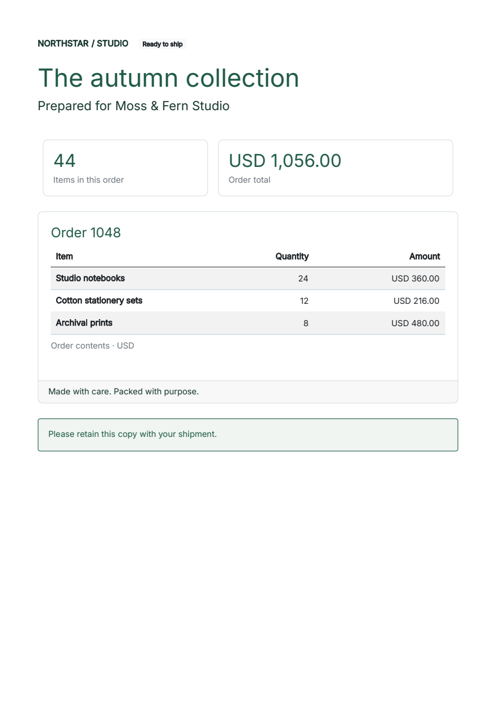

# Try Python components in a notebook

!!! info "Current component preview: 2.6.0a11"
    [Get the current showcase source kit and verified PDFs](../guides/component-preview-11.md).
    [Try the new page-band notebook](page-band-notebook.md) for reusable headers and final page totals.
    The downloadable kits on this page retain their original version pins and evidence.


Build an order summary from Python values, cards and a data table. Change the
customer, quantities or accent color, then download the PDF and both HTML exports.
The notebook contains the complete source, with no authored HTML strings.
Item cells return `Strong(...)` components, so emphasis stays part of the
component tree.

[Open in Colab](https://colab.research.google.com/github/fullbleed-engine/docs/blob/43aff6dee9692d371fa49221c4bcb99045d12639/examples/component-notebook-alpha6-r1/bootstrap_components.ipynb){ .md-button .md-button--primary }
[Download the notebook](../assets/component-notebook-alpha6-r1/bootstrap_components.ipynb){ .md-button download="bootstrap_components.ipynb" }
[View the source](https://github.com/fullbleed-engine/docs/blob/43aff6dee9692d371fa49221c4bcb99045d12639/examples/component-notebook-alpha6-r1/bootstrap_components.ipynb){ .md-button }

!!! warning "Opt-in component alpha"
    The notebook installs **Fullbleed 2.6.0a6**. Its APIs under
    `fullbleed.ui.experimental` may change and have documented CSS limits.
    Bootstrap components are static in PDF and HTML; no Bootstrap JavaScript
    is included. The [stable Python guide](../guides/python-components.md)
    documents the established API.

## Run in Colab

1. Open the notebook, sign in to Google if prompted, and choose **Runtime > Run all**.
2. Edit the order data in step 2 or the accent and title size in step 3.
3. Rerun from your edited cell through the download cell. Review every page preview.
4. Download the ZIP containing the current PDF, HTML files and page previews.

Use a standard CPU runtime; this example needs no GPU or paid plan. Colab runs
the code on a hosted machine, applies its [own availability and usage limits](https://research.google.com/colaboratory/faq.html),
and deletes runtime files after the session expires. Download your results before
leaving.

## Run in local Jupyter

Download the notebook above. In the folder containing `bootstrap_components.ipynb`,
create a virtual environment and launch Jupyter with these commands.

**Windows (PowerShell):**

```powershell
py -m venv .venv
.\.venv\Scripts\python.exe -m pip install "notebook==7.6.3"
.\.venv\Scripts\python.exe -m notebook bootstrap_components.ipynb
```

**macOS or Linux:**

```bash
python3 -m venv .venv
.venv/bin/python -m pip install "notebook==7.6.3"
.venv/bin/python -m notebook bootstrap_components.ipynb
```

In the browser, choose **Run > Run All Cells**. The first cell installs the pinned
Fullbleed alpha in this environment. When the kernel finishes, review the page
previews and click **output/component-order.zip** in step 6.

After editing the data or styles, use **Run > Run All Cells** again and download
the new ZIP. Its individual PDF, HTML and PNG files also remain in the notebook's
local `output/` folder. This notebook revision normalizes the download URL on
Windows so the browser saves the ZIP as `component-order.zip`.

## What you will make

[{ width="480" }](../assets/component-notebook-alpha6-r1/order.pdf)

[Open the sample PDF](../assets/component-notebook-alpha6-r1/order.pdf){ .md-button }
[Open styled HTML](../assets/component-notebook-alpha6-r1/order.styled.html){ .md-button }
[Open unstyled HTML](../assets/component-notebook-alpha6-r1/order.unstyled.html){ .md-button }

The fictional order contains 44 items totaling USD 1,056.00. Python `Decimal`
calculates the total; the example omits tax, shipping and discounts. Try an empty
item list or add rows to explore pagination. For the 72-row example, append
this to the order-data cell in step 2 and rerun from there:

```python
order["items"] = [
    {"item": f"Edition {n:02d} / art print", "quantity": 1, "unit_price": "9.50"}
    for n in range(1, 73)
]
```

Replace that assignment with `order["items"] = []` to try the empty state.
The download includes only the current order's pages, even after a longer run.

## See how styling connects

| Change | Where it belongs |
| --- | --- |
| Reusable card defaults | `Panel = styled(bs.Card, ...)` |
| One card's title or body | `.with_parts(title=style(...), body=style(...))` |
| Bootstrap spacing | `class_name="mb-4 mx-0"` |
| A custom class such as `dispatch-note` | Its selector rule in `Document(styles=...)` |
| Rich content inside a table cell | A column callback such as `lambda row: Strong(row["item"])` |
| Inherited typography | `Theme(text=style(...))` |

The PDF renderer receives the bundled Inter font file explicitly. Styled HTML
keeps the CSS font-family declaration; its browser host supplies Inter or uses
the Arial/sans-serif fallback.
Unstyled HTML retains the component structure and classes for the host's CSS.
The [component and styling guide](../guides/bootstrap-components-preview.md)
explains these choices and includes the full static Bootstrap catalog.

## What has been checked

The notebook checks execute its cells in Jupyter for the default order, edited
data and styles, a 72-row order spanning four pages, and an empty order after that
long run. They inspect PDF text, page bounds and colors with independent readers;
compare repeat renders; and check both HTML exports and the ZIP's exact contents. They also check
that rich item cells preserve their emphasis, order and escaped text.
Old page previews are excluded from a shorter order's download.

The [verification record](../assets/component-notebook-alpha6-r1/verification.json) includes
the sample and notebook hashes. A separate
[Jupyter browser record](../assets/component-notebook-alpha6-r1/browser-verification.json)
covers all four cases in Windows Chrome with Notebook 7.6.3: editing cells,
running them, displaying every preview, and clicking the actual ZIP download.
Every downloaded PDF, HTML file and PNG matches the independently checked output.

These checks do not execute a hosted Colab runtime or its download UI, or establish
complete CSS, browser or PDF-standard conformance.

[Share a small authoring example](https://github.com/fullbleed-engine/fullbleed-official/discussions/86)
if a composition or styling task feels awkward. Use fictional data in public examples.

The [archived alpha 3 notebook](https://colab.research.google.com/github/fullbleed-engine/docs/blob/8cf4915321f2faf517ad7e5b0725e83754e227a6/examples/component-notebook/bootstrap_components.ipynb), [sample PDF](../assets/component-notebook/order.pdf) and [archived verification record](../assets/component-notebook/verification.json) retain their original runtime and bytes.

The [alpha 5 notebook guide](https://github.com/fullbleed-engine/docs/blob/9aa0b2d9b26d398df58f55c8dd3b240a2457e96e/docs/getting-started/component-notebook.md) retains its original pinned notebook and sample files.

The [original alpha 6 notebook guide](https://github.com/fullbleed-engine/docs/blob/ba2540e2603787593189c1ae836b1c61702e313d/docs/getting-started/component-notebook.md) retains its original notebook and sample files. This revision uses the same Fullbleed 2.6.0a6 runtime and produces identical documents.
