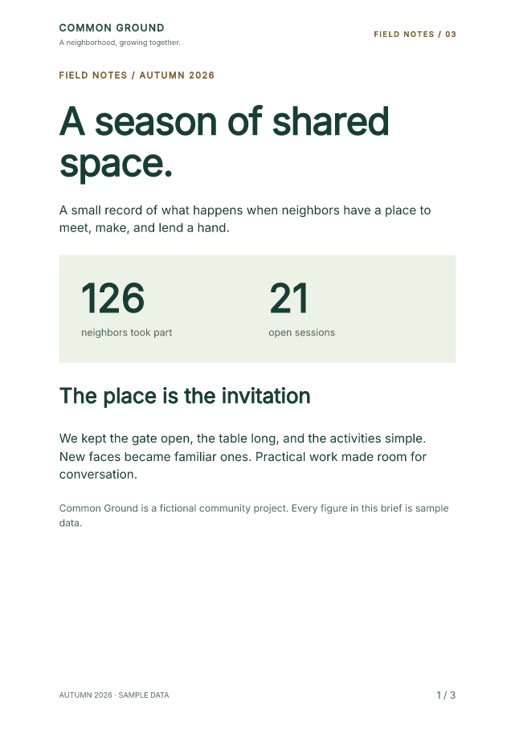
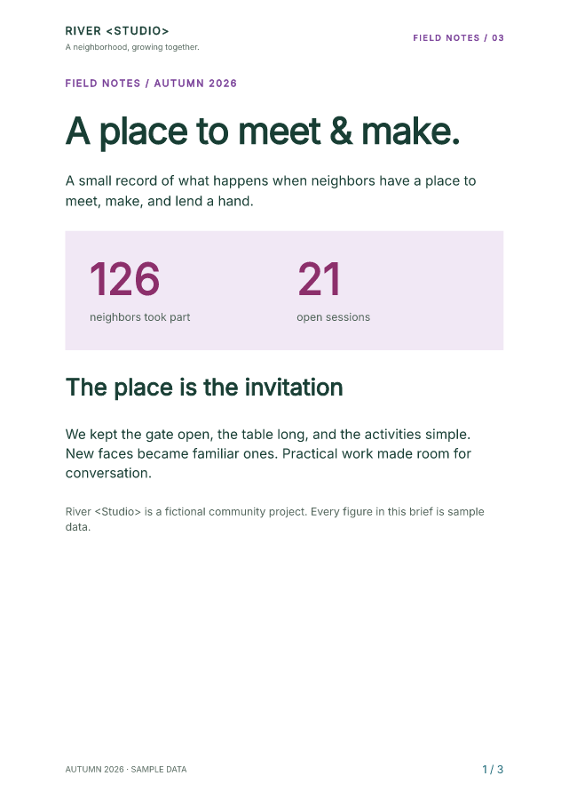

# Make the components your own

Change five styling controls in a complete Common Ground report. See which
elements change, then download the PDF, styled HTML and unstyled HTML.
The notebook includes every component definition and uses Python values for
the content.

[Open in Colab](https://colab.research.google.com/github/fullbleed-engine/docs/blob/70fd19a7f292ce52bfb466ed782d4c4776a68f12/examples/styling-notebook-alpha11/component_styling.ipynb){ .md-button .md-button--primary }
[Download the notebook](../assets/styling-notebook-alpha11/component_styling.ipynb){ .md-button download="component_styling.ipynb" }
[View the pinned source](https://github.com/fullbleed-engine/docs/blob/70fd19a7f292ce52bfb466ed782d4c4776a68f12/examples/styling-notebook-alpha11/component_styling.ipynb){ .md-button }

!!! info "Opt-in component preview: 2.6.0a11"
    The first cell installs `fullbleed==2.6.0a11`. The API under
    `fullbleed.ui.experimental` remains experimental. Ordinary `pip install
    fullbleed` selects the stable channel. The [current preview guide](../guides/component-preview-11.md)
    includes the complete source kit, API references and release evidence.

[{ width="340" }](../assets/styling-notebook-alpha11/field-notes.pdf)
[{ width="340" }](../assets/styling-notebook-alpha11/edited.pdf)

[Open the sample PDF](../assets/styling-notebook-alpha11/field-notes.pdf){ .md-button }
[Open styled HTML](../assets/styling-notebook-alpha11/field-notes.styled.html){ .md-button }
[Open unstyled HTML](../assets/styling-notebook-alpha11/field-notes.unstyled.html){ .md-button }

## Change one control at a time

Run all cells, then edit the values in step 2 and rerun from that cell through
the download cell. Start with one color so its target is easy to spot.

| Control | Styling mechanism | Visible effect |
| --- | --- | --- |
| `ACCENT` | `Theme(...)` and `token("accent")` | Small uppercase labels |
| `TITLE_SIZE` | `styled(Heading, ...)` | Large headings throughout the report |
| `PANEL_BACKGROUND` | `.with_style(...)` | The first page's metrics panel |
| `METRIC_COLOR` | `.with_parts(value=...)` | The two large metric values |
| `FOLIO_COLOR` | `class_name` and `Document(styles=...)` | Page numbers in every footer |

To reproduce the edited palette above, use:

```python
ACCENT = "#763c96"
TITLE_SIZE = 27
PANEL_BACKGROUND = "#f1e8f5"
METRIC_COLOR = "#8c2f6b"
FOLIO_COLOR = "#206b7a"
```

You can also edit `PROJECT_NAME`, `HEADLINE` and the `ACTIVITY` rows. All data
in the example is fictional.

## Connect `class_name` to a rule

A class names a target; the matching style rule gives it an appearance.
The notebook places `PageNumbers(class_name="folio", ...)` in the footer and
defines this rule on its `Document`:

```python
styles={
    ".folio": style(font_size=pt(8), color=FOLIO_COLOR),
}
```

Use the dot in the selector, `.folio`, and omit it from `class_name="folio"`.
A Python function's name does not create a selector. A class name does not
automatically load Bootstrap or another stylesheet.

The rule applies to the generated `.folio` element in PDF and styled HTML.
Unstyled HTML retains the class so another application can style it.

## Customize the root or a named part

The `Metric` function declares `value` and `label` parts. Each instance can
customize its large number without restyling the label:

```python
Metric("126", "neighbors took part").with_parts(
    value=style(color=METRIC_COLOR),
)
```

For the whole metrics panel, the notebook uses
`.with_style(background=PANEL_BACKGROUND)` on its `Box`. These calls return
new component values; they do not mutate other instances. Shared typography
belongs in `Theme` or a reusable `styled(...)` primitive.

The [authoring reference](https://github.com/fullbleed-engine/fullbleed-official/blob/v2.6.0a11/docs/component-bootstrap.md)
explains precedence, supported styles and named parts.

## Run in Colab or local Jupyter

In Colab, choose a standard CPU runtime and **Runtime > Run all**. Review
the three default page previews, edit a control, rerun and save the ZIP.
No GPU is needed. Colab's availability and usage limits apply.

For local Jupyter, download the notebook and open a terminal in its folder.
Use Python 3.11 or later.

=== "Windows (PowerShell)"

    ```powershell
    py -m venv .venv
    .\.venv\Scripts\python.exe -m pip install "notebook==7.6.3"
    .\.venv\Scripts\python.exe -m notebook component_styling.ipynb
    ```

=== "macOS or Linux"

    ```sh
    python3 -m venv .venv
    .venv/bin/python -m pip install "notebook==7.6.3"
    .venv/bin/python -m notebook component_styling.ipynb
    ```

Wait for the kernel to connect, choose **Run > Run All Cells**, and click
**output/component-field-notes.zip** in the final code cell. The ZIP contains
the current PDF, both HTML forms and every current page preview.

For a longer report, replace `ACTIVITY` with:

```python
ACTIVITY = [
    (f"Session {number:02d}", str(number), "8 neighbors")
    for number in range(1, 73)
]
```

That checked example has eight pages. Set `ACTIVITY = []` and rerun to see
the empty table and a three-page result. The ZIP excludes previews left over
from a longer run.

## Use the HTML elsewhere

`document.to_html(include_styles=True)` includes the resolved component and
document CSS. With `include_styles=False`, the export retains the semantic
structure and classes without style declarations. Your application can supply
its own stylesheet.

Both forms are static HTML. They use one header/main/footer sequence and
`[page] / [pages]` placeholders; they do not paginate the browser or add
Bootstrap JavaScript.

The PDF registers bundled Inter explicitly. That registration does not embed
Inter in browser HTML: the host must supply the font or use the included
sans-serif fallback. `Flow` now exports its own browser layout and gaps.
The notebook's `@media screen` rules supply fonts and screen framing. A
`browser_document` reuses the same component content with those host rules;
the PDF document does not receive them. PDF-only page breaks are hidden in
continuous styled HTML. The
[complete source kit](../guides/component-preview-11.md) includes an example
that writes the font file and a matching browser `@font-face` rule.

## What the checks cover

The [execution record](../assets/styling-notebook-alpha11/verification.json)
covers six cases: default, edited text and styles, selector-only changes,
named-part-only changes, 72 activity rows, and an empty table after the long run.
Independent readers inspect all 23 PDF pages, including text, character bounds,
colors and finalized page totals. Repeat renders, both HTML forms and ZIP
contents are checked. The default PDF reproduces the qualified field-notes
specimen exactly.

The [style-isolation record](../assets/styling-notebook-alpha11/style-isolation.json)
checks the rendered pixels: changing only `.folio` affects the footer on each
page; changing only the metric value part leaves pages two and three identical.

The [Jupyter browser record](../assets/styling-notebook-alpha11/browser-verification.json)
covers editing the controls, running cells, displaying all previews and clicking
the actual ZIP downloads. Those downloads match the independently inspected
files. The checks cover local Jupyter, not execution in a hosted Colab session.

The PDF/UA-2 profile and source checks express authoring intent. Validate your
own documents and include human assistive-technology review where needed.
Repeated PDF bands sit outside body reading order, so essential information
also belongs in the body.

The earlier [page-band notebook](page-band-notebook.md) and
[Bootstrap notebook](component-notebook.md) retain their original pins and
examples.
