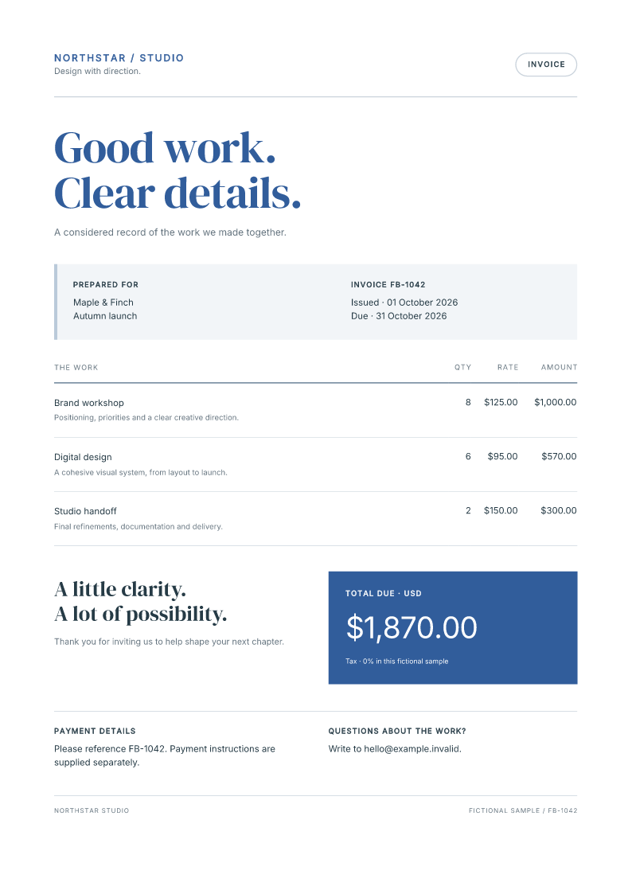
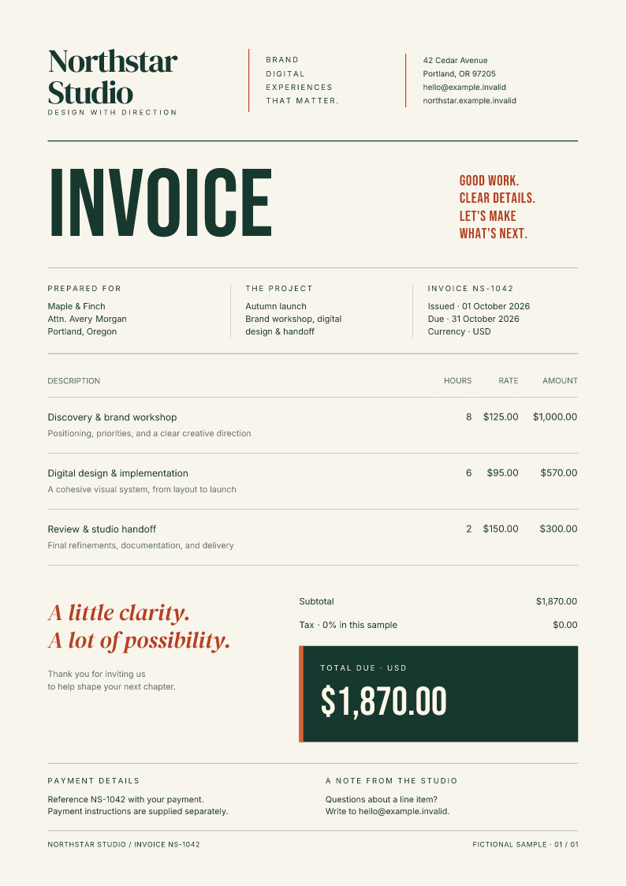

# Generate PDFs from C# and .NET

[`FullBleed.DotNet`](https://www.nuget.org/packages/FullBleed.DotNet/0.2.7)
brings Fullbleed's Rust rendering engine into a .NET process. Generate invoices
and reports from HTML/CSS templates, or compose them with ordinary C# methods,
named components and reusable styles. Native
rendering needs neither Python nor a browser.

## Install and render your first PDF

With the .NET 10 SDK installed:

```bash
dotnet new console -n InvoiceDemo --framework net10.0
cd InvoiceDemo
dotnet add package FullBleed.DotNet --version 0.2.7
```

### Render HTML/CSS

Replace `Program.cs` with this complete example:

```csharp
using FullBleed.DotNet;

const string html = """
    <h1 class="invoice-title">Invoice INV-1042</h1>
    <p>Consulting: USD 1,200.00</p>
    """;
const string css = """
    @page { size: A4; margin: 20mm; }
    .invoice-title { color: #175c52; }
    """;
using var engine = new FullBleedEngine(new FullBleedEngineOptions
{
    DocumentLanguage = "en-US",
    DocumentTitle = "Invoice INV-1042",
});
engine.RenderPdfToFile(html, css, "invoice.pdf");
var inspection = FullBleedEngine.InspectPdf("invoice.pdf");
Console.WriteLine($"Created invoice.pdf: {inspection.PageCount} page(s).");
```

Run `dotnet run` and open `invoice.pdf` in the project directory. For existing
files, pass strings from `File.ReadAllText("invoice.html")` and
`File.ReadAllText("invoice.css")`. `engine.RenderPdf(html, css)` returns bytes
for an HTTP response or your own storage.

The renderer accepts static HTML/CSS. Render any Razor templates before passing
them in; JavaScript execution and live webpage capture require a browser.

### Author with C# components

To build the document with C# methods and reusable styles, replace `Program.cs`
with this alternative:

```csharp
using FullBleed.DotNet;
using FullBleed.DotNet.UI;
using static FullBleed.DotNet.UI.Components;

var invoice = new Document(
    Heading(1, "Invoice INV-1042").WithClass("invoice-title"),
    Paragraph("Consulting: USD 1,200.00")
)
{
    Styles = new StyleSheet
    {
        ["@page"] = new Style { ["size"] = "A4", ["margin"] = "20mm" },
        [".invoice-title"] = new Style { ["color"] = "#175c52" },
    },
};
using var engine = new FullBleedEngine(new FullBleedEngineOptions
{
    DocumentLanguage = "en-US",
    DocumentTitle = "Invoice INV-1042",
});
invoice.RenderPdfToFile(engine, "invoice.pdf");
var inspection = FullBleedEngine.InspectPdf("invoice.pdf");
Console.WriteLine($"Created invoice.pdf: {inspection.PageCount} page(s).");
```

`WithClass("invoice-title")` labels the heading. The `.invoice-title` rule in
`Document.Styles` makes it green; the class name alone adds no styling.
Read [class names and styles](../guides/csharp-components.md#class-names-and-styles)
for shared stylesheets, reusable components and inline overrides.

Run it with the same `dotnet run` command. Both examples use standard PDF fonts.
Their PNG previews use bundled
outline substitutes, so they work without system fonts. Register explicit font
files for your chosen type design and character coverage; the designed example
below embeds its fonts.

The package's managed library targets `net8.0`; your application can target
`net8.0`, `net9.0`, or `net10.0`. It contains native libraries for Windows x64,
Linux x64, Intel macOS, and Apple Silicon macOS. It pins Fullbleed 2.5.43.
The managed assembly has no third-party NuGet runtime dependencies.

Version 0.2.7 preserves the final color and opacity beyond a radial gradient's
ending shape and corrects zero-width PDF stitching intervals. Earlier long-code
wrapping and `pre-line` whitespace fixes remain included.
The component and HTML/CSS APIs are unchanged. The assembled package is checked
on .NET 8, 9 and 10 across all four native platforms.
[Inspect the release evidence](https://github.com/fullbleed-engine/fullbleed-dotnet/releases/tag/v0.2.7).

## Download a component invoice

The [C# component project](../guides/csharp-components.md) uses typed records,
reusable fields and table rows, shared style objects and explicitly registered
fonts. Its complete source is included in a standalone download.

[](../assets/dotnet-components/invoice.pdf)

[Download the project](../assets/dotnet-components/project.zip){ .md-button .md-button--primary }
[Learn C# components](../guides/csharp-components.md){ .md-button }

Extract it, run `dotnet restore --locked-mode`, then
`dotnet run -c Release --no-restore -- output`.

## Use an existing HTML/CSS design

The Northstar sample combines explicit fonts, CSS grid, tables, print
dimensions, color, and typographic hierarchy. Its text and business details
are fictional.

[](../assets/showcase/invoice-dotnet.pdf)

[Open the PDF generated from C#](../assets/showcase/invoice-dotnet.pdf).

Clone the documentation repository and run the example with .NET 10:

```bash
git clone https://github.com/fullbleed-engine/docs.git fullbleed-docs
cd fullbleed-docs
dotnet run --project examples/dotnet -c Release -- output/northstar
```

Open `output/northstar/invoice.pdf` and `invoice_page1.png`. The sample
includes the HTML, CSS, font files, and their license notices. Rendering
uses those local assets and the prebuilt NuGet package. You do not need a
Rust compiler to run it.

[Read the complete C# sample](https://github.com/fullbleed-engine/docs/tree/main/examples/dotnet)
or [browse the document assets](https://github.com/fullbleed-engine/docs/tree/main/docs/assets/showcase).

## Register fonts and inspect the result

In the downloaded component project, replace `Program.cs` with this version to
register its bundled fonts and check the result before writing it:

```csharp
using FullBleed.ComponentInvoice;
using FullBleed.DotNet;

var document = InvoiceDocument.Create(InvoiceDocument.Example);
using var engine = new FullBleedEngine(new FullBleedEngineOptions
{
    DocumentLanguage = document.Language,
    DocumentTitle = document.Title,
    Assets = Directory.GetFiles(Path.Combine(AppContext.BaseDirectory, "Assets/fonts"), "*.ttf")
        .Order(StringComparer.Ordinal)
        .Select(path => FullBleedAsset.FromPath(path, FullBleedAssetKind.Font))
        .ToList(),
});

var result = document.RenderPdfWithDiagnostics(engine);
if (result.Diagnostics.MissingGlyphs.Count != 0)
{
    throw new InvalidOperationException("The supplied fonts do not cover every character.");
}
Directory.CreateDirectory("output");
File.WriteAllBytes("output/invoice.pdf", result.Pdf);

document.RenderImagePagesToDirectory(engine, "output/preview", dpi: 96, stem: "invoice");
```

Keep the font notices when redistributing the assets. The PDF and PNG calls
above are separate render operations; use
`RenderFinalizedPdfImagePagesToDirectory` to preview an existing Fullbleed PDF.
Inspect the rendered pages after changing content or fonts.

## Use the native API or the CLI adapter

`FullBleedEngine` covers rendering, batches, diagnostics, previews, PDF
inspection, template composition, and compiled bindings. For repeated
documents, `BindingMap<T>` projects records through ordinary LINQ selectors.
Use fixed bindings for values with reserved geometry, and reflow bindings
when changing text must wrap or repaginate.

`FullBleedCliClient` is a separate adapter for an independently installed
Fullbleed Python CLI. It discovers that runtime's capabilities and schemas
and exposes verification, profiles, scaffolding, and other CLI workflows.
Installing the NuGet package alone does not install the Python CLI.

Selecting an output profile is not proof of conformance. Check the actual
document and retain the relevant verification evidence before making an
accessibility, archival, or print-standard claim.

For a web application, download the [ASP.NET Core PDF starter](../guides/aspnet-pdf.md).
It includes a download page, styled invoice, private responses, and checks against
the published application artifact.
For tagged output, use the [C# library-notice starter](../guides/csharp-tagged-pdf.md)
with PDF/UA profiles and independent validation.

[.NET API reference](https://github.com/fullbleed-engine/fullbleed-dotnet/blob/v0.2.7/docs/api.md)
· [LINQ and variable-data example](https://github.com/fullbleed-engine/fullbleed-dotnet/tree/v0.2.7/samples/FullBleed.DotNet.LinqVdp)
· [CSS coverage](../css-coverage.md)
· [More document designs](../examples.md)
· [Report a .NET issue](https://github.com/fullbleed-engine/fullbleed-dotnet/issues)

Use an existing certificate or letterhead PDF with the
[PDF-template project](../guides/pdf-template.md#c). It includes a C# component
overlay, editable CSS, JSON records, and the designed background.

Ask a question or share a document in [GitHub Discussions](https://github.com/fullbleed-engine/fullbleed-official/discussions/6).
