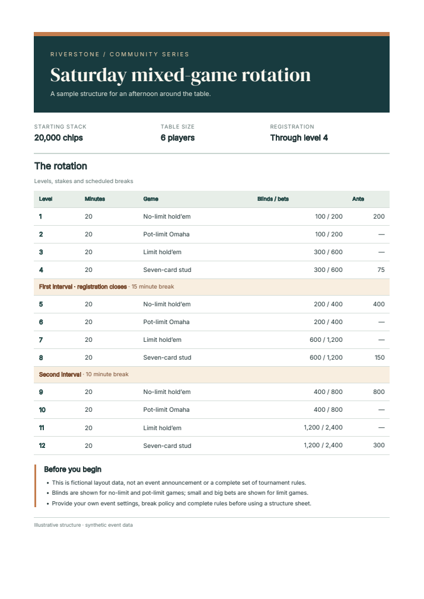

# Generate PDFs from Rust with HTML and CSS

Use the [`fullbleed` crate](https://crates.io/crates/fullbleed) directly in a
Rust application. The engine renders static HTML and CSS into print documents;
you do not need Python or a browser to render them.

For editable invoice and report templates with fonts included,
[start with the complete Rust project](#render-a-designed-invoice-or-report).

## Create your first PDF

With Rust 1.85 or newer and a working native Rust toolchain:

```bash
cargo new invoice-demo
cd invoice-demo
cargo add fullbleed@=2.5.50 --features svg_raster
```

Replace `src/main.rs` with:

```rust
use fullbleed::FullBleed;

fn main() -> Result<(), Box<dyn std::error::Error>> {
    let html = "<h1>Invoice INV-1042</h1><p>Consulting: USD 1,200.00</p>";
    let css = "@page { size: A4; margin: 20mm; } h1 { color: #175c52; }";
    let engine = FullBleed::builder().build()?;
    let pdf = engine.render_to_buffer(html, css)?;
    std::fs::write("invoice.pdf", pdf)?;
    Ok(())
}
```

Run it:

```bash
cargo run --release
```

Open `invoice.pdf` in the project directory. `render_to_buffer` returns PDF
bytes, which you can also return from an HTTP handler or write to your own
storage. For a file directly, use
`engine.render_to_file(html, css, "invoice.pdf")?`.

For unoptimized builds on Windows, use 2.5.19 or newer. Versions 2.5.17 and
2.5.18 can overflow the default main-thread stack on small table layouts;
the [2.5.19 release](https://github.com/fullbleed-engine/fullbleed-official/releases/tag/v2.5.19)
includes the fix and its regression evidence.

This first example uses standard PDF fonts. For explicit typography and
broader character coverage, register the font files your document uses.
The Python wheel's bundled fonts are not included in the Rust crate.

## Render a designed invoice or report

The standalone project includes font registration, missing-glyph checking, and
PNG previews. It contains the Rust source, pinned Cargo dependencies, editable
HTML/CSS, and four font faces with their license notices. It uses the same
document source and fonts as the
[editable browser playground](../playground.md).

[](../assets/showcase/invoice.pdf)

[Download the Rust project](../assets/rust-starter/project.zip){ .md-button .md-button--primary }
[Source and checksums](../assets/rust-starter/source.json){ .md-button }

Extract the ZIP and open a terminal in `fullbleed-rust-starter`:

```bash
cargo run --release --locked --bin from-files -- templates/invoice.html templates/invoice.css fonts output/invoice
```

Open `output/invoice/document.pdf` and `output/invoice/page-1.png`. For the
three-page report:

```bash
cargo run --release --locked --bin from-files -- templates/report.html templates/report.css fonts output/report
```

Edit the files in `templates/` to customize the content and design. Render to a
new output directory after edits, so previews from a longer previous document
do not remain. The first Cargo build downloads dependencies and needs internet
access. These examples pin Fullbleed 2.5.50 and include a Cargo lockfile; the ZIP
is compiled and rendered on Windows and Linux with Rust 1.97.0.

For the service notice or your own edits, choose **Download project** in the
playground. Extract its ZIP into `my-project` inside the Rust starter, then run:

```bash
cargo run --release --locked --bin from-files -- my-project/input.html my-project/style.css my-project/fonts output/my-project
```

The Rust example reads the exported HTML, CSS, and fonts directly. The individual
**Save HTML** and **Save CSS** links also work with an existing fonts directory.

## Register fonts and create previews

Font registration is explicit. With the downloaded `fonts` directory beside
your application, load a font into an asset bundle. Reading the file surfaces
missing-file errors; building the engine checks the font bytes:

```rust
use fullbleed::{Asset, AssetBundle, AssetKind};

let mut assets = AssetBundle::default();
assets.add(Asset::new(
    "InvoiceSans".into(),
    AssetKind::Font,
    std::fs::read("fonts/Inter-Variable.ttf")?,
    None,
    true,
));
let engine = FullBleed::builder().register_bundle(assets).build()?;
let css = "body { font-family: 'InvoiceSans'; font-size: 11pt; }";
let (pdf, glyphs) = engine.render_with_glyph_report(html, css)?;
if !glyphs.is_empty() {
    return Err("A character is not covered by the supplied fonts.".into());
}
std::fs::write("invoice.pdf", pdf)?;
```

Keep font license notices with redistributed assets. Register the additional
families and styles used by your CSS; the designed example registers all four
playground font files.

The `register_font_file` and `register_font_dir` helpers are also available,
but skip unreadable or invalid files. A glyph report can find missing characters;
it does not prove that the intended typeface loaded. The
[API font guide](https://docs.rs/fullbleed/2.5.50/fullbleed/#supply-fonts-explicitly)
explains these choices.

For one PNG per page, preview the PDF you just wrote at your chosen DPI:

```rust
for (index, png) in engine.render_finalized_pdf_image_pages("invoice.pdf", 96)?.iter().enumerate() {
    std::fs::write(format!("page-{}.png", index + 1), png)?;
}
```

This previews the finalized PDF, including its supported gradient fills. The
designed example and downloaded playground projects use the same path.

## Compile fonts and templates into your executable

If fonts and templates should travel with your application, the
[same Rust download](../assets/rust-starter/project.zip) includes an optional
`embedded` program. Build it from the extracted `fullbleed-rust-starter`
directory:

```bash
cargo build --release --locked --features embedded-assets --bin embedded
```

Run the compiled program directly:

```bash
./target/release/embedded invoice output/embedded-invoice
```

On Windows, use:

```powershell
.\target\release\embedded.exe invoice output\embedded-invoice
```

Replace `invoice` with `report` for Common Ground. The program writes
`document.pdf` and one `page-*.png` preview per page. Choose a new output
directory; an existing directory is rejected.

You can copy the executable elsewhere and run it without adjacent font or
template files. Keep the font license notices with distributions of the
executable. Changes to its fonts, HTML or CSS require rebuilding; use
`from-files` when templates should stay editable at runtime.

In your own program, pass
`include_bytes!("../fonts/Inter-Variable.ttf").to_vec()` to `Asset::new` where
the registration example above reads a file. Use `include_str!` to embed HTML
or CSS. These macro paths are relative to the Rust source file at compile
time, rather than the program's working directory. The included
`src/embedded.rs` shows all four fonts, both designs, and missing-glyph handling.

The download check copies the executable to an otherwise empty directory,
runs both designs, and compares its PDFs and finalized previews with the
file-based example. It also checks repeated output and rejects overwriting
an existing output directory.

## Use Yew components

If your application already uses Yew, you can author a document with typed
props and its `html!` macro. This optional example renders a fictional event
schedule to PDF and exports the same content as styled or plain HTML.

[](../assets/yew-starter/document.pdf)

[Download the Yew project](../assets/yew-starter/project.zip){ .md-button .md-button--primary }
[Open the PDF](../assets/yew-starter/document.pdf){ .md-button }

[Styled HTML](../assets/yew-starter/preview/document.html)
· [HTML without styles](../assets/yew-starter/preview/unstyled.html)
· [Source checksums](../assets/yew-starter/source.json)

Extract the ZIP, open a terminal in `fullbleed-yew-sheet`, and run:

```bash
cargo run --release --locked -- data.json output
```

Open `output/document.pdf`, `output/document.html`, or `output/unstyled.html`.
Edit `data.json` for the content and `style.css` for the design. Choose a new
output directory after edits; the program refuses to overwrite one.

The public `StructureSheet` component and its `SheetData` and `ScheduleRow`
types live in `src/document.rs`. Its `class="masthead"` attribute selects
`.masthead` in `style.css`; styling follows ordinary CSS class rules. Text
passed through component props is escaped by Yew. The native
`to_html(data, true).await` helper includes a link to `style.css`;
`to_html(data, false).await` leaves out that link and preserves the content
and classes. Keep the CSS and bundled `fonts/` directory beside styled HTML
when copying the export.

The component module depends on Yew and Serde. `src/main.rs` handles fonts,
files, and Fullbleed PDF rendering. The native helper is excluded from WASM
builds, allowing the shared component to compile with Yew's `csr` feature in
a browser application and `ssr` in the native renderer. PDF generation uses
static HTML; it does not execute a client-side application.

This separate example pins Fullbleed **2.5.34**, Yew **0.23.0**, and Tokio
**1.54.1**. [Yew describes SSR as experimental](https://yew.rs/docs/advanced-topics/server-side-rendering).
The downloadable project is built and run in documentation CI on Linux with
Rust 1.85.0 and Windows with Rust 1.97.0. Checks cover the one-page fixture,
a longer schedule, escaped text, repeated output, static HTML in Chromium,
and compilation of the shared component with Yew's browser feature. This is
a standalone example, not a tested integration with an existing application.
Review browser and paginated PDF layout independently when changing a design.

## Keep building

For an external application example, read [Davis's schema-document generator](https://github.com/bin-utokyo/davis/blob/343d4d27537b7809638140df082901a1d9c7dab9/crates/davis-document/src/lib.rs).
It registers bundled Inter and Japanese fonts, shares an engine through
`OnceLock`, and renders English and Japanese dataset documentation. Its source
also includes a repeated-output test and a helper that writes only changed PDF
bytes. That pinned source snapshot uses Fullbleed 2.3.1; the examples on this
page retain their separately verified versions.

Explore [more community integrations](../guides/community-projects.md), including
workflow automation, binary-analysis reports, and independent Ruby bindings.

For a Rust web application, [download the Axum PDF starter](../guides/axum-pdf.md).
It turns invoice JSON into a styled download with editable HTML/CSS, bundled
fonts, a browser form, and bounded rendering work.

Use [the hosted Rust API reference](https://docs.rs/fullbleed/2.5.50/fullbleed/)
for the first-PDF program, method selection, fonts, and executable examples of
fixed-layout and reflowing templates. The quickstart and downloadable designed
starter both pin 2.5.50 with SVG rendering enabled and match the
[2.5.50 source](https://github.com/fullbleed-engine/fullbleed-official/blob/v2.5.50/src/lib.rs).
Check
[CSS coverage](../css-coverage.md) before adapting a web layout, and inspect
your actual output when changing fonts or content. These examples use trusted
local inputs; file and HTML handling should follow your application's trust
boundary.

[Runnable Rust source](https://github.com/fullbleed-engine/docs/tree/main/examples/rust)
· [More document designs](../examples.md)
· [Python quickstart](quickstart.md)
· [Ask a usage question](https://github.com/fullbleed-engine/fullbleed-official/discussions)

## Authorship and checks

This walkthrough was written by an AI coding agent for the Fullbleed project.
The [runnable Rust examples are compiled and rendered in documentation CI](https://github.com/fullbleed-engine/docs/actions/workflows/docs.yml),
where the 2.5.50 starter's 103 bundled-font fixture PDFs and PNG previews are
compared with the 2.5.50 playground's output, including closing counter labels and numbering through `display: contents` wrappers. The [download verifier](https://github.com/fullbleed-engine/docs/blob/main/tools/verify_rust_starter.py)
also extracts the actual ZIP, compiles it outside the source tree, and checks
the invoice, report, edited HTML/CSS, failure handling, and repeated output.
See the [example verification source](https://github.com/fullbleed-engine/docs/blob/main/tools/verify_rust_examples.py)
for the playground comparisons and their scope.

Ask a question or share a document in [GitHub Discussions](https://github.com/fullbleed-engine/fullbleed-official/discussions/6).
