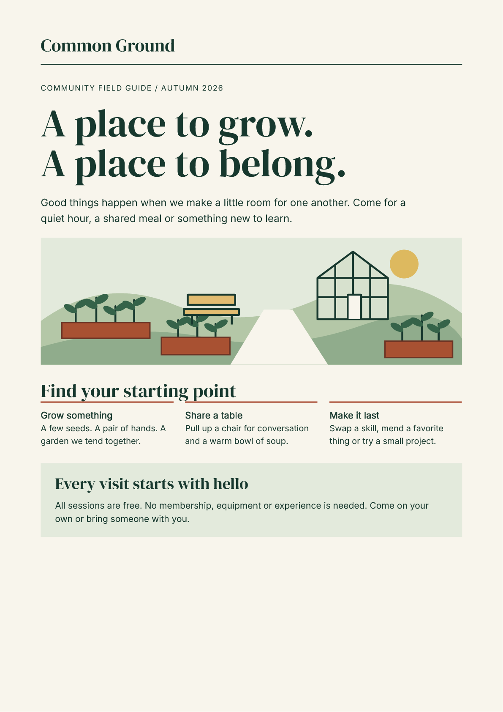

# An accessible document, authored with components

!!! info "Current component preview: 2.6.0a9"
    [Get the current showcase source kit and verified PDFs](component-preview-9.md).
    The downloadable kits on this page retain their original version pins and evidence.


Common Ground is a fictional community-program guide: an illustrated cover,
reusable program cards, a captioned schedule and practical visitor information.
Its Python source carries headings, table headers, lists and an image description
through to the final PDF.

[Read the component source](https://github.com/fullbleed-engine/fullbleed-official/blob/v2.6.0a7/examples/accessible_showcase/guide.py).

[Read PDF/UA-1](../assets/accessible-showcase-alpha7/common-ground-guide.pdf){ .md-button .md-button--primary }
[Read PDF/UA-2](../assets/accessible-showcase-alpha7/pdfua2/common-ground-guide.pdf){ .md-button }
[Download the source kit](../assets/accessible-showcase-alpha7/project.zip){ .md-button }
[Open the responsive HTML](../assets/accessible-showcase-alpha7/guide.html){ .md-button }



[View the schedule and visitor-information page](../assets/accessible-showcase-alpha7/page-2.png).

!!! info "Pinned component alpha"
    The kit uses `fullbleed.ui.experimental` from **2.6.0a7**. Its API may change
    before stabilization. The PDFs and verification receipts below refer to
    these exact specimens.

## Build it and make it yours

Unzip the source kit, open its folder and run:

```sh
python -m pip install -r requirements.txt
python render.py
```

The PDF appears at `output/common-ground-guide.pdf`. Edit the `SCHEDULE` records
or compose another card:

```python
from guide import ProgramCard

card = ProgramCard(
    "Grow something",
    "A few seeds. A pair of hands. A garden we tend together.",
)
```

`ProgramCard` owns its section and H3. `ProgramSchedule` uses `DataTable` and
`Column` to turn records into a table with a caption and scoped column headers.
`BulletList` preserves list semantics; the illustration uses `Image(alt=...)`.
The source needs no raw HTML strings.

The default is PDF/UA-1. To render the same component design as PDF/UA-2:

```sh
python render.py --pdf-profile pdfua2 --out output-ua2
```

Both the component and exported HTML/CSS paths use that profile. The render
report records it; the HTML exports retain the same semantic content and styling.

## Styling and HTML export

`class_name="program-card"` emits the authored CSS class. Its appearance comes
from `.program-card` in `guide.css`, loaded with `Document(styles=...)`.
The class name does not load a stylesheet automatically.

`guide.css` owns the print design. `browser.css` adds the responsive presentation
only to browser exports; `Page(size="A4", margin=mm(0))` owns the PDF geometry.

```python
from guide import build_document

document = build_document(browser=True)
styled = document.to_html(include_styles=True, a11y_mode="raise")
unstyled = document.to_html(include_styles=False, a11y_mode="raise")
```

[Open the unstyled HTML](../assets/accessible-showcase-alpha7/guide-unstyled.html) to see
the semantic document without CSS. It retains authored class names, text, alt
text and the link, so another application can supply its own presentation.
The render command copies the local fonts and illustration beside both exports.

## What was checked

Both final two-page specimens passed **veraPDF 1.30.3**, with zero failed
checks and empty stderr. Each receipt identifies its exact PDF by SHA-256.

| Specimen | Passed rules | Passed checks |
| --- | ---: | ---: |
| PDF/UA-1 | 106 | 5,512 |
| PDF/UA-2 | 1,728 | 8,147 |

| Check | Result |
| --- | --- |
| Actual PDF structure and marked-content text | One H1, continuous H2/H3 hierarchy, expected logical reading order |
| Marked-content boundaries | Balanced tags, no nested IDs; retained faulty PDF rejected |
| Image | One tagged figure with the authored description |
| Schedule | One table with one directly owned caption, three column headers with `/Scope /Column`, nine data cells |
| Lists | Two lists containing six items |
| Fonts, metadata and geometry | Embedded fonts, English language, document title, two A4 pages; no overflow or missing-glyph/font-substitution gate failures |
| Reproduction | Identical PDF bytes on repeat rendering and through the exported HTML/CSS path, checked separately for each profile |
| Visual review | Both pages inspected in native and independent PDFium previews |
| Styled HTML | Checked at 1440, 390 and 320 pixels; no horizontal overflow; keyboard link focus verified |
| Unstyled HTML | Semantic elements and authored classes retained; no CSS or inline style declarations |
| Authored text colors | Minimum contrast ratio 7.45:1 across the design's text/background pairs |

[PDF/UA-1 receipt](../assets/accessible-showcase-alpha7/validation.json) ·
[PDF/UA-1 veraPDF report](../assets/accessible-showcase-alpha7/pdfua1.verapdf.json) ·
[PDF/UA-2 receipt](../assets/accessible-showcase-alpha7/pdfua2/validation.json) ·
[PDF/UA-2 veraPDF report](../assets/accessible-showcase-alpha7/pdfua2/pdfua2.verapdf.json) ·
[PDF tag and reading-order report](../assets/accessible-showcase-alpha7/structure.json) ·
[Verifier failure control](../assets/accessible-showcase-alpha7/verification-guard.json) ·
[Visual review](../assets/accessible-showcase-alpha7/visual-review.json) ·
[Browser checks](../assets/accessible-showcase-alpha7/browser-verification.json) ·
[Source manifest](../assets/accessible-showcase-alpha7/source.json)

These checks are **not a screen-reader user test or blanket WCAG certification**.
The kit includes `verify.py` to inspect the actual output again after edits.
It rejects nested marked-content IDs, unbalanced tag boundaries and duplicate
or detached captions even without veraPDF. Alpha 7 keeps the schedule caption
directly under its Table, with its text and reading order preserved. The verifier
rejects both the retained nested-MCID defect and the published alpha6
duplicate-caption specimen.

To check your PDF/UA-2 output with the independent reader:

```sh
python -m pip install -r requirements-check.txt
python verify.py --pdf-profile pdfua2 --out output-ua2
```

The program column returns `Strong(row["program"])` directly, retaining rich
component content inside its table cell. The earlier rich-cell tagging and
pagination corrections remain included.

For an external check, run the matching [veraPDF profile](https://docs.verapdf.org/cli/validation/)
on the final PDF:

```sh
verapdf --format json -f ua1 output/common-ground-guide.pdf
verapdf --format json -f ua2 output-ua2/common-ground-guide.pdf
```

The pinned runtime exports HTML links as plain PDF text, so this document also
writes out its destination URL. Redundant decorative folios and card numbers
are omitted because paragraph ARIA attributes do not reliably remove that text
from the PDF's tags in this alpha. The browser export has a descriptively named
link. The two-page print layout should be rechecked after content changes.

For another way to author the same design, see the
[paired Northstar and Common Ground examples](showcase-authoring.md).

The [alpha 4 guide](https://github.com/fullbleed-engine/docs/blob/fff03de311627b15291a527996b94fd3626cd79d/docs/guides/accessible-showcase.md), [PDF](../assets/accessible-showcase/common-ground-guide.pdf) and [source kit](../assets/accessible-showcase/project.zip) retain their original bytes, validation receipt and plain-text table workaround.

The [alpha 5 guide](https://github.com/fullbleed-engine/docs/blob/9aa0b2d9b26d398df58f55c8dd3b240a2457e96e/docs/guides/accessible-showcase.md) retains its original runtime pins and download links.

The [alpha 6 guide](https://github.com/fullbleed-engine/docs/blob/2a4f3ca9cca015f59e53e8aac6e1721ebb67922a/docs/guides/accessible-showcase.md), [PDF](../assets/accessible-showcase-alpha6/common-ground-guide.pdf), and [source kit](../assets/accessible-showcase-alpha6/project.zip) retain their original bytes and PDF/UA-1 receipt.
