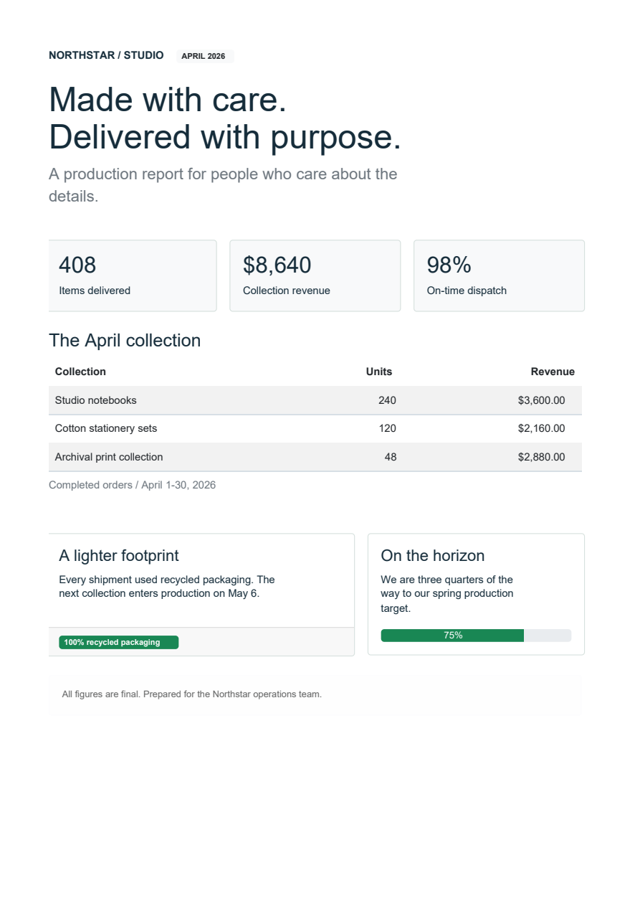

# Bootstrap components, authored in Python

Build an order summary with a card, a data table and a status badge. Export it
as HTML or render it as a PDF. The component supplies its structure and default
styling; your Python supplies the content.

!!! warning "Opt-in alpha 2.6.0a1"
    This guide uses **Fullbleed 2.6.0a1**, with experimental APIs under
    `fullbleed.ui.experimental`. Install the alpha explicitly; a normal stable
    installation does not select it. Names and behavior may change. Use the
    [released component guide](python-components.md) for the stable API.

[Download the Bootstrap kit](../assets/bootstrap-alpha/project.zip){ .md-button .md-button--primary }
[Open the report PDF](../assets/bootstrap-alpha/report.pdf){ .md-button }
[Browse the HTML catalog](../assets/bootstrap-alpha/catalog.html){ .md-button }

All Bootstrap components are **static, including HTML export**. There is no
Bootstrap JavaScript. Tabs show the selected panel, carousels show the selected
item, and overlays appear in document flow. Ordinary HTML form controls retain
their native browser behavior; PDF controls show printed values and selections.

## A production report in components

<div class="showcase-entry" markdown>
<figure markdown>
[](../assets/bootstrap-alpha/report.pdf)
</figure>
<div markdown>

**Northstar production report · One A4 page**

Grid columns, metric cards, formatted table columns, badges and a progress bar
compose a single document. Its content is fictional. The kit includes the
complete Python source, and this image is rendered from the downloadable PDF
with PDFium.

[Open the styled HTML](../assets/bootstrap-alpha/report.styled.html){ .md-button }
[Compare unstyled HTML](../assets/bootstrap-alpha/report.unstyled.html)

</div>
</div>

## Install the alpha

Extract the [kit ZIP](../assets/bootstrap-alpha/project.zip), enter its
`fullbleed-bootstrap-alpha` folder and create an isolated environment with
CPython 3.10 or later:

```console
python -m venv .venv
```

Activate it with `.venv\Scripts\Activate.ps1` in Windows PowerShell, or
`source .venv/bin/activate` on macOS/Linux. Then run:

```console
python -m pip install --pre "fullbleed==2.6.0a1"
python first_document.py
python examples/component_bootstrap/main.py --out output --catalog-pdfs
```

Open `order.pdf` and `order.html`, then `output/report.pdf` and
`output/catalog.html`. The kit's `requirements.txt` pins the same alpha version.
Compatible Windows, macOS and Linux wheels need no Rust build. On other platforms,
pip may build the source distribution, which needs Rust/Cargo and native build tools.
See the [alpha release](https://github.com/fullbleed-engine/fullbleed-official/releases/tag/v2.6.0a1).

The older [pinned preview kit](../assets/bootstrap-preview/project.zip) and
[GitHub preview](https://github.com/fullbleed-engine/fullbleed-official/releases/tag/component-preview-41a2cee)
remain available at `41a2cee`. Those downloads retain their original source,
installer and version metadata. The alpha adds required/optional part declarations
and explicit child-part forwarding.

## Compose content, then choose an output

The first example uses no HTML strings. `Card` owns its heading, body, header
and footer; `DataTable` owns the table structure. Each `Column` defines a header
and a function that reads a row. Save this as `first_document.py`:

```python
from pathlib import Path
from fullbleed.ui.experimental import Document, style
from fullbleed.ui.experimental import bootstrap as bs

rows = [{"item": "Studio notebook", "quantity": 24, "amount": "$360.00"}]
card = bs.Card(
    bs.DataTable(
        rows,
        columns=[
            bs.Column("Item", lambda row: row["item"]),
            bs.Column("Quantity", lambda row: row["quantity"], align="right"),
            bs.Column("Amount", lambda row: row["amount"], align="right"),
        ],
        striped=True,
    ),
    title="Ready to ship",
    header="ORDER / 1048",
    footer=bs.Badge("Approved", variant="success"),
    class_name="mb-3",
).with_parts(title=style(color="#205b47"))

document = Document(card, title="Order summary")
Path("order.html").write_text(document.to_html(include_styles=True), encoding="utf-8", newline="\n")
Path("order.unstyled.html").write_text(document.to_html(include_styles=False), encoding="utf-8", newline="\n")
```

That block runs by itself and writes both HTML files. Add this to render a PDF
with the bundled Inter font; the downloadable `first_document.py` includes both
blocks:

```python
from importlib.resources import files
from fullbleed.ui.experimental import Renderer, Theme, pt

document = Document(card, title="Order summary", theme=Theme(text=style(font_family="Inter", font_size=pt(11))))
font = files("fullbleed_assets").joinpath("fonts/Inter-Variable.ttf")
renderer = Renderer(font_files=[str(font)], document_timestamp="2026-04-30T00:00:00Z")
Path("order.pdf").write_bytes(document.render_pdf(renderer))
```

Ordinary Python functions, conditions, lists and generators compose components.
Strings become escaped text. Components are immutable values; methods such as
`.with_style(...)` return a changed copy. The optional `@component` decorator
gives diagnostics a useful component name and source location.

## How `class_name` applies styling

The Python spelling is **`class_name`**. It labels the generated element with
literal CSS classes. It does not look up a Python variable or search for CSS
files. Bootstrap components carry the pinned Bootstrap stylesheet with them,
and a document collects that dependency once.

| What you want | Use |
| --- | --- |
| A supported component variation | `bs.Badge("Paid", variant="success", pill=True)` |
| An existing Bootstrap utility | `class_name="mb-3 text-secondary"` |
| Checked utility names and breakpoints | `class_name=bs.utilities(p=3, mt={"md": 2})` |
| An explicit style on one root element | `style=style(border_color="#b8cec4")` or `.with_style(...)` |
| A card's title or body appearance | `.with_parts(title=style(...), body=style(...))` |
| A custom CSS class | A literal `class_name` plus a rule in `Document(styles=...)` |

For a custom class, connect the label and rule explicitly:

```python
note = bs.Alert("Please retain this copy.", class_name="order-note")
styled_document = Document(
    note,
    styles={".order-note": style(color="#304f45", border_color="#b8cec4")},
)
Path("custom-class.html").write_text(styled_document.to_html(include_styles=True), encoding="utf-8", newline="\n")
```

Normal CSS specificity applies. Bootstrap utilities using `!important` can
override normal inline declarations; avoid assigning conflicting values through
both. `bs.classes(...)` combines literal strings, ordered collections and
conditional mappings. `bs.utilities(...)` checks names against the actual 5.0.0
compiled stylesheet, including supported breakpoint variants.

Cards expose `header`, `body`, `title`, `subtitle` and `footer` as style parts.
Changing a card's title part affects its own heading, preserving nested cards'
headings. Optional sections stay absent until you provide content. For manual
structure, use `Card(body=False)` with `CardBody`, `CardTitle` and the other
section components.

Custom components declare required targets with `parts=(...)` and conditional
targets with `optional_parts=(...)`. A parent exposes a selected child part with
`.forward_parts(heading="label")`. Missing required targets produce a diagnostic
when the component is created; child implementation details stay private. The
[part-styling guide](https://github.com/fullbleed-engine/fullbleed-official/blob/v2.6.0a1/examples/component_recipes/README.md#customize-a-root-or-an-exposed-part)
shows reusable components and forwarding through containers.

## Export whole documents or fragments

| Call | Result |
| --- | --- |
| `document.to_html(include_styles=True)` | Complete HTML with collected CSS in the head |
| `document.to_html(include_styles=False)` | HTML without generated or inline styles; class names remain |
| `card.to_html(include_styles=True)` | A component fragment with its CSS |
| `card.to_html(include_styles=False)` | An unstyled component fragment |
| `document.to_html()` and `document.to_css()` | Separate markup and CSS, preserving the existing API |

Styled export embeds CSS, not font or image files. Provide asset URLs appropriate
to your web application. HTML export does not create a PDF renderer; it still
requires the installed Fullbleed distribution. The alpha is not a separate
HTML-only package.

Bootstrap CSS includes global reset and typography rules. A styled Bootstrap
fragment brings those rules into the host page. If your application already
loads its stylesheet, export the fragment with `include_styles=False` and let
the application's CSS apply to the retained class names.

`render_pdf`, `prepare` and `render_image_pages` automatically choose the static
print representation. Use `document.compile(target="pdf")` to inspect that
source, or `target="html"` for ordinary HTML controls.

## Explore the component catalog

The [HTML catalog](../assets/bootstrap-alpha/catalog.html) shows all 23
Bootstrap 5.0.0 component families, plus four groups for layout, forms, content
and utilities. The source is in `examples/component_bootstrap/catalog.py`.

| Area | Included families and helpers |
| --- | --- |
| Content and status | Alerts, badges, cards, list groups, progress, static spinners, toasts |
| Navigation | Breadcrumbs, navs/tabs, navbar, pagination, static scrollspy |
| Grouped state | Accordion, collapse, carousel |
| Actions and overlays | Buttons, button groups, close button, dropdowns, modal, offcanvas, popovers, tooltips |
| Layout and content | Containers, rows/columns, gutters, headings, images/figures, tables, ratios, visually hidden helper |
| Forms | Inputs, textareas, selects, checks/radios/switches, ranges, input groups, floating labels and feedback |

Group helpers derive child IDs from a single group ID and optional item keys.
Set `active`, `open`, `value`, `checked` and selected options to author the
state. Hidden panels remain hidden in unstyled HTML.

PDF controls print values and selections, including masked passwords and
selected options. They do not become fillable PDF fields. Compare the
[form PDF](../assets/bootstrap-alpha/forms.pdf) and
[form preview](../assets/bootstrap-alpha/forms-page-1.png) with the HTML catalog.

## What has been checked

The source implementation has focused tests for the component and export
contracts. Its native catalog contains 27 one-page specimens; a separate
80-row table checks pagination and repeated headers. Browser checks exercise
authored states and styled/unstyled HTML at desktop and mobile widths.
The [download manifest](../assets/bootstrap-alpha/source.json) pins source
files and wheel hashes. The [output verification record](../assets/bootstrap-alpha/verification.json)
records the published documents and checks.

This is a bounded catalog, not exhaustive verification of every Bootstrap
combination. Interactive Bootstrap behavior, Sass compilation, browser pixel
parity and accessibility conformance are outside this alpha. PDF layout uses
the engine's print-media/page-width behavior. JavaScript and C# authoring APIs
do not yet include this Bootstrap kit.

Try adding a column, rebranding a card or changing a selected state before
reading the implementation. If a task requires generated HTML or an internal
selector, that is useful feedback for the API design.

[Share an editing task in the design discussion](https://github.com/fullbleed-engine/fullbleed-official/discussions/86){ .md-button }
[Read the complete API guide](https://github.com/fullbleed-engine/fullbleed-official/blob/adbc97d68188cd4e934a3a15d97b3e65d42ed080/docs/component-bootstrap.md)
· [Read the implementation review](https://github.com/fullbleed-engine/fullbleed-official/blob/adbc97d68188cd4e934a3a15d97b3e65d42ed080/docs/component-authoring-next-iteration.md)
· [Review the draft PR](https://github.com/fullbleed-engine/fullbleed-official/pull/85)
