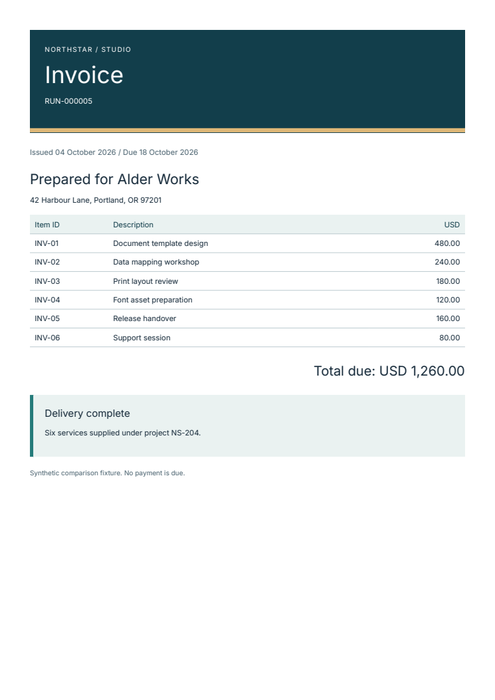
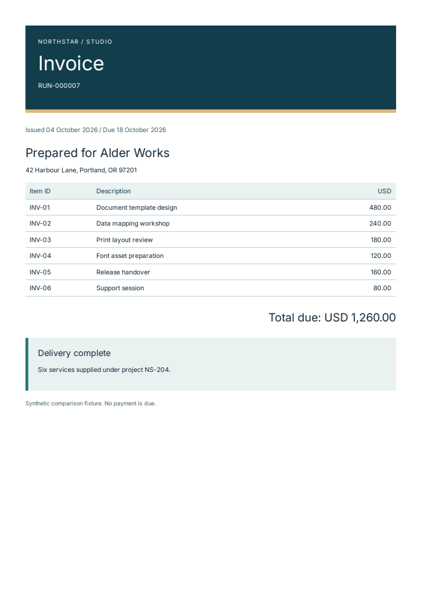

# Playwright vs WeasyPrint for Python PDF generation { #compare-python-pdf-libraries }

Use **Playwright with Chromium** for PDFs that depend on JavaScript or a live
browser page. Evaluate **WeasyPrint** for static HTML/CSS invoices, statements,
and reports. For either, test your actual page breaks, fonts, and deployment
environment.

This guide compares those rendering models, shows the same invoice rendered by
both, and explains where **Fullbleed** fits as another static-document engine.
It also covers ReportLab for Python drawing and layout, and pypdf for operations
on existing PDFs.

This guide is maintained by Fullbleed. The choices below link to each project's
documentation and to our retained comparison files, so you can evaluate the
tradeoffs on your own documents.

[Compare actual PDFs](#inspect-the-same-invoice-in-three-renderers){ .md-button }
[Try Fullbleed in your browser](../playground.md){ .md-button .md-button--primary }

The playground needs no installation or account. Change the sample's customer
name in the HTML editor, select **Render PDF**, then **Download PDF**. On a phone,
select **Edit source** first. Under **Files and projects**, choose Python or
Node.js, then **Download project** to keep your edited HTML/CSS, fonts, and a
local renderer in a ZIP.

For amounts calculated from application data, use the
[Python invoice examples](invoices.md) or the
[FastAPI, Flask, and Django starter](web-frameworks.md).

Using Node.js? [Render an existing HTML template with Fullbleed](node-html-to-pdf.md)
and compare the same input with the included Puppeteer reference.

## Choose by the job

| Your main task | Tools to evaluate | What to check |
| --- | --- | --- |
| Generate invoices, statements, or reports from static HTML/CSS | Fullbleed, WeasyPrint | Page breaks, repeated table headings, fonts, and your actual CSS |
| Compose reusable documents with Python functions and nested children | [Fullbleed components](../getting-started/quickstart.md) | Style ownership, table and page behavior, and the stable or experimental API you intend to use |
| Export a JavaScript application or a live web page | Playwright with Chromium | Page readiness, loaded fonts/images, and print styles |
| Build a document through Python drawing and layout primitives | ReportLab | Canvas/Platypus APIs and the layout code your team wants to own |
| Merge, split, crop, or extract text from existing PDFs | pypdf | The existing files' structures and the operations you need |

## Playwright vs WeasyPrint for HTML to PDF

**Playwright runs a browser.** It can load an application, execute its JavaScript,
and print the resulting page through Chromium. Its [`page.pdf()` API](https://playwright.dev/python/docs/api/class-page#page-pdf)
uses print CSS by default; background graphics and preference for CSS page size
are explicit options. For an application-generated chart, arrange a readiness
signal for the completed chart and fonts before printing.

**WeasyPrint lays out static documents.** Its [pagination engine](https://doc.courtbouillon.org/weasyprint/stable/)
is independent of a browser, and its [documented scope excludes JavaScript](https://doc.courtbouillon.org/weasyprint/stable/going_further.html#why-weasyprint).
Generate the HTML and chart images before rendering. This is a useful model for
server templates whose final content is already known.

**Fullbleed also renders static documents**, using a Rust print engine with
Python bindings. It adds explicit asset registration, structured diagnostics,
PNG previews, and compiled document workflows. It does not execute your page's
JavaScript. Check its [CSS coverage](../css-coverage.md) and your page breaks
before moving an existing template.

### What you deploy

| Renderer | Runtime to provision | First integration check |
| --- | --- | --- |
| Fullbleed | Python and a [published wheel](../getting-started/installation.md), which bundles the engine and fonts | Confirm your Python/platform has a wheel; register your brand fonts and images |
| WeasyPrint | Python, its Python packages, and [platform libraries including Pango](https://doc.courtbouillon.org/weasyprint/stable/first_steps.html#installation) | Follow the installation instructions for your host and verify font discovery |
| Playwright | Python package, the matching [Chromium binary and system dependencies](https://playwright.dev/python/docs/browsers) | Verify browser startup, asset loading, and PDF generation in the deployment image |

Using the same HTML in all three does not guarantee the same line or page
breaks. Include a long table, an unusually long name, and the final record of
your largest document in the first evaluation.

## Inspect the same invoice in three renderers

These unmodified previews come from the retained **October 27, 2026** comparison:
Fullbleed **2.5.39**, WeasyPrint **70.0**, and Playwright **1.64.1** with Chromium
**156.0.8078.4**. Each received the same HTML/CSS, Inter font, and synthetic
records. Select an image to open its actual one-page PDF.

<figure markdown>

<figcaption markdown="span">Fullbleed 2.5.39 · [Download PDF](../assets/renderer-comparison-20261027/pdfs/fullbleed/invoice.pdf){ download="fullbleed-invoice.pdf" }</figcaption>
</figure>

<figure markdown>

<figcaption markdown="span">WeasyPrint 70.0 · [Download PDF](../assets/renderer-comparison-20261027/pdfs/weasyprint/invoice.pdf){ download="weasyprint-invoice.pdf" }</figcaption>
</figure>

<figure markdown>

<figcaption markdown="span">Chromium 156 · [Download PDF](../assets/renderer-comparison-20261027/pdfs/chromium/invoice.pdf){ download="chromium-invoice.pdf" }</figcaption>
</figure>

The [complete comparison](renderer-comparison.md) includes a longer ledger and
report, the input source, output checks, timings, memory samples, and all 414
generated PDFs. The ledger occupies three pages in Fullbleed and WeasyPrint,
and four in Chromium. That difference is included in the results.

The timings describe those versions and fixtures on one host. The results favor
different tools for different measurements; they do not establish a universal
speed or quality ranking. These previews show the measured release versions; the date and exact pins
remain part of the evidence.

## Author reusable documents with Python components

Fullbleed's stable Python API lets you compose ordinary functions, nested
children and repeated data without writing HTML tags. The
[Python quickstart](../getting-started/quickstart.md) includes complete component
and HTML/CSS versions of the same small invoice. `class_name` attaches literal
CSS classes; `Document(styles=...)` supplies their rules.

For components with reusable style defaults, tables defined by columns, and
repeating page headers or footers, see the [current opt-in preview and release
status](component-status.md). The [namespace and migration guide](component-preview-12.md)
explains the newer `fullbleed.components` surface. The
[editable styling tutorial](../getting-started/component-styling.md) demonstrates
reusable defaults, root overrides, classes, named parts and theme values in a
complete report. Export the component tree as PDF, styled HTML or unstyled HTML.
This preview remains experimental; its browser exports use static content.

## When Fullbleed is a useful fit

Fullbleed is useful when your application owns the document template, input
data, and assets, and needs repeatable print output. Its Python package has no
required third-party Python runtime dependencies. Its compiled fixed and
reflowing binding APIs support repeated document families, such as monthly
statements. The engine is [MIT licensed](https://github.com/fullbleed-engine/fullbleed-official/blob/v2.5.22/LICENSE).

Start with the integration closest to your application:

- [Python invoice from structured data](invoices.md), with editable HTML/CSS.
- [FastAPI, Flask, or Django PDF endpoint](web-frameworks.md), with a downloadable project.
- [Docker deployment](python-docker.md) or [AWS Lambda](aws-lambda-pdf.md), with explicit runtime requirements.
- [Variable-data documents](bank-statements.md), for compiled fixed and reflowing workflows.

For the current CSS evidence, [browse all 1,662 fixtures](css-explorer.md) from
the published Fullbleed **2.5.43** Linux wheel. The recorded results include
**20 FAIL** and **18 REFERENCE-DISPUTED** cases; the unchanged upstream gate
fails. Inspect the relevant cases and test your own templates. A CSS comparison
does not establish PDF/A, PDF/UA, or PDF/X conformance.

## Other projects' documented scope

- [ReportLab](https://docs.reportlab.com/reportlab/userguide/ch1_intro/) exposes Python PDF generation and document-layout APIs. Evaluate it when you want to build the layout through Python rather than an HTML/CSS template.
- [pypdf](https://pypdf.readthedocs.io/en/stable/) supports operations on existing PDFs, including transformations, merging, splitting, and text or metadata extraction. It can be a separate step after document generation.

The linked third-party descriptions were reviewed on **October 14, 2026**.
Consult each project's current documentation and license before adopting it.

## A practical migration check

1. **Define the output contract.** Choose representative documents and expected record IDs, values, totals, page dimensions, and required metadata.
2. **Pin the inputs.** Record engine versions and the exact font/image files. Match margins, headers, and footers before judging differences.
3. **Inspect the longest document.** Compare page images and extracted content. Check that every record appears once, in order, and that the final row and closing notes are present.
4. **Validate required profiles.** For accessible, archival, or print output, run the relevant validators on the final PDFs and retain the reports. Visual similarity alone is insufficient.
5. **Measure complete jobs.** Include startup, font and asset setup, rendering, and file writes. Test a reused process separately from a fresh process and retain failures as well as successful outputs.

Use the [shared-input comparison harness](renderer-comparison.md#reproduce-with-your-own-documents)
as a starting point for your own acceptance contract. For Fullbleed projects,
the [PDF regression starter](pdf-regression-ci.md) provides a runnable CI example.

## Get help with your first document

[Ask a usage question in Q&A](https://github.com/fullbleed-engine/fullbleed-official/discussions/new?category=q-a).
Describe the document, your language or framework, and the edit or integration
step you tried. Include the expected result and what happened instead. A small
example with fictional data is enough to start.

For a reproducible rendering error, [open a bug report](https://github.com/fullbleed-engine/fullbleed-official/issues/new?template=bug_report.yml)
with the input, package version, and platform. The playground's **Report a
rendering problem** link fills in its engine version; your document is not
attached automatically.
