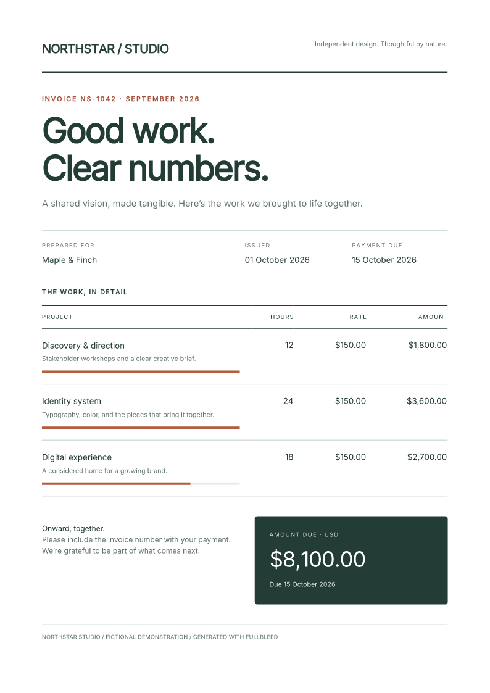

# Render a complete HTML document

Fullbleed **2.5.26 and later** can render supported CSS from `<style>` elements
inside your HTML. Keep a document's markup and stylesheet together, including
its `@page` size and margins, and pass that HTML directly to the engine.

```bash
python -m pip install "fullbleed>=2.5.26"
```

## Make a receipt

Save this as `receipt.py`, then run `python receipt.py`:

```python
from importlib.resources import files
from pathlib import Path
import fullbleed

font = files("fullbleed_assets").joinpath("fonts/Inter-Variable.ttf")
engine = fullbleed.PdfEngine(font_files=[str(font)])
html = """<!doctype html>
<html lang="en"><head><title>Payment receipt</title>
<style>
  @page { size: A5; margin: 18mm; }
  body { font-family: Inter; font-size: 11pt; color: #263b46; }
  h1 { color: #315d9b; font-size: 28pt; }
  .total { padding: 12pt; background: #edf2f8; font-weight: 700; }
</style></head><body>
  <h1>Payment received</h1>
  <p>Thank you, Maple &amp; Finch.</p>
  <p class="total">Total paid: $120.00</p>
</body></html>"""
Path("receipt.pdf").write_bytes(engine.render_pdf(html, ""))
```

The empty second argument means there is no additional CSS. The receipt uses
the bundled Inter font and the A5 paper size declared inside the HTML.
Fonts, images, and other assets remain explicit inputs; see
[fonts and assets](../engine/assets.md).

Prefer composing documents without HTML strings? Start with
[Python components](python-components.md).

## Add an override

You can still supply a separate stylesheet:

```python
override = ".total { background: #f5eadf; }"
Path("warm-receipt.pdf").write_bytes(engine.render_pdf(html, override))
```

Author styles enter the cascade in this order:

1. CSS assets registered in the engine's `AssetBundle`.
2. Active embedded stylesheets, in document order.
3. The explicit CSS argument.

Later rules win when the rest of the cascade ties. Selector specificity,
`!important`, cascade layers, inheritance, and inline declarations still apply.
For example, an embedded ID selector can outrank a later class selector.
Each stylesheet is parsed separately, so an unfinished comment in one sheet
does not consume the next sheet.

## Try a designed invoice

The [complete example project](../assets/complete-html/project.zip) keeps this
invoice's typography, grid, table, progress indicators, and page settings in one
`invoice.html`. Install its pinned requirements and run `python render.py` to
write the PDF and native preview. The customer and business are fictional.

[Open the PDF](../assets/complete-html/invoice.pdf) ·
[Download the project](../assets/complete-html/project.zip) ·
[Verification record](../assets/complete-html/verification.json)

{ width="520" loading="lazy" }

This example produces the same PDF bytes with embedded styles as its separately
supplied HTML/CSS control. Its page and expected text were independently checked;
that comparison covers this fixture, not general browser-layout parity.

## Print rules and compiled templates

Embedded sheets use print media. A `media="print"` sheet applies; a
`media="screen"` sheet does not. Supported nested media queries, page rules,
margin boxes, and footnote-area rules follow the same print context. Styles
inside inert HTML `<template>` content are excluded.

The same embedded styles work with `compile_pdf`, previews, reporting methods,
and batches. Compilation captures the template's stylesheet sources. Recompile
when those sources change: inserting a new `<style>` through a structural
binding does not rebuild the compiled stylesheet. Batch outputs retain their
single-paper-size contract, initialized from the first record.

## Check the installed engine

```python
assert fullbleed.build_features().get("embedded_stylesheets", False)
```

This guide targets the Python package. Other language packages can contain an
older engine; check the capabilities of the package you installed before using
the same behavior there.

External stylesheet links and CSS `@import` are not fetched, and JavaScript does
not execute. Supply external CSS through the explicit argument or `AssetBundle`.
Inline SVG still has a separate local styling pipeline; document selectors do
not propagate into SVG descendants.

See the [full stylesheet contract](https://github.com/fullbleed-engine/fullbleed-official/blob/v2.5.26/docs/embedded-stylesheets.md)
for type filtering, preferred stylesheet sets, SVG boundaries, and structured
diagnostics. The [CSS coverage guide](../css-coverage.md) describes broader
rendering support and known gaps.
