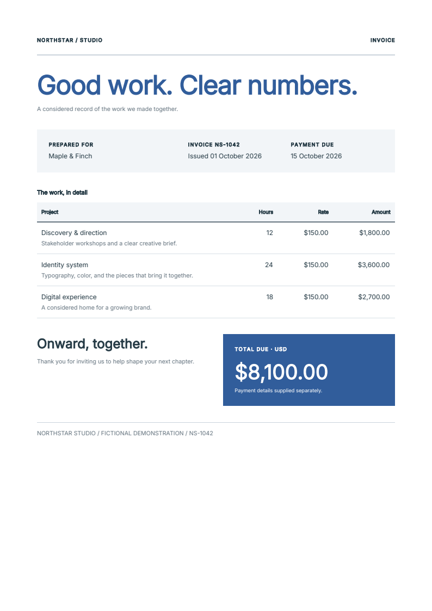
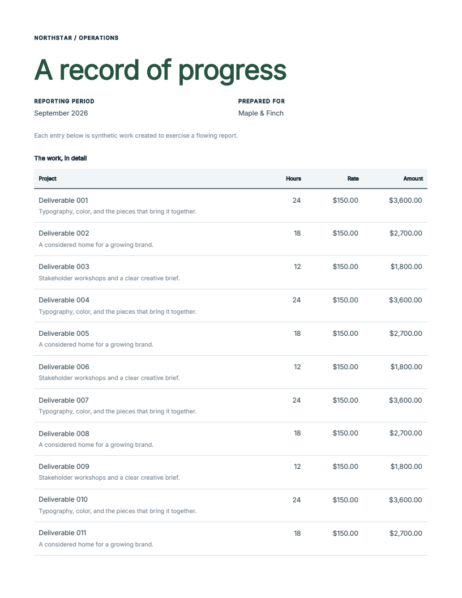

# Components that carry their design

An experimental Python authoring model for importing a component together with
its appearance, customizing it without knowing its internal selectors, and
describing a table column once.

!!! warning "Source preview — not a published release"
    This page shows the draft at source commit
    [`d686153`](https://github.com/fullbleed-engine/fullbleed-official/tree/d686153b392a5cb5f5316624bf6b9401e7bcf951).
    `fullbleed.ui.experimental` is **not included in the published 2.5.25 wheel**.
    Names and behavior may change. Use the [released component guide](python-components.md)
    for an installable starting point.

[Download the source kit](../assets/component-preview/project.zip){ .md-button .md-button--primary }
[Read the implementation review](https://github.com/fullbleed-engine/fullbleed-official/blob/d686153b392a5cb5f5316624bf6b9401e7bcf951/docs/component-authoring-design.md){ .md-button }
[Review the draft](https://github.com/fullbleed-engine/fullbleed-official/pull/85){ .md-button }

## One kit, two documents

The invoice and operations report import the same `Field`, `WorkTable`, `Total`
and typography helpers. Their [shared kit](https://github.com/fullbleed-engine/fullbleed-official/blob/d686153b392a5cb5f5316624bf6b9401e7bcf951/examples/component_recipes/kit.py)
owns those styles; neither document registers a separate stylesheet. All data
and organizations are fictional.

<div class="showcase-entry" markdown>
<figure markdown>
[](../assets/component-preview/invoice.pdf)
</figure>
<div markdown>

**Invoice · One A4 page**

One document combines a customer field, a table with formatted columns and a
total panel. Its blue brand values come from the document theme.

[Open the invoice PDF](../assets/component-preview/invoice.pdf){ .md-button }
[Read the document function](https://github.com/fullbleed-engine/fullbleed-official/blob/d686153b392a5cb5f5316624bf6b9401e7bcf951/examples/component_recipes/documents.py)

</div>
</div>

<div class="showcase-entry" markdown>
<figure markdown>
[](../assets/component-preview/report.pdf)
</figure>
<div markdown>

**Operations report · Five Letter pages**

The report changes the theme and supplies 60 records to the same table. Column
headers repeat as the rows flow over five pages. The total panel reuses the
invoice component with a root override and an advertised label-part override.

[Open the five-page report](../assets/component-preview/report.pdf){ .md-button }
[Inspect the second page](../assets/component-preview/report-page-2.png)

</div>
</div>

These images were rendered from the downloadable PDFs with PDFium. The
[artifact manifest](../assets/component-preview/verification.json) records the
source revision, candidate wheel, file hashes, page counts and verification scope.

## A small component owns its appearance

Functions still take ordinary Python arguments. A style is an immutable value
on the returned node; compilation collects it for the document:

```python
from fullbleed.ui.experimental import Document, Paragraph, Stack, component, pt

@component
def Field(label: str, value: str):
    return Stack(
        Paragraph(label).with_style(font_size=pt(8), color="#667580"),
        Paragraph(value),
        gap=pt(4),
    )

customer = Field("Prepared for", "Maple & Finch")
highlighted = customer.with_style(background="#f2f5f8", padding=pt(12))
document = Document(highlighted)
```

Importing `Field` carries the label's styling into another document. The root
override returns a new node; `customer` keeps its original appearance. A function
does not have to accept and forward a `style` parameter to support that override.

For repeated defaults, the draft offers `styled(...)`; for shared brand values,
`Theme` and tokens; for public internals, declared parts and `.with_parts(...)`.
The [runnable guide](https://github.com/fullbleed-engine/fullbleed-official/blob/d686153b392a5cb5f5316624bf6b9401e7bcf951/examples/component_recipes/README.md)
introduces each separately, including font selection and PDF rendering.

`class_name` keeps its literal CSS meaning. It does not look up a Python variable
or load a stylesheet. The normal experimental workflow uses style values; the
established API remains available for selector-based CSS.

## Rebrand a theme without rebuilding it

A reusable label can refer to a theme value. Deriving a new theme retains its
typography and leaves existing documents alone:

```python
from fullbleed.ui.experimental import Theme, style, styled, token

BrandLabel = styled(Paragraph, color=token("accent"), font_size=pt(14))
label = BrandLabel("Portable design")
base_theme = Theme(
    {"accent": "#315d9b", "ink": "#263b46"},
    text=style(font_family="Inter", color=token("ink")),
)
warm_theme = base_theme.with_values(accent="#9a462e")

assert label.required_tokens == ("accent",)
```

`required_tokens` reports the explicit theme references in the constructed node.
The document's version includes its text styles too. It helps a kit consumer see
what to supply without reading selectors or discovering missing values one error
at a time. It describes the current content, not every possible component variant.

## A column owns its header and cells

```python
from fullbleed.ui.experimental import Column, DataTable, mm

table = DataTable(
    [{"name": "Design", "amount": "$120.00"}],
    columns=[
        Column("Work", lambda row: row["name"]),
        Column("Amount", lambda row: row["amount"], align="right", width=mm(30)),
    ],
    empty="No billable items.",
)
```

Adding a column changes one declaration containing its label, cell function,
alignment and width. Cells can return components. Applications still calculate
and format their values. `DataTable` supplies the table structure, empty state
and repeated column headers.

## Render the composed document

The four Python blocks on this page run together. Paper belongs to the document;
font selection belongs to the renderer, which can be shared by your application:

```python
from importlib.resources import files
from pathlib import Path
from fullbleed.ui.experimental import Flow, Page, Renderer

document = Document(
    Flow(label, highlighted, table, gap=pt(18)),
    title="Component design preview",
    page=Page("A5", margin=mm(14)),
    theme=warm_theme,
)
renderer = Renderer(
    font_files=[str(files("fullbleed_assets").joinpath("fonts/Inter-Variable.ttf"))],
    document_timestamp="2026-10-15T00:00:00Z",
)
prepared = document.prepare(renderer)
Path("component-preview.pdf").write_bytes(prepared.render_pdf())
preview_pages = prepared.render_image_pages(dpi=96)
```

`prepare` creates one native layout, checks its pagination trace and returns a
snapshot you can reuse for PDF output and layout previews. If you only need the
PDF, `document.render_pdf(renderer)` handles preparation for you. Content or
renderer changes require a new preparation. The fonts used here ship with the
engine; system fonts and a browser are not required for rendering.

## Try the source candidate

Download and extract the [source kit](../assets/component-preview/project.zip),
then open a terminal in its `fullbleed-component-preview` folder. Building this
preview requires Python 3.10 or later, Rust/Cargo, the platform's native build
tools and internet access. The kit includes examples and a requirement pinned to
the engine's source archive. It does not include a prebuilt engine. The
[source manifest](../assets/component-preview/source.json) records every file
and the download's hash. Use an isolated environment:

```console
python -m venv .venv
```

=== "Windows PowerShell"

    ```powershell
    .venv\Scripts\Activate.ps1
    ```

=== "macOS / Linux"

    ```bash
    source .venv/bin/activate
    ```

Then install the pinned source candidate and render the examples. The first
installation builds the engine and can take several minutes:

```console
python -m pip install -r requirements-preview.txt
python examples/component_recipes/main.py --output output
python edit_tasks.py --output output/edits
```

Open `output/invoice.pdf` and `report.pdf`. Edit
`examples/component_recipes/kit.py` to change shared components, or
`documents.py` to change a document's composition. No browser is used to produce
the PDFs. The preview's package metadata still says 2.5.25; the source revision,
rather than that version alone, identifies this experimental build.

The kit's `edit_tasks.py` gives you four small starting points:

| Editing task | Function |
| --- | --- |
| Reuse components and change the brand | `shared_components()` |
| Add a formatted column | `extra_column()` |
| Change the invoice's paper size | `paper_change()` |
| Find and repair a clipping constraint | `layout_repair()` |

The last task intentionally catches a layout error and saves its authored path
and reason in `output/edits/expected-layout-error.json`, then renders the repair.

## What needs review

The draft has rendered-output checks, but independent usability feedback is
still needed. Try an ordinary editing task: reuse a field in another document,
change the brand, add a table column, change the paper size, or diagnose content
that does not fit. Report where you needed an internal selector, generated HTML
or an undocumented behavior. A small input and the expected layout are useful.

The current limits matter when evaluating the design:

- Oversized top-aligned text cells can continue, but rowspans, page-tall cell
  images and oversized cells with other vertical alignments need further work.
- Native table and block split errors identify the responsible cell or container
  when the engine provides that cause. Other failures retain their authored scope;
  this is not a general overflow validator.
- Token requirements and advertised part names are discoverable at runtime;
  automatic completion of those names in editors is unfinished.
- Shared preparation avoids repeating layout for PDF and preview output.
  Large-scale performance and engine pooling still need qualification.
- Semantic validation integration and final delivery-profile verification remain
  separate work. These examples do not establish accessibility conformance.

Existing documents can try one new component through the explicit `to_legacy`
adapter described in the runnable guide. This does not deprecate the established
API or promise equivalent experimental interfaces in other languages.

[Share an editing task in the design discussion](https://github.com/fullbleed-engine/fullbleed-official/discussions/86){ .md-button }
