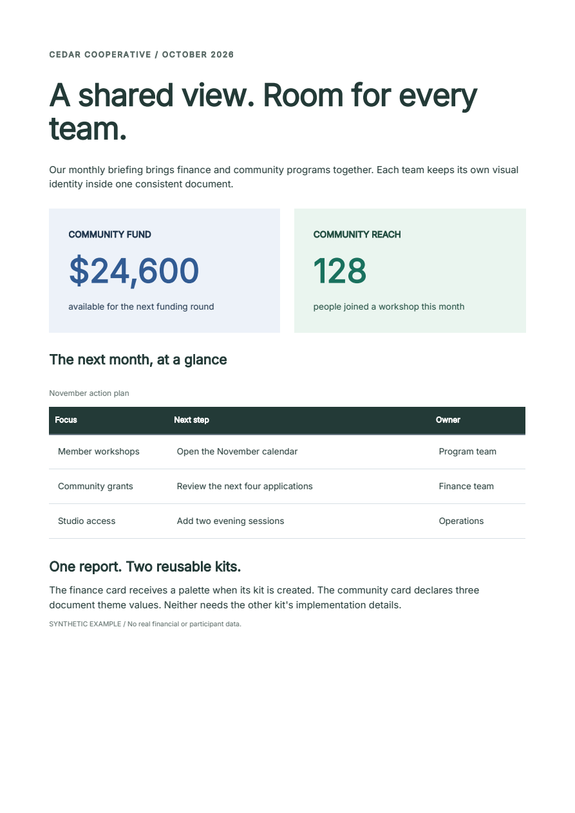

# Two component kits, one document

Reusable components should explain what they need and what you can change.
This example combines a finance card and a community card in one report.
Rebrand either kit or restyle one value without inspecting generated CSS selectors.

[Download the Python project](../assets/component-kits/project.zip){ .md-button .md-button--primary }
[Open the report](../assets/component-kits/default.pdf){ .md-button }

!!! info "Uses the opt-in component alpha"
    The project pins **Fullbleed 2.6.0a14** and requires Python 3.10 or later.
    The component API remains alpha; see the [release status](component-status.md).
    Both kit modules are maintainer-authored examples, not independent user feedback.

[](../assets/component-kits/default.pdf)

## Run and compare

Extract the download, open `fullbleed-component-kits`, then run:

```sh
python -m venv .venv
# Windows PowerShell: .venv\Scripts\Activate.ps1
# macOS/Linux: source .venv/bin/activate
python -m pip install -r requirements.txt
python report.py
```

The `output` directory contains four PDFs and their styled and unstyled HTML.
It also contains native PNG previews, separate print source and pagination
diagnostics. All organizations and data are fictional.

| Output | What changes |
| --- | --- |
| [Default](../assets/component-kits/default.pdf) | Blue finance card and green community card |
| [Billing brand](../assets/component-kits/billing-brand.pdf) | Finance palette becomes purple; community card is unchanged |
| [Impact brand](../assets/component-kits/impact-brand.pdf) | Community palette becomes warm brown; finance card is unchanged |
| [Local override](../assets/component-kits/local-override.pdf) | Only the community card's large value becomes rose |

## Give each kit a clear contract

The download demonstrates two useful choices:

| Kit | Configuration | Document dependency | Advertised parts |
| --- | --- | --- | --- |
| `billing.py` | `billing_kit(BillingPalette(...))` returns a reusable `Balance` component | None: its palette has concrete defaults | `label`, `amount`, `note` |
| `impact.py` | `Impact(...)` uses values from the document theme | `impact.accent`, `impact.surface`, `impact.ink`; all supplied by `IMPACT_DEFAULTS` | `label`, `value`, `note` |

Use concrete defaults for a component that should work immediately after import.
An immutable palette passed to a factory gives each kit its own settings. Use
document tokens when the document is meant to coordinate those values; export
the complete defaults and document their meaning alongside the component.

After extracting the project, this is enough to compose its two cards:

```python
from billing import BillingPalette, billing_kit
from impact import IMPACT_DEFAULTS, Impact
from fullbleed.components import Document, Grid, Theme, style

Balance = billing_kit()
community = Impact("COMMUNITY REACH", "128", "people joined a workshop")
theme = Theme(IMPACT_DEFAULTS)

document = Document(
    Grid(
        Balance("COMMUNITY FUND", "$24,600", "available for the next round"),
        community,
    ),
    theme=theme,
)
```

`report.py` adds the page size, typography, table, explicit font registration
and output files. Neither kit loads fonts or registers global styles when imported.

## Rebrand a kit or change one instance

Create a separate concrete kit to change the finance palette. Derive a new theme
to change the community palette. Neither operation mutates the original:

```python
PurpleBalance = billing_kit(BillingPalette(
    accent="#7047a1", surface="#f3eef8", ink="#483461",
))
warm_theme = theme.with_values({
    "impact.accent": "#a34e21",
    "impact.surface": "#faf0e8",
    "impact.ink": "#673d29",
})
highlighted = community.with_parts(value=style(color="#9b3d64"))
```

Use the returned values in a new document: `PurpleBalance(...)` replaces the
finance component, `theme=warm_theme` changes the community palette, or
`highlighted` replaces just that community card. The complete report renders
these edits separately so their effect is easy to compare.

Kit appearance belongs in `styled(...)` defaults. Ordinary function arguments
express choices such as a status or a label. Use `.with_style(...)` for a local
root change and `.with_parts(...)` for an advertised internal part. Setting a
root color does not replace a child that declares its own color.

For two instances of the **same** kit with different palettes, use separate
concrete factories, the kit's public parts, or an explicit prefix parameter
offered by that kit. A document theme does not create an implicit local scope.

## Find missing values before rendering

`community.required_tokens` lists its three dependencies without compiling or
opening the kit implementation. `document.required_tokens` also includes values
used by document styles, typography and page bands.

A missing binding in styled HTML or PDF raises `AuthoringError` with code
`theme.missing`, the missing name and a component path. For example, omitting
`impact.accent` reports the path `Impact → value`. An unknown part reports
`style.part` and lists the available parts.

Token names are **flat and document-wide**. The `impact.` prefix is a naming
convention, not automatic scoping. Two kits using `token("accent")` share one
value. Mapping merges and `Theme.with_values(...)` use the later value for a
repeated name; they do not diagnose a collision. Use distinct prefixes when
the meanings differ and deliberately share a name only when the value is shared.

## Export for a browser or a host stylesheet

```python
from pathlib import Path

Path("cards.html").write_text(
    document.to_html(include_styles=True), encoding="utf-8",
)
Path("cards.unstyled.html").write_text(
    document.to_html(include_styles=False), encoding="utf-8",
)
```

The styled export embeds the collected CSS. The unstyled export removes generated
CSS and inline declarations while retaining the content and literal classes,
including `billing-summary` and `impact-summary`. A host stylesheet can own their
appearance. Neither export includes JavaScript.

In the complete report, the document owns the responsive layout. Its two-column
grid uses `styled(Grid, ...)` defaults so a mobile class rule can stack the cards.
An explicit `Grid(columns=2)` is an instance choice and overrides an ordinary
class rule. Keep reusable defaults separate from deliberate instance choices.

The report includes explicit print and screen rules. On Fullbleed's separate-CSS
path, screen rules can apply when no print rule is present; keep the example's
print block when adding screen-only styling. The PDF uses bundled Inter, while
browser HTML uses local Inter or a sans-serif fallback. Browser layout is not a
PDF pagination preview.

## What was checked

The downloadable source produces four one-page PDFs with embedded fonts, the
expected text and no reported text overlaps. Repeated rendering produces the
same PDF bytes. PDFium pixel comparisons confirm each palette change is confined
to its own card, and the local override to its value. The checks also exercise
missing tokens, conflicting names, unknown parts and immutable defaults.

Chromium checks both HTML exports at desktop and mobile widths, including colors,
card layout, preserved content and the absence of styles in unstyled HTML.
[Read the retained verification](../assets/component-kits/verification.json).
These are checks of the included examples, not general conformance or independent
usability evidence. Share a synthetic integration and any missing customization
point in the [component RFC](https://github.com/fullbleed-engine/fullbleed-official/discussions/86).
