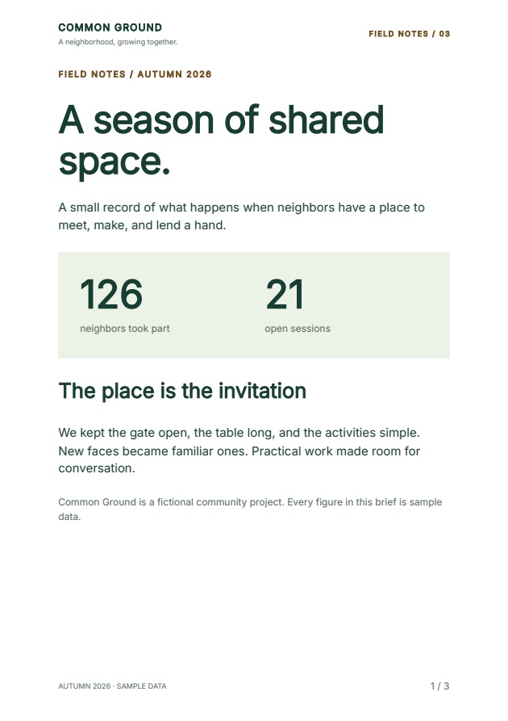

# Build styled documents from Python components

Write a Python function once, then reuse it across invoices, reports and
repeating page headers. Compose semantic building blocks, apply shared styles,
and export PDF, styled HTML or unstyled HTML.

**2.6.0a10** is the current experimental preview. The source kit includes the
Northstar invoice, Common Ground reports and an accessible community guide.
Start with the three-page field-notes report below, then edit its functions
and data.

[Download the complete source kit](https://github.com/fullbleed-engine/fullbleed-official/releases/download/v2.6.0a10/fullbleed-component-showcases-2.6.0a10.zip){ .md-button .md-button--primary }
[Open the field-notes PDF](https://github.com/fullbleed-engine/fullbleed-official/releases/download/v2.6.0a10/common-ground-field-notes-pdfua2-2.6.0a10.pdf){ .md-button }
[Try the styling notebook](../getting-started/component-styling.md){ .md-button }



!!! info "Install the preview explicitly"
    Use Python 3.10 or later in a virtual environment. The kit pins
    `fullbleed==2.6.0a10`; ordinary `pip install fullbleed` selects the stable
    channel. Components under `fullbleed.ui.experimental` may change.

## Run the report

Extract the ZIP, open its `fullbleed-component-showcases-2.6.0a10` folder, and run:

```sh
python -m pip install -r requirements.txt
python component_page_bands/render.py --out output/field-notes --pdf-profile pdfua2
```

Open `output/field-notes/field-notes.pdf`, `field-notes.html`, or
`field-notes-unstyled.html`. The PDF has repeating bands and page values such as
`1 / 3`. HTML has one semantic header, main and footer, with explicit
`[page] / [pages]` placeholders. It does not paginate the browser.

The content is fictional. Fonts come from the pinned package or the source kit;
PDF generation does not need a browser or system fonts. Choose `--pdf-profile
tagged` for ordinary tagged PDF, or `pdfua1` for the other accessible profile.

## Give the margins reusable components

This complete example creates a PDF with a branded header and a numbered footer:

```python
from importlib.resources import files
from pathlib import Path
from fullbleed.ui.experimental import (
    Document, Heading, Page, PageBand, PageNumbers, Paragraph, Renderer,
    Theme, component, mm, pt, style,
)

@component
def Brand(name):
    return Paragraph(name, style=style(font_size=pt(8), font_weight=700))

document = Document(
    Heading("Project summary", level=1),
    Paragraph("Prepared by Northstar Studio."),
    title="Project summary",
    lang="en-US",
    theme=Theme(text=style(font_family="Inter", font_size=pt(10))),
    page=Page(
        "A4", margin=mm(20),
        header=PageBand(left=Brand("NORTHSTAR STUDIO")),
        footer=PageBand(right=PageNumbers(total=True, class_name="folio")),
    ),
    styles={".folio": style(font_size=pt(8), color="#53665c")},
)
font = files("fullbleed_assets").joinpath("fonts/Inter-Variable.ttf")
renderer = Renderer(font_files=[str(font)])
Path("summary.pdf").write_bytes(document.render_pdf(renderer))
Path("summary.html").write_text(document.to_html(include_styles=True), encoding="utf-8")
Path("summary.unstyled.html").write_text(document.to_html(include_styles=False), encoding="utf-8")
```

## Apply styles deliberately

`class_name="folio"` adds a class to the exported element. Define the matching
`.folio` rule in `Document(styles=...)` to give it an appearance. A Python
function name does not create a CSS selector, and a class name does not load a
stylesheet.

| Use | Authoring API |
| --- | --- |
| Shared document typography and colors | `Theme(...)` on `Document` |
| A selector such as `.folio` | `Document(styles={".folio": style(...)})` with `class_name="folio"` |
| A style for one element | `style=style(...)` |
| Customize a component's root | `.with_style(...)` |
| Customize named internal elements | `.with_parts(...)` |
| Reuse a styled primitive | `styled(...)` |

In the complete report, `Brand`, `Metric` and `NextStep` expose parts, and
`styled(...)` defines reusable typography. The [component authoring reference](https://github.com/fullbleed-engine/fullbleed-official/blob/v2.6.0a10/docs/component-bootstrap.md)
explains style precedence and the supported authoring forms.

The example writes both `to_html(include_styles=True)` and
`to_html(include_styles=False)`. Styled HTML includes the resolved component and
document styles. Unstyled HTML keeps the document structure without those style
declarations, so a separate application can supply its own design. Both are
static HTML exports.

Styled export includes CSS. Referenced images and fonts remain separate assets;
registering a font with `Renderer` configures PDF output. Supply browser font
URLs in your HTML's CSS when you need the same typography there. The field-notes
source kit writes its font file and a matching `@font-face` rule for you.

## Reserve room for repeating bands

`Page` reserves the margins. A band does not enlarge them automatically. It
accepts `left`, `center` and `right` slots, with `first_page` and `blank_pages`
policies. A `PageNumbers` value occupies its own slot. Managed bands report
layout or conservative paint-bound failures with the page, slot and authoring
source. Register fonts explicitly so those checks can use the actual glyphs.

See the [page-band API and limits](https://github.com/fullbleed-engine/fullbleed-official/blob/v2.6.0a10/docs/component-page-bands.md)
for per-record numbering, fit diagnostics, styling precedence and export behavior.

## Keep both authoring paths

The same kit also includes the existing Northstar invoice, Common Ground
report and authored accessible community guide:

```sh
python design_showcase/compare_authoring.py --out output/paired
python accessible_showcase/render.py --out output/accessible-ua1
python accessible_showcase/render.py --pdf-profile pdfua2 --out output/accessible-ua2
```

Northstar and the report each include component and HTML/CSS sources for the
same design. The paired command compares the rendered pages and writes styled
and unstyled HTML. The guide demonstrates headings, captioned tables, column
headers, lists and image descriptions. Bootstrap components remain static,
including HTML export; no Bootstrap JavaScript is included.

The [paired-authoring walkthrough](showcase-authoring.md),
[accessible-guide walkthrough](accessible-showcase.md), and
[Bootstrap catalog](bootstrap-components-preview.md) retain their versioned
examples. The [alpha 9 guide](component-preview-9.md) retains the initial
page-band release, and the [alpha 8 guide](component-preview-8.md) retains the
earlier package without `PageBand` or `PageNumbers`. The
[styling notebook](../getting-started/component-styling.md) uses alpha 10 and
lets you edit theme, typography, root, named-part and class-selector styles.
The earlier page-band notebook retains its verified alpha 9 package.

## Changes in alpha 10

Solid text decorations now span word spaces and remain continuous through nested
inline content. Propagated lines stop at atomic inline boundaries. The accessible
community guide demonstrates the corrected documentation-link underline.

The preview retains reusable components, named styling parts, column-based
tables, static Bootstrap helpers, `PageBand` and `PageNumbers`.

## Verification and scope

The [release evidence](https://github.com/fullbleed-engine/fullbleed-official/releases/tag/v2.6.0a10)
links source provenance, checksums, saved-output comparisons and independent
PDF/UA validator reports. The source ZIP is tested after extraction using a
fresh public package installation.

The final installed candidate passes 970 Python tests, 80 decoration-space
cases, 100 decoration-thickness cases and 33 page-band cases. The extracted
source kit reproduces 11 saved showcase PDFs using Fullbleed alone. The
page-band matrix includes per-record numbering, styled number comparisons,
first/blank-page policies and rejected inputs.

The accessible guide's link underline now spans its word spaces. Its text
positions and semantic-role counts are preserved, and both changed PDF/UA
specimens pass independent veraPDF validation. The CSS comparison still has
21 failed cases and 18 disputed references; the release evidence retains the
unchanged comparator and all verdicts.

Repeated bands are artifacts outside the PDF body reading order. Keep essential
identity and report details in the body as well. Profile selection and passing
specimens do not establish accessibility for arbitrary documents or human
assistive-technology usability. Fit checks are conservative; named/facing-page
band variants are outside this API. Native streaming output is not atomic.
