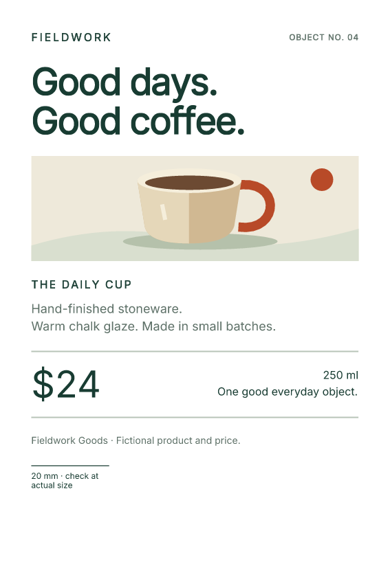

# Set your PDF paper size in CSS

Keep a sign, label or shelf card's paper size with its design. Fullbleed reads
the supported print rules in your HTML's `<style>` elements, including `@page`
size and margins. You can leave page geometry out of the Python constructor.

This fictional shelf-card project renders **100 × 150 mm** and **4 × 6 inch**
PDFs from the same HTML. Those sizes are close, but different: 4 × 6 inches
is 101.6 × 152.4 mm. The project is pinned to **Fullbleed 2.5.46**.

[Download the project](../assets/print-sizes/project.zip){ .md-button .md-button--primary }
[Open the metric PDF](../assets/print-sizes/metric-card.pdf){ .md-button }
[Open the inch PDF](../assets/print-sizes/inch-card.pdf){ .md-button }

[{ width="360" }](../assets/print-sizes/metric-card.pdf)

## Run the complete project

Extract the ZIP and open a terminal in `fullbleed-print-sizes`. Use a
[Python virtual environment](../getting-started/installation.md#use-a-virtual-environment), then run:

```sh
python -m pip install -r requirements.txt
python render.py
```

Open `output/metric-card.pdf` and `output/inch-card.pdf`. The corresponding
folders contain PNG previews rendered from the finalized PDFs. Edit
`shelf-card.html` to change the text, typography, illustration or print rules.
The project uses the package's bundled Inter font and an inline vector drawing.

## Let the stylesheet choose the page

The HTML contains this rule:

```css
@page { size: 100mm 150mm; margin: 8mm; }
```

The first length is the paper width; the second is its height. Margins leave an
**84 × 134 mm content area** within that sheet. A margin changes the space
available for content; it does not change the outer paper dimensions.

Here is the project's complete `render.py`. It reads the HTML next to the
script, so it also works when invoked from another directory:

```python
from importlib.resources import files
from pathlib import Path
import fullbleed

here = Path(__file__).resolve().parent
output = here / "output"
output.mkdir(exist_ok=True)
html = (here / "shelf-card.html").read_text(encoding="utf-8")
font = files("fullbleed_assets").joinpath("fonts/Inter-Variable.ttf")
engine = fullbleed.PdfEngine(font_files=[str(font)])

for name, extra_css in (
    ("metric-card", ""),
    ("inch-card", "@page { size: 4in 6in; margin: 8mm; }"),
):
    pdf = output / f"{name}.pdf"
    pdf.write_bytes(engine.render_pdf(html, extra_css))
    engine.render_finalized_pdf_image_pages_to_dir(
        str(pdf), str(output / name), 144, name
    )
    print(pdf)
```

The empty CSS argument preserves the embedded page rule. For the inch-sized
card, the separate CSS argument supplies a later `@page` rule with the same
priority. Each call produces a separate PDF. This example does not combine
different paper sizes in one batch.

## Use print styles from existing HTML

The project includes a screen-only preview message and a print-only scale line.
The latter is enabled by a print media query:

```css
.screen-only, .print-only { display: none; }
@media print {
  .print-only { display: block; }
}
```

A separate `<style media="screen">` shows the preview message in a browser.
That sheet also declares Letter paper, deliberately different from the print
rule. It is excluded from PDF rendering: both PDFs retain their custom size,
omit the screen message, and include the scale line.

When adapting an existing template, keep its supported print CSS and supply
fonts and assets explicitly. Fullbleed does not fetch `<link rel="stylesheet">`
or `@import` URLs or execute JavaScript. Move those styles into `<style>`
elements, the explicit CSS argument or a registered CSS asset. See the
[embedded stylesheet guide](complete-html.md) for cascade order and the
[CSS coverage report](../css-coverage.md) for known rendering gaps.

## Check the PDF, then check the printer

PDF page dimensions are expressed in points, with 72 points per inch. The
example's [verification record](../assets/print-sizes/verification.json)
checks the finalized PDFs with an independent reader:

| Output | CSS paper size | PDF width × height, points |
| --- | --- | --- |
| `metric-card.pdf` | `100mm 150mm` | approximately `283.465 × 425.197` |
| `inch-card.pdf` | `4in 6in` | `288 × 432` |

The checks also cover one page per card, expected text, print/screen filtering,
embedded Inter, repeatable PDF bytes and execution of the actual downloaded
project. These checks establish this example's output, not general browser
parity, printer accuracy or PDF/X conformance.

In your PDF viewer's print dialog, select matching stock and **Actual size**
or **100%**. **Fit to page** scales the document. Print a sample and measure
the 20 mm line before producing a run; driver settings and the printer's
physical margins are separate from the PDF's page geometry.

For a print-provider workflow requiring output intents, trim/bleed boxes or a
specific PDF profile, continue to [print output and PDF/VT](print-output.md).
