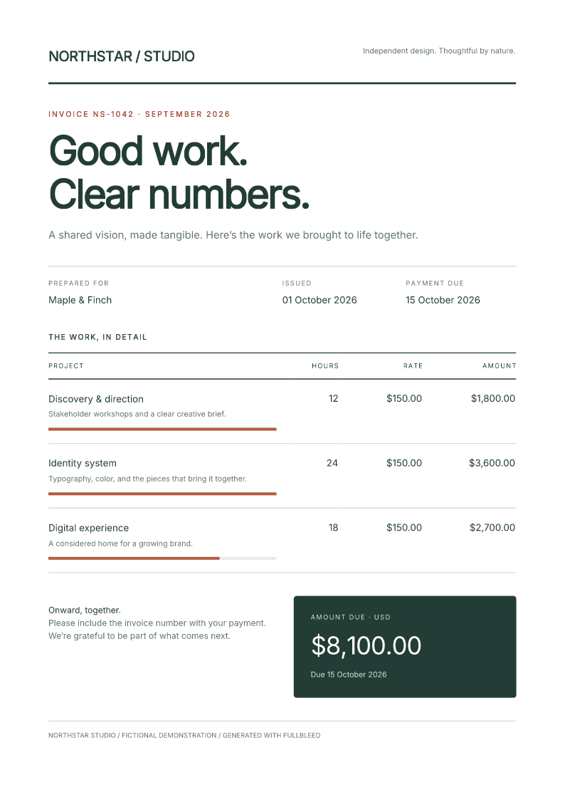

# Build PDFs with JavaScript components and JSX

Compose a PDF from reusable functions, typed props, children, arrays and
conditions. Use ordinary JavaScript without a build step, or write the same
template in JSX/TSX. Pass the document to a Node renderer, render queue or browser
renderer; you do not need to write HTML strings or install React. You can also
export the same tree as [static HTML](#export-html-with-or-without-styles), with
its CSS included or with classes ready for a host application stylesheet.

The downloadable invoice and guide use **fullbleed 0.8.1**, wrapping engine
**2.5.35**, including the stable SVG stylesheet, inset-shadow and saved-PDF preview fixes.
[HTML export](#export-html-with-or-without-styles) works with or without styles.
The linked React demo uses the same package and engine versions.

[Try the component invoice in React](../assets/react-demo/index.html){ .md-button .md-button--primary }

[Download the complete project](../assets/node-components/project.zip){ .md-button }
[Open the component invoice](../assets/node-components/invoice.pdf){ .md-button }

[](../assets/node-components/invoice.pdf)

Prefer [Python components](python-components.md) or [C# components](csharp-components.md)?
Both guides cover reusable functions and explicit styling in those languages.

## JavaScript without a build step

```javascript
import { writeFile } from 'node:fs/promises';
import { renderPdf } from 'fullbleed';
import { Document, Heading, Paragraph, Strong, Stack, StyleSheet } from 'fullbleed/ui';

const Line = ({ label, amount }) => Paragraph(Strong(label), ': ', amount);
const styles = new StyleSheet({
  '@page': { size: 'A4', margin: '18mm' },
  body: { fontFamily: 'Inter', color: '#233c36' },
  h1: { fontSize: '32pt', letterSpacing: '-1pt' },
  p: { margin: 0 },
});
const Invoice = ({ customer, items }) => Document({ title: 'Invoice', styles },
  Stack({ gap: '12pt' }, Heading({ level: 1 }, 'Made for ', customer),
    items.map(item => Line(item))));

const invoice = Invoice({ customer: 'Maple & Finch', items: [
  { label: 'Design', amount: '$120.00' },
  { label: 'Review', amount: '$40.00' },
] });
const result = await invoice.renderPdf(renderPdf, { previewDpi: 96 });
await writeFile('invoice.pdf', result.pdf);
await writeFile('invoice.png', result.previews[0]);
```

Save this as `invoice.mjs`, install `fullbleed@0.8.1`, and run `node invoice.mjs`
with Node 22 or newer. Functions need no special wrapper. The optional
`component(fn)` identity helper preserves the function and its types.

## Optional JSX and TSX

Use your compiler's automatic JSX transform. In a dedicated print-document file,
add `/** @jsxImportSource fullbleed/ui */`; this selects Fullbleed for that file
without changing the JSX runtime used by the rest of an existing app.

```tsx
/** @jsxImportSource fullbleed/ui */
import { Document, Heading, Paragraph, Strong, Stack, renderDocument } from 'fullbleed/ui';
import { renderPdf } from 'fullbleed';

function Line({ label, amount }: { label: string; amount: string }) {
  return <Paragraph><Strong>{label}</Strong>: {amount}</Paragraph>;
}
function Invoice({ customer }: { customer: string }) {
  return <Document title="Invoice" styles={{ '@page': { size: 'A4', margin: '18mm' } }}>
    <Stack gap="12pt">
      <Heading level={1}>Made for {customer}</Heading>
      <Line label="Design" amount="$120.00" />
    </Stack>
  </Document>;
}
const result = await renderDocument(<Invoice customer="Maple & Finch" />, renderPdf, { previewDpi: 96 });
// result.pdf and result.previews[0] are Node Buffers; save or return them.
```

For a whole document project, TypeScript options are `"jsx": "react-jsx"` and
`"jsxImportSource": "fullbleed/ui"`. Development JSX (`react-jsxdev`) and
CommonJS are supported. The [React starter](react-pdf.md) connects a composed
document to a live preview and configures Vite so print TSX and style edits
refresh the PDF. JSX expressions use `renderDocument` because their
TypeScript type can represent a document, element, fragment or text.

This is React-inspired synchronous composition for print output. React hooks,
events, refs, React component libraries and async components are not supported.
Fetch data before composing the document. `key` is accepted and ignored because
static documents have no reconciliation lifecycle. Native tags remain available
for engine-supported markup; their presence is not a claim of browser layout support.

## Props and children

`Paragraph({ className: 'note' }, 'Hello ', Strong('world'))` accepts props first.
`Paragraph('Hello ', Strong('world'))` is shorthand when there are no props.
`Paragraph({ children: 'Hello' })` also works; combining `props.children` with
positional children throws rather than silently losing content.

Nested arrays and ordered iterables are captured at construction. `false`,
`true`, `null` and `undefined` omit children; numeric zero remains. Format booleans
and data objects explicitly. Maps, sets, buffers, promises, uncalled functions,
cycles and nested documents fail clearly. Use one outer `Document`.

Text and attributes are escaped. A string containing `<strong>` prints literally;
use `Strong` for emphasis. Elements snapshot their children, attributes and inline
styles. `StyleSheet` snapshots rule maps and composed styles, so later mutations
do not change an already-authored document. Developer-authored CSS and URLs are
not sanitized for untrusted template execution.

## Named components

| Purpose | Components |
| --- | --- |
| Text | `Text`, `Paragraph`, `Strong`, `Emphasis`, `Heading`, `LineBreak` |
| Structure | `Document`, `Fragment`, `Box`, `Header`, `Footer`, `Section` |
| Layout | `Stack`, `Row`, `LayoutGrid`, `Inline`, `Center`, `Card`, `Divider` |
| Tables | `Table`, `TableCaption`, `THead`, `TBody`, `TFoot`, `Tr`, `Th`, `Td` |
| Lists and media | `List`, `ListItem`, `Image`, `Link` |

`Heading` accepts integer `level` 1–6. `Section` can prepend a `heading` with a
`headingLevel`. `Image` requires `src` and an explicit `alt` string; use `alt: ''`
for a decorative image. `Link` requires `href`. Table headers accept `scope`.
These helpers do not port Python's semantic validator or establish PDF/UA conformance.

Layout containers accept a constrained semantic `as` tag, such as
`Stack({ as: 'section' }, ...)`. `List({ as: 'ol' }, ...)` creates an ordered list.
`el(tag, props, ...children)` remains the lower-level escape hatch.

## Class names and styles

`className` labels an element so stylesheet selectors can match it. It does not
create or load a style. Define the rules in a `StyleSheet` and pass that sheet
to the outer `Document` through its `styles` prop.

| Prop | What it accepts | Where it applies |
| --- | --- | --- |
| `className="notice is-paid"` | Space-separated class names, without dots | The element returned by a built-in component |
| `style={{ color: '#a64232' }}` | Inline declarations, without a selector | That element |
| `<Document styles={sheet}>` | A stylesheet containing selectors and declarations | Matching elements throughout this document |

This example prints **Paid in full** in blue at 18 pt:

```tsx
/** @jsxImportSource fullbleed/ui */
import { Document, Paragraph, StyleSheet } from 'fullbleed/ui';

const paymentStyles = new StyleSheet({
  '@page': { size: 'A5', margin: '15mm' },
  body: { fontFamily: 'Inter' },
  '.notice': { color: '#245541', fontSize: '18pt', margin: 0 },
  '.notice.is-paid': { color: '#315d9b' },
});

const payment = <Document title="Payment" styles={paymentStyles}>
  <Paragraph className="notice is-paid">Paid in full</Paragraph>
</Document>;
```

Pass `payment` to `renderDocument(payment, renderer)`, using a Node or browser
renderer. That call includes the attached stylesheet. In ordinary JavaScript,
the same child is `Paragraph({ className: 'notice is-paid' }, 'Paid in full')`.

The dots belong in selectors: `.notice` matches `className="notice"`.
`.notice.is-paid` matches one element with **both** classes; `.notice .notice-title`
matches a descendant with `notice-title` inside a `notice`. Class order in the
string does not set precedence. A function named `Notice` is not itself a CSS
selector, and classes are not automatically scoped to a component or source file.

### Forward styling props in your own components

Your function decides which element receives `className` and `style`. Building
on `paymentStyles` above, accept and forward those props to make the root
customizable:

```tsx
import { Card } from 'fullbleed/ui';
import type { ElementProps } from 'fullbleed/ui';

function Notice({ children, className = '', style }:
  Pick<ElementProps, 'children' | 'className' | 'style'>) {
  return <Card className={`notice ${className}`.trim()} style={style}>
    {children}
  </Card>;
}

const noticeStyles = new StyleSheet(paymentStyles, {
  '.notice': { padding: '12pt', border: '2pt solid #245541' },
  '.notice .notice-title': { fontSize: '14pt', fontWeight: 700 },
});

const styledNotice = <Document title="Styled notice" styles={noticeStyles}>
  <Notice className="is-paid" style={{ borderColor: '#a64232' }}>
    <Paragraph className="notice-title">Payment</Paragraph>
    <Paragraph>Paid in full</Paragraph>
  </Notice>
</Document>;
```

`Notice` keeps its base `notice` class and adds the caller's `is-paid` class.
`Card` also retains its built-in `ui-card` class. The document combines shared
and component rules through `new StyleSheet(paymentStyles, ...)`; defining a
sheet beside a function does not attach it automatically. When splitting files,
export both the component and its sheet, then compose the sheets on the document.

The title's descendant rule sets 14 pt bold text. The inline `borderColor`
changes this one notice's border to rust red. Ordinary stylesheet rules follow
selector specificity, then source order for ties. Inline declarations override
ordinary stylesheet declarations on the same element; `!important` changes that
priority. Text properties such as color can inherit into children, while padding
and borders apply to the element itself. Layout props such as `<Stack gap="12pt">`
produce inline styles too; an explicit `style` prop can override those values.

Use component-specific class names when combining designs to avoid unintended
matches. A CSS import in the React app styles the web interface; it does not
attach that CSS to the PDF. Fullbleed does not generate CSS Modules names or load
a framework's stylesheet from a class string. Pass print rules through
`Document.styles`, using the supported print CSS.


## Styles and layout

`Stack` accepts `gap` and `align`; `Row` adds `justify` and boolean `wrap`.
`LayoutGrid` accepts `columns` as a positive integer or a CSS track string.
Explicit `style` declarations override layout props. Named layout components use
small default rules returned by `componentStyles()`, included by `Document`.
They do not load a theme or fonts. Disable them with `includeComponentStyles: false`.

```javascript
const brand = { color: '#233c36', fontWeight: 600 };
const cell = Paragraph({ style: [brand, { color: '#a0442e' }] }, 'Overridden');
const sheet = new StyleSheet(
  { '.total': { padding: '18pt', background: '#233c36', color: '#fff' } },
  '@media print { .note { color: #63756e; } }',
);
```

`style(...)` composes inline declarations with last-write-wins semantics.
Map keys accept camelCase, snake_case or CSS spelling. Numbers have no automatic
unit: use `'12pt'`, `'4mm'`, or `'1.5em'` where a length needs a unit. Custom property
names preserve case. `StyleSheet` accepts ordered rule maps, raw CSS and other
stylesheets; use raw CSS for nested at-rules.

`document.toCss(...overrides)` returns layout defaults, document styles and then
overrides in cascade order. `document.toHtml()` leaves that generated stylesheet
separate. When calling the underlying API yourself, pass both:
`renderPdf({ html: doc.toHtml(), css: doc.toCss() })`.
To carry the stylesheet inside the HTML, use
`document.toHtml({ includeStyles: true })`, as shown below. Remote CSS is not fetched.

The document's `title` and `lang` describe its HTML. `page` and `margin` are
authoring metadata; set actual PDF page geometry in `@page` CSS. They do not set
PDF metadata or imply a standards profile. The renderer's existing
`defaultStyles` option is preserved; use `false` when your stylesheet owns all
font defaults.

## Export HTML with or without styles

Install `fullbleed@0.8.1` for explicit HTML export options. Save the example as
`export.mjs` and run `node export.mjs` to write both HTML documents. Import only `fullbleed/ui` to use
the authoring layer without starting the PDF engine, a worker, or a browser.

```javascript
import { writeFile } from 'node:fs/promises';
import { Document, Heading, Paragraph, Row, toHtml } from 'fullbleed/ui';

const summary = Row(
  Paragraph({ className: 'customer' }, 'Northstar Studio'),
  Paragraph({ className: 'amount' }, 'USD 1,200.00'),
);
const report = Document({ title: 'Account summary', styles: {
  '.amount': { color: '#175c52', fontWeight: 700 },
} }, Heading({ level: 1 }, 'Account summary'), summary);

await writeFile('report.html', report.toHtml({ includeStyles: true }));
await writeFile('report-unstyled.html', report.toHtml({ includeStyles: false }));
const styledFragment = toHtml(summary, {
  includeStyles: true,
  styles: { '.amount': { color: '#175c52', fontWeight: 700 } },
});
```

| Call | Result |
| --- | --- |
| `doc.toHtml({ includeStyles: true })` | Complete HTML document with component defaults and attached CSS in one generated `<style>` element in its head; inline styles remain |
| `doc.toHtml({ includeStyles: true, styles: overrides })` | The same document, with extra CSS appended after its attached styles |
| `doc.toHtml({ includeStyles: false })` | Complete HTML document with inline styles, authored `<style>` elements and stylesheet `<link>` elements removed recursively |
| `node.toHtml(options)` or `toHtml(children, options)` | An HTML fragment; styled mode prefixes component defaults and explicit `styles` once |
| `doc.toHtml()` | The existing separate HTML/CSS form: inline styles remain and no stylesheet is added |

Class names, content and semantic tags remain in unstyled mode, ready for the
host application's stylesheet. SVG presentation attributes such as `fill` remain
part of the artwork. Export does not mutate the component tree or its styles.
The same options work with JSX: `toHtml(<Report />, { includeStyles: true })`.
Supply `styles` only together with `includeStyles: true`; contradictory options
throw instead of silently discarding your CSS.

Styled fragments include their own component rules and the CSS supplied in that
call. They do not inherit a separate `Document`'s stylesheet. When composing many
fragments, export their array once, or attach your CSS to a host document.
Use `Document({ includeComponentStyles: false, styles: yourStyles }, ...)` to
control the complete stylesheet yourself.

Export adds no JavaScript or Bootstrap behavior. Fonts, images and external CSS
are not fetched or embedded; authored URLs remain URLs. Browsers apply their own
CSS support and pagination, so browser HTML is not a promise of identical PDF
layout. Values used as text and attributes are escaped, but developer-authored
CSS, tags and URLs are not sanitized. Unstyled export is not a security sanitizer.

For PDFs, `report.renderPdf(renderer)` and `renderDocument(report, renderer)`
pass HTML and CSS together for you. The renderer also reads supported static
`<style>` sheets from complete HTML, so exported HTML can be rendered with
`renderPdf({ html: report.toHtml({ includeStyles: true }), css: '', defaultStyles: false })`.
The installed-package checks retain identical PDFs and previews for seven component
examples through both paths. Remote stylesheets are not fetched.

## Queues and browsers

Pass a `createRenderQueue(...)` result in place of the Node `renderPdf` function.
Its deadlines, admission limits, cancellation and structured errors remain in
effect. `signal`, `fonts`, `assets`, preview and isolation options pass through.
The return type remains the renderer's result type.

In a browser, configure `createRenderer` from `fullbleed/browser` with its deployed
asset directory, then call `renderDocument(node, renderer, options)`. The PDF and
preview bytes are `Uint8Array`s. See the [browser deployment guide](browser-pdf.md).
The UI and JSX entrypoints have browser exports and no Node imports.

## Complete example and verification

The [invoice project](../assets/node-components/project.zip) includes a complete styled invoice
in ordinary functions and TSX, using the same data and attached `StyleSheet`.
Extract the download, then run with Node 22 or newer:

```sh
npm ci
npm run check
npm run pdf
npm run pdf:tsx
```

Package checks install the exact tarball in isolated consumers with spaces in
their paths, then render seven fixtures: default, paid, empty, escaped, credit,
60-row invoices and named layouts. They compare function/TSX HTML, CSS, PDFs and
all previews; exercise the queue and recovery paths; and inspect PDF text, fonts,
page bounds and layout coordinates with independent readers. Browser checks use
the installed UI/JSX assets, compare and download every fixture, and edit a
customer name through a real form. These are scoped fixture checks, not a claim
of full Python/JavaScript API parity or standards conformance.
