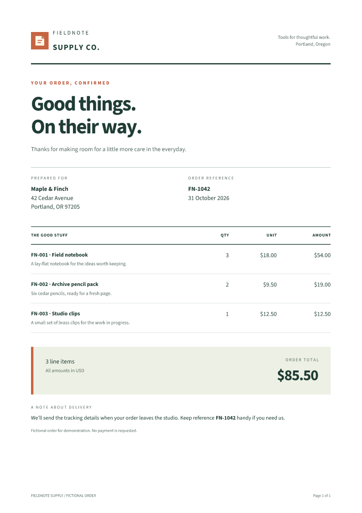

# HTML to PDF in Node.js without Puppeteer

If your Node application already turns records into HTML, you can pass that HTML
to Fullbleed to generate a PDF. The example below keeps the template, stylesheet,
two font files and logo together, with a short order and a longer order to check
page breaks. The main project installs **Fullbleed 0.9.0**, which contains
**engine 2.5.46**; rendering does not launch a browser.

Use this path for static documents such as invoices, order summaries, statements
and reports. Keep Puppeteer when the required output depends on JavaScript running
in the page, a live application's state, or Chromium's rendering behavior.
Fullbleed is a separate layout engine, so migrating a template needs a layout
review. It is not a drop-in replacement for `page.pdf()`.

<div class="cta-group" markdown>
[Download the complete project](../assets/node-html/project.zip){ .md-button .md-button--primary download="node-html-to-pdf.zip" }
[Open the three-page PDF](../assets/node-html/fullbleed/long/document.pdf){ .md-button }
</div>

{ loading=lazy width=794 }

## Run the project

Use Node.js **22.12 or newer**. Unzip the download, enter `node-html-to-pdf`, and run:

```sh
npm ci --ignore-scripts
npm run render
```

Open `output/fullbleed/short/document.pdf` and
`output/fullbleed/long/document.pdf`. Each folder also contains the exact HTML
input and native PNG previews. `output/fullbleed/render.json` records engine
version, page counts, missing-glyph counts and output hashes.

| File | What to change |
| --- | --- |
| `records.json` | Customers and line items; prices use integer cents. |
| `template.html` | The document structure. |
| `print.css` | Typography, page size, margins, tables and page numbers. |
| `document.mjs` | Your data-to-HTML step. This loader escapes text and computes totals. |
| `fonts/` and `assets/` | The supplied regular/bold fonts and SVG logo. |
| `render.mjs` | The Fullbleed call and file output. |
| `reference/` | An optional, separate Puppeteer comparison. |

Render just the longer fixture, optionally into a directory with spaces:

```sh
node render.mjs long "output/my order"
```

## Keep your data-to-HTML step

You can keep an existing template function or server-side template engine.
Resolve the data and return HTML before calling Fullbleed. If a chart or other
element is currently created by page JavaScript, generate an image or SVG first
and supply it with the other assets.

Save this as `example.mjs` in the downloaded project, then run `node example.mjs`:

```javascript
import { writeFile } from 'node:fs/promises';
import { renderPdf } from 'fullbleed';
import { loadDocument } from './document.mjs';

const input = await loadDocument('long');
const result = await renderPdf({
  html: input.html,
  fonts: input.fonts,
  assets: input.assets,
  defaultStyles: false,
  previewDpi: 96,
  isolation: 'process',
});

await writeFile('order.pdf', result.pdf);
console.log(`${result.pages} pages; engine ${result.engineVersion}`);
```

The loader places `print.css` inside a `<style>` element. You can also pass a
separate `css` string to `renderPdf`. With `defaultStyles: false`, explicitly
style headings, `b`, `strong`, table headings and other elements you use; do not
depend on a browser's default stylesheet. See the
[Node API guide](../getting-started/node.md) for options and
[queue guide](node-render-queue.md) for bounded background jobs.

## Supply fonts and images explicitly

The project supplies two unmodified Source Sans 3 font files, with their OFL
license and pinned source manifest. Named font objects use `Brand-Regular.ttf`
and `Brand-Bold.ttf`, matching these CSS URLs:

```css
@font-face {
  font-family: "Source Sans 3";
  src: url("Brand-Regular.ttf");
  font-weight: 400;
  font-style: normal;
}
@font-face {
  font-family: "Source Sans 3";
  src: url("Brand-Bold.ttf");
  font-weight: 700;
  font-style: normal;
}
body { font-family: "Source Sans 3"; font-synthesis: none; }
b, strong, th { font-weight: 700; }
```

Use the font's actual family name consistently in the body and page margin boxes,
as this example does. Supply separate faces for the weights and styles your
template needs, and review [font face selection](../engine/font-registration.md)
when changing them.

The HTML's `assets/logo.svg` resolves to the `logo.svg` entry in Fullbleed's asset
map. Both font files and the image are passed as bytes. Download remote assets
in your application before rendering; the PDF renderer does not load a website's
assets or use your machine's installed fonts.

## Move print settings into CSS

| Puppeteer setup | Fullbleed document setup |
| --- | --- |
| A page created with `setContent()` or `goto()` | A completed HTML string passed to `renderPdf`. |
| `format`, `width`, `height`, or page margins | CSS `@page { size: A4; margin: 17mm 18mm 20mm; }`. |
| A header/footer template with page-number placeholders | CSS margin boxes with `counter(page)` and `counter(pages)`. |
| Waiting for browser fonts and image requests | Supply the required font and image bytes in the render call. |
| `printBackground: true` | Backgrounds defined in the print stylesheet. |

The sample uses a flowing table, a repeated `thead`, and
`break-inside: avoid` on rows and the closing total/delivery section. It does not
assign a fixed height to the document or slice it into predetermined pages.
An individual row or closing section taller than a page still needs a layout
decision. Check both your shortest and longest realistic records.

## Compare with the optional Puppeteer reference

From the project's root:

```sh
cd reference
npm ci
npm run render
```

This separate package installs **Puppeteer 25.16.0** and its compatible Chrome.
It prints the same generated HTML, regular/bold font bytes and logo from a
temporary loopback server. Outputs are in `../output/chromium/`; its `render.json`
records the actual browser version and local asset requests. The main Fullbleed
installation does not need this reference package.

The reference enables `printBackground` and `preferCSSPageSize` so the shared
stylesheet controls backgrounds and A4 page size. These options default to false
in Puppeteer; see its [PDF options](https://pptr.dev/api/puppeteer.pdfoptions) and
[PDF generation guide](https://pptr.dev/guides/pdf-generation). Use Puppeteer's
compatible browser download, or follow the included README to supply a compatible
Chrome already provisioned in CI.

## Inspect the retained results

Both renderers produced one page for three items and three pages for 24 items in
these fixtures. The typography and spacing differ; matching page counts is not a
claim of visual parity or support for every browser template.

| Fixture | Fullbleed | Puppeteer / Chrome |
| --- | --- | --- |
| Three items, $85.50 | [PDF](../assets/node-html/fullbleed/short/document.pdf) · [preview](../assets/node-html/fullbleed/short/page-1.png) | [PDF](../assets/node-html/chromium/short/document.pdf) · [preview](../assets/node-html/chromium/short/page-1.png) |
| 24 items, $896.00 | [PDF](../assets/node-html/fullbleed/long/document.pdf) · [page 1](../assets/node-html/fullbleed/long/page-1.png) · [page 2](../assets/node-html/fullbleed/long/page-2.png) · [page 3](../assets/node-html/fullbleed/long/page-3.png) | [PDF](../assets/node-html/chromium/long/document.pdf) · [page 1](../assets/node-html/chromium/long/page-1.png) · [page 2](../assets/node-html/chromium/long/page-2.png) · [page 3](../assets/node-html/chromium/long/page-3.png) |

The [verification record](../assets/node-html/verification.json) retains versions,
input/output hashes and checks using two independent PDF readers: every item once
and in order, the correct total, embedded regular/bold fonts, visible local logo,
repeated table headings, correct page counters and text within the page bounds.
The closing total and delivery note remain together on the final page. The
download and the JavaScript snippet above are executed in CI.

These are fictional order documents and ordinary PDFs. This example makes no
accessibility, archival, print-profile or performance claim. To evaluate your own
template, start with [CSS coverage](../css-coverage.md), then inspect the actual
output with your fonts and representative data.
