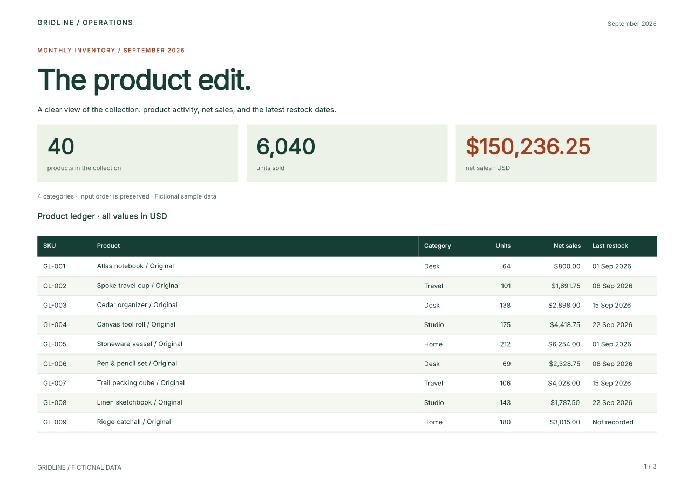

# pandas reports with Python components

Keep the data preparation in pandas and build the report from reusable Python
functions. This example turns the same fictional Gridline CSV used in the
[HTML/CSS pandas guide](pandas-to-pdf.md) into a new three-page design: summary
cards, a striped product ledger, repeated headers, and finalized page totals.

!!! warning "Pinned experimental API"
    This project uses the published **Fullbleed 2.6.0a9** wheel and **pandas 3.0.6**.
    The component API is experimental. Keep the exact pin while evaluating it;
    the [HTML/CSS example](pandas-to-pdf.md) remains a separate stable-release path.

[Download the PDF](../assets/pandas-components/report.pdf){ .md-button .md-button--primary download="gridline-components.pdf" }
[Get the runnable source](../assets/pandas-components/project.zip){ .md-button download="fullbleed-pandas-components.zip" }
[Download both HTML exports](../assets/pandas-components/html-exports.zip){ .md-button download="fullbleed-pandas-html.zip" }

[](../assets/pandas-components/report.pdf)

[Preview page 2](../assets/pandas-components/page-2.png) ·
[Preview page 3](../assets/pandas-components/page-3.png) ·
[Inspect the verification record](../assets/pandas-components/verification.json) ·
[Source checksums](../assets/pandas-components/source.json)

The previews come from the actual PDF. All data and the Gridline organization are
fictional. This is a component-authored design using the earlier example's data;
the two designs do not claim pixel parity.

## Run the complete example

Extract the source ZIP and open its `fullbleed-pandas-components` directory. Use
Python 3.11 or later:

```sh
python -m venv .venv
# Windows: .venv\Scripts\activate
# macOS/Linux: source .venv/bin/activate
python -m pip install --only-binary=:all: -r requirements.txt
python report.py --previews
```

Open `output/report.pdf`. The command also writes styled HTML, unstyled HTML,
source structural diagnostics, pagination evidence, and optional PNG previews.
The published wheel includes the font and native renderer; PDF generation needs
no browser, system font, or remote asset.

```sh
python report.py --csv products.csv --title "The autumn edit." --period "Autumn 2026" --out output/autumn
```

## Bridge a DataFrame to a table

`data.py` validates the CSV and preserves its row order. `report.py` calls:

```python
Ledger(frame.to_dict(orient="records"))
```

Each `Column` callback receives one record. It can return text or another
component. Here is the core of the table in `components.py`:

```python
from fullbleed.ui.experimental import Column, DataTable, Strong, mm
from data import dollars, restock

def Ledger(records):
    return DataTable(
        records,
        caption="Product ledger · all values in USD",
        columns=(
            Column("SKU", lambda row: row["sku"], width=mm(23)),
            Column("Product", lambda row: Strong(row["product"])),
            Column("Category", lambda row: row["category"], width=mm(23)),
            Column("Units", lambda row: f'{row["units"]:,}', align="right", width=mm(19)),
            Column("Net sales", lambda row: dollars(row["net_sales_cents"]), align="right", width=mm(30)),
            Column("Last restock", lambda row: restock(row["last_restock"]), width=mm(30)),
        ),
        class_name="ledger",
    )
```

The complete file adds header, caption, and cell styles with `.with_parts()`.
The table supplies semantic column headers and repeats them across PDF pages.
`Flow` lets the document paginate; short metric cards use `Stack` internally.

## Give reusable components a styling API

The metric is a Python function. Its two named parts let callers style the value
or label without reaching through its implementation:

```python
from fullbleed.ui.experimental import (
    Box, Paragraph, Stack, component, pt, style, token,
)
from components import Small

@component(parts=("value", "label"))
def Metric(value, label):
    return Box(
        Stack(
            Paragraph(value, part="value", style=style(
                font_size=pt(26), font_weight=700, line_height=1.15,
            )),
            Small(label, part="label"),
            gap=pt(5),
        ),
        style=style(background=token("paper"), padding=pt(12)),
    )

sales = Metric("$150,236.25", "net sales · USD").with_parts(
    value=style(color=token("accent")),
)
```

`Theme` defines the palette and shared typography. `styled(Paragraph, ...)`
creates the reusable `Small` and `Kicker` factories. Styles are immutable values;
an override produces a new component value.

### What does `class_name` do?

`class_name="ledger"` attaches the class to the table. It applies no declarations
by itself. The document supplies the selector and its styles:

```python
Document(
    ...,  # report components
    styles={
        ".ledger tbody tr:nth-child(even)": style(background="#f5f7f2"),
        ".folio": style(font_size=pt(8), color=token("muted")),
    },
)
```

Use a component's `style=` or `.with_style()` for one instance, `styled()` for a
reusable factory, and `.with_parts()` for its declared public parts. Use
`class_name` plus document selectors when a rule needs a selector, such as the
alternating rows above.

## Repeat the brand and count the final pages

The document owns its page geometry. Its header and footer contain the same
Python component values used in the body:

```python
Page(
    "A4", landscape=True,
    margin=(mm(20), mm(16), mm(19), mm(16)),
    header=PageBand(left=Brand(), right=Small(period)),
    footer=PageBand(
        left=Small("GRIDLINE / FICTIONAL DATA"),
        right=PageNumbers(total=True, prefix="", separator=" / ", class_name="folio"),
    ),
)
```

`PageNumbers` uses the finalized page count. The 40-row sample produces `1 / 3`
through `3 / 3`; the 120-row check produces seven pages. Review your own content
after changing widths, fonts, data, or page size. An oversized row or page band
can raise a structured layout error.

## Export HTML with or without styles

The same document can be used without PDF rendering:

```python
document = build_report(frame)
styled_html = document.to_html(include_styles=True, a11y_mode="raise")
plain_html = document.to_html(include_styles=False, a11y_mode="raise")
```

`True` embeds the collected component CSS. `False` removes component CSS and
inline styles while retaining authored classes and semantic elements. The example's
export function also adds font loading and screen framing to the styled export;
keep its `fonts/` directory beside the HTML. These are static browser documents,
with a single header and footer. Browser pagination does not reproduce PDF pages.

## Keep presentation and data rules separate

The CSV contract is explicit: unique nonblank SKU, nonblank product and category,
nonnegative integer units, signed integer cents, and an ISO restock date or a
missing value. Additional columns are ignored. `Decimal` formats currency;
Python integers sum the amounts. Missing dates display “Not recorded”. Data
containing markup remains literal text, and building the report leaves the frame
unchanged. Normalize an existing DataFrame to this contract before authoring it.

## Reproduce the checks

```sh
python -m pip install --only-binary=:all: -r requirements-check.txt
python verify.py --out output/verification
```

The checks save actual PDFs for 40 rows, one row, mixed long/Unicode/literal-markup
values, and 120 rows. Independent readers check row order and completeness,
repeated headings, page totals, and glyph bounds, and rasterize every page. Eight
invalid input cases are rejected. A fresh Python process reproduces the sample's
exact PDF bytes using the fixed timestamp and bundled font. Both HTML modes and
unchanged input frames are also checked.

The PDF uses the tagged profile and passes source structural checks. These checks
do not establish PDF/UA conformance or assistive-technology usability. For that
separate workflow, see the [accessible component showcase](accessible-showcase.md).

Continue with the [current component preview](component-preview-9.md),
[reusable page-band notebook](../getting-started/page-band-notebook.md), or
[HTML/CSS pandas report](pandas-to-pdf.md).
