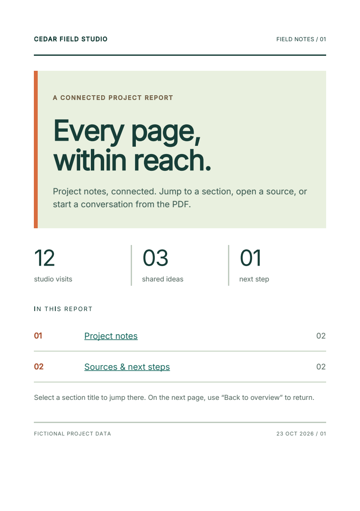

# Add clickable links to a PDF

Use an HTML anchor to send a PDF reader to a web page, an email address, or a
section in the same document. Fullbleed turns the visible link into a native
PDF link when it renders your HTML and CSS.

The sample below is a two-page project handoff. Its contents links jump to
different positions on page 2, and **Back to overview** returns to page 1.
It uses fictional project data and a font bundled with Fullbleed.

[Open the linked report](../assets/pdf-links-alpha14/linked-report.pdf){ .md-button .md-button--primary }
[Download the Python project](../assets/pdf-links-alpha14/project.zip){ .md-button }

[](../assets/pdf-links-alpha14/linked-report.pdf)

!!! info "Requires the 2.6.0a14 prerelease"
    Use Python 3.10 or later in a virtual environment and install
    `python -m pip install fullbleed==2.6.0a14`.
    Stable 2.5.34 predates this native-navigation feature. Ordinary
    `pip install fullbleed` continues to select the stable channel.

## Start with an anchor

An external link needs a complete URL. An internal link needs a fragment
such as `#findings` and an element with the matching `id="findings"`:

```python
from importlib.resources import files
from pathlib import Path
import fullbleed

html = """
<h1 id="overview">Project report</h1>
<p><a href="#findings">Go to project notes</a></p>
<p><a href="https://docs.fullbleed.dev/">Read the documentation</a></p>

<h2 id="findings" style="break-before: page">Project notes</h2>
<p>Keep the handoff clear, connected, and easy to use.</p>
<p><a href="#overview">Back to overview</a></p>
"""
css = """
@page { size: A5; margin: 18mm; }
body { font-family: Inter; font-size: 11pt; line-height: 16pt; }
a { color: #12665c; text-decoration: underline; }
"""

font = files("fullbleed_assets").joinpath("fonts/Inter-Variable.ttf")
engine = fullbleed.PdfEngine(font_files=[str(font)])
Path("report.pdf").write_bytes(engine.render_pdf(html, css))
```

The renderer does not fetch the linked page. It stores the destination in
the PDF; the reader handles activation. PDF-reader security settings can
affect opening external URLs.

| Destination | HTML |
| --- | --- |
| Web page | `<a href="https://example.com/report">Open the source report</a>` |
| Email address | `<a href="mailto:hello@example.com">Email the project team</a>` |
| Document section | `<a href="#findings">Project notes</a>` with an element whose `id` is `findings` |

Email links use the reader's configured mail application. The example address
is illustrative. Use descriptive labels so the destination is clear before
someone selects a link.

## Adapt the complete report

Unzip the project, then run:

```sh
python -m pip install -r requirements.txt
python render.py
```

Edit `report.html` for the content and destinations. Edit `report.css` for
the color palette, spacing, typography, and page layout. The script writes
`output/linked-report.pdf` and two PNG previews. Open the PDF to try the links;
PNG previews show the layout and do not contain interactive links.

Use unique IDs. Missing destinations produce no active internal link, and
duplicate IDs resolve to the first occurrence. Link text may span multiple
activation regions when it wraps or contains separate shaped fragments.

## Use the same links in components

The component authoring path emits HTML anchors with the same behavior.
Pass native HTML attributes through `attrs`, including a heading's `id`:

```python
from pathlib import Path
from fullbleed.components import Document, Heading, Renderer
from fullbleed.components.bootstrap import Link

document = Document(
    Link("Project notes", href="#findings"),
    Heading("Project notes", level=2, attrs={"id": "findings"}),
    Link("Documentation", href="https://docs.fullbleed.dev/"),
    title="Component link example",
)
Path("component-links.pdf").write_bytes(document.render_pdf(Renderer()))
styled_html = document.to_html(include_styles=True)
unstyled_html = document.to_html(include_styles=False)
```

Both HTML exports keep the `href` values. The new component API remains alpha;
see its [release status](component-status.md) and
[styling and export guide](component-preview-12.md).

## What was checked

The report was checked for two complete pages and working section, web, and
email destinations. Its layout was reviewed in native previews and an
independent PDF reader; layout/font checks reported no overflow or missing
glyphs. Both Python examples were executed, and the component example's
styled and unstyled HTML exports were inspected.

[Verification record](../assets/pdf-links-alpha14/verification.json) ·
[Release evidence](https://github.com/fullbleed-engine/fullbleed-official/releases/tag/v2.6.0a14)

Keep links rectangular when precise activation boundaries matter. Some readers
expand the clickable area of rotated or diagonally clipped links. This example
does not establish keyboard, screen-reader, or PDF/UA conformance. The
[navigation reference and reader observations](https://github.com/fullbleed-engine/fullbleed-official/blob/v2.6.0a14/docs/pdf-links.md)
describe the tested geometry and remaining limits.
