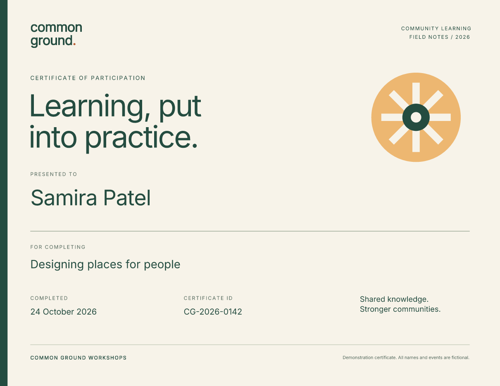

# Personalize an existing PDF template

Keep your certificate, letterhead, or other fixed artwork as a PDF. Generate a
transparent text overlay for each record, then compose the two pages into the
finished document.

This Common Ground certificate pairs a reusable PDF background with names,
workshop titles, dates, and certificate IDs from JSON. The download includes
the background's HTML/CSS source as well as its ready-to-use PDF.

[Open the three-page PDF](../assets/pdf-template/certificates.pdf){ .md-button .md-button--primary }
[Download Python project](../assets/pdf-template/project.zip){ .md-button }
[Download C# project](../assets/dotnet-pdf-template/project.zip){ .md-button }

[](../assets/pdf-template/certificates.pdf)

The fictional sample uses **Fullbleed 2.5.39** in Python and
**FullBleed.DotNet 0.2.3** in C#, with a bundled Inter font. Both projects
use the same artwork and records. The previews show the final composed PDF,
including the background and overlay.

## Run the example

### Python

Extract the Python ZIP, open `fullbleed-pdf-template`, and use Python 3.10 or newer in
a virtual environment:

```sh
python -m pip install -r requirements.txt
python render.py --out output
```

Open `output/certificates.pdf`. The folder also holds the final page previews,
`overlay.pdf`, `plan.json`, and `render.json` with input hashes and checks for
repeatable composition and an unchanged source template. Choose a new output
folder for each run.

Rendering runs locally. It needs no browser, external rendering service, or
system-font installation.

### C\#

Extract the C# ZIP, open `fullbleed-csharp-pdf-template`, and use the .NET 10 SDK:

```sh
dotnet restore --locked-mode
dotnet run -c Release --no-restore -- --out output
```

[Open the C# PDF](../assets/dotnet-pdf-template/certificates.pdf){ .md-button }

Open `output/certificates.pdf` and the three `page-*.png` previews. The C#
project also saves its component-authored `overlay.html`, `overlay.css`,
`overlay.pdf`, composition plan, and a `render.json` receipt. Its rendering
runs locally through the bundled native library; Python is not required.

The C# fields are authored with `Section` and `Paragraph`. A class name selects
rules from the stylesheet attached to the document:

```csharp
using FullBleed.DotNet.UI;
using static FullBleed.DotNet.UI.Components;

var document = new Document(
    Section(Paragraph("Samira Patel").WithClass("name"))
        .WithClass("certificate"))
{
    IncludeComponentStyles = false,
    Styles = StyleSheet.FromCss(File.ReadAllText("Assets/overlay.css")),
};
```

`WithClass("name")` connects that paragraph to the `.name` selector shown
below. The full project registers the bundled font, adds every record and
checks the final composition. See the [C# component guide](csharp-components.md)
for reusable components and HTML export.

## Change the records

Edit `data.json` in Python or `Assets/data.json` in C#. Each record becomes
one page:

```json
[
  {
    "name": "Samira Patel",
    "workshop": "Designing places for people",
    "completed_on": "2026-10-24",
    "certificate_id": "CG-2026-0142"
  }
]
```

Render the edited records to a new folder and inspect the PDF:

=== "Python"

    ```sh
    python render.py --out output-edited
    ```

=== "C#"

    ```sh
    dotnet run -c Release --no-restore -- --out output-edited
    ```

Both projects escape text, reject invalid records, and check for missing font glyphs.
Names allow up to 48 characters, workshop titles 80, and IDs 20; longer values
within those limits use smaller type. Those limits are this design's layout
budget, so review longer names and titles in the final previews.

## Position fields with CSS

The background is US Letter landscape: **792 × 612 points**. The overlay uses
the same page size and positions its fields from the top-left:

```css
@page { size: 792pt 612pt; margin: 0; }
body { margin: 0; background: transparent; }
.certificate { position: relative; width: 792pt; height: 612pt; }
.name { position: absolute; left: 48pt; top: 295pt; width: 696pt; }
```

One inch is 72 points. Edit `overlay.css` in Python or `Assets/overlay.css` in
C# to change field positions, sizes, fonts, and colors. Avoid an opaque background on the overlay: it would cover
the original artwork.

## Compose the pages

After rendering the overlay, the Python project composes its pages with:

```python
import fullbleed

templates = [("certificate", "template.pdf")]
plan = [
    ("certificate", 0, overlay_page, 0.0, 0.0)
    for overlay_page in range(len(records))
]

fullbleed.finalize_compose_pdf(
    templates,
    plan,
    "output/overlay.pdf",
    "output/certificates.pdf",
    annotation_mode="none",
)
```

Each plan entry contains the template ID, template page index, overlay page
index, and X/Y offsets. Page indexes start at zero. This example reuses template
page `0` for every record and uses zero offsets because both pages already
share the same dimensions.

C# uses the corresponding typed composition API:

```csharp
var composition = new ComposeOptions
{
    Templates = [new ComposeTemplate("certificate", template)],
    Plan = Enumerable.Range(0, records.Count)
        .Select(page => new ComposePage("certificate", 0, page)).ToList(),
    AnnotationMode = ComposeAnnotationMode.None,
};
FullBleedEngine.ComposePdf(overlay, pdf, composition);
```

These types are in `FullBleed.DotNet`; `template`, `overlay` and `pdf` are file
paths. The complete C# program supplies them and verifies repeated output.

The background remains PDF content rather than a screenshot. Review the final
composed previews: an overlay-only preview cannot show alignment with the
background. The [composition reference](../engine/template-composition.md)
covers catalogs, plans, and the CLI.

## Use your own background

Supply a readable, unencrypted, unsigned, one-page PDF:

=== "Python"

    ```sh
    python render.py --template my-template.pdf --out output-custom
    ```

=== "C#"

    ```sh
    dotnet run -c Release --no-restore -- --template my-template.pdf --out output-custom
    ```

Use an unrotated page and adjust the overlay CSS to its dimensions and field
positions. Both projects check readability, encryption, and page count; they
do not automatically check page geometry or align fields for you.

To edit the supplied artwork, change `template.html` and `template.css`
(under `Assets/` in C#), then rebuild to a new file:

=== "Python"

    ```sh
    python build_template.py --out revised-template.pdf
    python render.py --template revised-template.pdf --out output-revised
    ```

=== "C#"

    ```sh
    dotnet run -c Release --no-restore -- build-template --out revised-template.pdf
    dotnet run -c Release --no-restore -- --template revised-template.pdf --out output-revised
    ```

This workflow adds static content over artwork. It does not fill AcroForm
fields, replace existing PDF text, preserve digital signatures, or establish
tagging/accessibility. The example omits source annotations. For flowing
content authored entirely in HTML/CSS, start with the
[invoice guide](invoices.md) or [variable-data guide](bank-statements.md).
