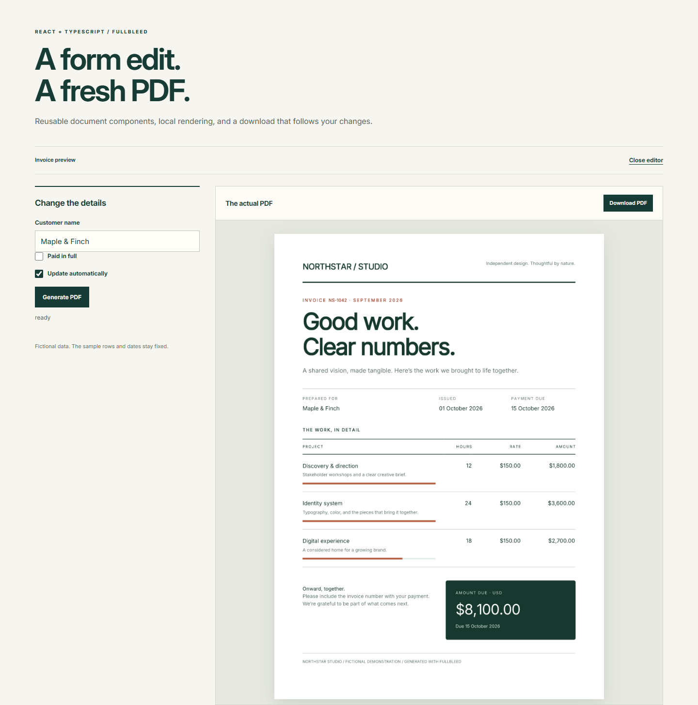

# Keep a React PDF download in sync with your form

A customer name changes while a PDF is rendering. The old document must not
become the download for the new form. Closing the editor should also stop its
pending work and release its preview URLs.

This smaller version of the [React starter](react-pdf.md) makes those behaviors
easy to inspect. It has a customer field, a paid checkbox, automatic or manual
generation, and an editor you can close and reopen. It keeps the styled
component invoice and the existing preview hook.

[Download the focused project](../assets/react-preview-recipe/project.zip){ .md-button .md-button--primary }
[Read App.tsx](../assets/react-preview-recipe/App.tsx){ .md-button }



The project pins **fullbleed 0.8.2**, engine **2.5.37**, and **React 19.3.0**.
The data is fictional; the sample invoice rows and dates stay fixed. Its source
is MIT licensed. Rendering runs in a browser worker after loading the runtime
and fonts from your static host.

## Run it

Extract the ZIP into an empty directory. With Node.js 22.13+ on the 22.x line,
or Node.js 23.5+ (including 24.x), open a terminal in `fullbleed-react-starter`:

```sh
npm ci
npm run dev
```

Open the localhost URL printed by Vite. After the status says **ready**,
download the PDF. Then try these edits:

1. Change the customer. The previous preview and download disappear while the
   new document is pending. A short pause in typing starts the next render.
2. Select **Paid in full**. The PDF's payment summary and note change.
3. Turn off **Update automatically** and edit the customer. Choose
   **Generate PDF** to produce the new document.
4. Clear the customer. Generation is disabled and the previous download is
   removed. Enter a name to make the input valid again.
5. Choose **Cancel** while work is queued or rendering. Generate explicitly,
   or edit a field in automatic mode, to continue.
6. Choose **Close editor**, then **Open editor**. The editor starts again with
   the sample values.

`npm run build` type-checks the app and creates `dist/`. Deploy that complete
directory to a static HTTPS host. The runtime URL is resolved relative to the
app's base URL, so the example can live beneath a URL prefix. See the
[browser hosting requirements](browser-pdf.md) before adapting the deployment.

## Connect form state to the document

`src/App.tsx` holds React state. These lines construct a new print document only
when the relevant values change:

```tsx
const input = useMemo(() => customer.trim() ? {
  document: Invoice({ data: { ...sample, customer: customer.trim(), paid } }),
  previewDpi: 96, maxPages: 20, timeoutMs: 30_000,
} : null, [customer, paid]);
const pdf = usePdfPreview(input, assetBaseUrl, { auto });
```

`null` means the form cannot currently produce a document. The hook clears its
old result and does not start a render. Memoization keeps unrelated state
updates from scheduling another PDF. If you add line items, dates, or a color
field, include those values in both the document input and its dependencies.

Render a download only while the hook exposes a result:

```tsx
{pdf.result && <a href={pdf.result.url} download="invoice.pdf">Download PDF</a>}
```

The complete [App.tsx](../assets/react-preview-recipe/App.tsx) includes imports,
fields, status text, preview images, and the close/reopen control. The ZIP
includes `src/usePdfPreview.ts`; copy that hook too when adapting the example.
It is example source, not an export from the npm package.

## React renders the form; Fullbleed composes the document

The form uses React's JSX runtime. `src/documents/Invoice.tsx` starts with
`/** @jsxImportSource fullbleed/ui */` and uses Fullbleed's static document
components. Its ordinary synchronous functions compose headings, rows, totals,
and conditional payment text. Call `Invoice({ data })` to obtain that document
value. Use React hooks in the surrounding application.

Print styles live in `src/documents/invoiceStyles.ts`, attached through
`Document`'s `styles` prop. A component's `className="total"` matches the
stylesheet's `'.total'` rule. It does not automatically load application CSS.
`src/style.css` styles the form and preview interface. Read the
[component styling guide](javascript-components.md#class-names-and-styles) for
selectors, inline styles, and reusable sheets.

The SDK lays out the static print document. It does not capture the React DOM,
run document scripts, or fetch document URLs. Supply extra images and fonts as
bytes through the renderer options when your template needs them.

## What the preview hook owns

| Event | Download behavior | Resource behavior |
| --- | --- | --- |
| Valid input changes | Hide the previous result immediately | Cancel the preceding timer/render and revoke its Blob URLs |
| Automatic mode | Expose the result after the latest render completes | Debounce edits for 450 ms by default |
| Manual mode | Wait for **Generate PDF** | No render scheduled by a form edit |
| Input becomes `null` | Remove the previous result | Cancel pending work and clear URLs |
| **Cancel** | Keep the result hidden | Clear the timer and abort active work |
| Editor unmounts | Remove the editor | Abort work and release its PDF/PNG URLs |

Aborting a request and ignoring an obsolete result are separate responsibilities.
The hook increments a request counter during cleanup and checks it before
exposing a completed document. It also compares the result's input with the
current input, so an old link is hidden before the input-change Effect runs.

Keep that cleanup when moving the hook into your application. React runs an
extra setup/cleanup cycle in development under StrictMode; the example's
`src/main.tsx` enables it. React's
[Effect cleanup guidance](https://react.dev/reference/react/useEffect#connecting-to-an-external-system)
explains why setup and cleanup must work together. Browser Blob URLs also need
[explicit release](https://developer.mozilla.org/en-US/docs/Web/API/URL/revokeObjectURL_static)
when their contents are no longer needed.

## Checks for your integration

Test a rapid edit while an earlier render is still pending, an invalid form,
cancel followed by retry, and unmount followed by remount. Download and inspect
the PDF after each relevant change; a preview being visible does not establish
that it belongs to the current form.

The [verification record](../assets/react-preview-recipe/verification.json)
covers this focused example in Chrome, including five downloaded PDFs checked
with an independent reader, cancellation, manual mode, input replacement,
cleanup, and 1440/390/320px layouts. Its
[sample PDF](../assets/react-preview-recipe/invoice.pdf) is the default output.
The [source manifest](../assets/react-preview-recipe/source.json) identifies the
ZIP and its files. These checks do not establish compatibility with every
browser or device; observed worker handles are not proof of native thread
termination. The broader starter has its own
[browser and development checks](react-pdf.md#what-is-checked).
