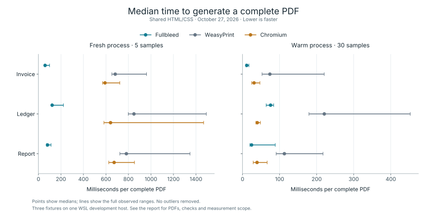

# Compare the PDFs before the timings

This maintainer-run comparison measures **Fullbleed 2.5.39**, **WeasyPrint 70.0**, and **Playwright 1.64.1 with Chromium 156.0.8078.4**. All three receive the same static HTML/CSS, font, and synthetic records: an invoice, a long ledger, and a three-page report. The run started **October 27, 2026 at 16:40 UTC** on one Linux/WSL development host.

**On these fixtures, Fullbleed had the lowest fresh-process median for all three jobs and the lowest warm median for the invoice and report. Chromium had the lowest warm median for the ledger. WeasyPrint produced the smallest PDFs in all three jobs.** All 414 output PDFs passed the declared checks: 315 latency samples, plus 99 warm-up and memory-pass PDFs.

[Inspect the PDFs](#inspect-the-files){ .md-button .md-button--primary }
[Download the complete evidence](../assets/renderer-comparison-20261027/measured-evidence.zip){ .md-button }

## Measured latency

[](../assets/renderer-comparison-20261027/latency.svg)

[Open the chart](../assets/renderer-comparison-20261027/latency.svg) or [download a PNG](../assets/renderer-comparison-20261027/latency.png). The table contains the same values and full ranges.

Milliseconds per complete PDF; lower is faster. Fresh-process medians use **five samples**, and warm medians use **thirty samples**, for every renderer/document pair. No outliers were removed.

| Document | Renderer | Pages | Fresh median (range), ms | Warm median (range), ms |
| --- | --- | ---: | ---: | ---: |
| Invoice | Fullbleed | 1 | 59.3 (56.9–98.8) | 11.4 (9.2–17.4) |
| Invoice | WeasyPrint | 1 | 682.7 (652.4–960.9) | 73.8 (52.6–220.4) |
| Invoice | Chromium | 1 | 591.7 (570.5–723.0) | 31.1 (24.7–46.9) |
| Ledger | Fullbleed | 3 | 122.0 (119.1–222.1) | 75.6 (63.9–84.0) |
| Ledger | WeasyPrint | 3 | 849.1 (798.8–1,492.2) | 220.6 (179.1–452.5) |
| Ledger | Chromium | 4 | 641.0 (582.0–1,468.4) | 39.9 (36.2–48.3) |
| Report | Fullbleed | 3 | 80.7 (72.7–111.9) | 24.5 (20.0–88.3) |
| Report | WeasyPrint | 3 | 781.5 (723.8–1,347.3) | 112.9 (90.8–217.1) |
| Report | Chromium | 3 | 673.0 (624.9–853.6) | 39.2 (28.8–66.5) |

The host used an Intel Core i7-12700H, 20 logical CPUs, about 31.2 GiB RAM exposed to WSL2, Ubuntu 22.04, Python 3.10.12, and Pango 1.50.6. The kernel was `6.18.54.1-microsoft-standard-WSL2`. This was a development host, so the results do not predict a dedicated server, concurrent workload, or another deployment. The [environment and package versions](../assets/renderer-comparison-20261027/environment.json) and [raw summary with quartiles](../assets/renderer-comparison-20261027/summary.json) are retained.

## Output size and sampled memory

PDF size is the median of the retained outputs. Memory comes from one separate sampled process-tree run for each pair. KiB and MiB use powers of 1024.

| Document | Renderer | PDF, KiB | Sampled peak tree RSS, MiB |
| --- | --- | ---: | ---: |
| Invoice | Fullbleed | 11.8 | 27.5 |
| Invoice | WeasyPrint | 8.7 | 60.0 |
| Invoice | Chromium | 9.5 | 639.8 |
| Ledger | Fullbleed | 16.5 | 28.4 |
| Ledger | WeasyPrint | 13.1 | 67.4 |
| Ledger | Chromium | 13.4 | 658.0 |
| Report | Fullbleed | 17.2 | 28.2 |
| Report | WeasyPrint | 12.9 | 61.4 |
| Report | Chromium | 13.9 | 651.4 |

The memory sampler adds the renderer process and its descendants. It can count shared pages more than once and miss short peaks. These numbers are sampled process-tree RSS, not memory allocated per PDF.

## Inspect the files

| Document | Fullbleed PDF | WeasyPrint PDF | Chromium PDF |
| --- | --- | --- | --- |
| Invoice | [1 page](../assets/renderer-comparison-20261027/pdfs/fullbleed/invoice.pdf) | [1 page](../assets/renderer-comparison-20261027/pdfs/weasyprint/invoice.pdf) | [1 page](../assets/renderer-comparison-20261027/pdfs/chromium/invoice.pdf) |
| Ledger | [3 pages](../assets/renderer-comparison-20261027/pdfs/fullbleed/ledger.pdf) | [3 pages](../assets/renderer-comparison-20261027/pdfs/weasyprint/ledger.pdf) | [4 pages](../assets/renderer-comparison-20261027/pdfs/chromium/ledger.pdf) |
| Report | [3 pages](../assets/renderer-comparison-20261027/pdfs/fullbleed/report.pdf) | [3 pages](../assets/renderer-comparison-20261027/pdfs/weasyprint/report.pdf) | [3 pages](../assets/renderer-comparison-20261027/pdfs/chromium/report.pdf) |

[Download the measured evidence (7.7 MiB)](../assets/renderer-comparison-20261027/measured-evidence.zip): all 414 PDFs, every raw sample, the source snapshot, input contracts, representative previews, validation results, and negative controls. [Download the preliminary qualification (3.8 MiB)](../assets/renderer-comparison-20261027/qualification-evidence.zip) for the separate 90-PDF setup check. Qualification timings are not part of the comparison.

Both archives include file manifests. [Download checksums](../assets/renderer-comparison-20261027/manifest.json) cover the published artifacts.

## What the output checks cover

Every output must contain all body-text segments, every record ID exactly once and in order, the expected row values and totals, A4 page dimensions, the declared page count, and embedded Inter fonts. PDFium checks non-whitespace character boxes against the page inset. Ledger pages containing rows must repeat their table headings, and report sections must start on their declared pages. Validation uses pypdf and PDFium separately from the rendering engines.

The ledger contract permits three or four pages. Chromium places its closing note on page four; Fullbleed and WeasyPrint keep it on page three. Timings cover the complete document in each case. The table and invoice spacing also differ between renderers.

All 12 negative controls were rejected: wrong record expectations, a removed final page, missing font embedding, and text shifted beyond the declared inset, for each renderer. The [inspection record](../assets/renderer-comparison-20261027/inspection.json) also verifies that all 22 representative page images match their previously reviewed counterparts exactly. These checks do not establish PDF/A, PDF/UA, PDF/X certification, or general visual parity between engines.

## What each measurement includes

**Fresh process** measures Python process launch through exit: imports, input reads, font setup, browser launch when applicable, rendering, writing the PDF, and cleanup. It does not flush operating-system caches or reboot the host.

**Warm process** reuses a Fullbleed engine, a parsed WeasyPrint stylesheet and font configuration, or a Chromium browser and page. Each render gets changed HTML with a unique fixed-length token. Timing includes HTML parsing, layout, PDF creation, and a common Python file write. Chromium waits for its fonts to load. There are two warm-ups in each of three independently started ten-sample blocks.

**Memory** is a separate pass that samples summed process-tree RSS every 10 milliseconds from startup through two warm-ups and three renders. It includes the Playwright driver and browser children. Memory sampling does not run during latency measurement.

Jobs run sequentially in seeded shuffled order. Every raw sample and output is retained, including outliers. Writes are buffered without `fsync`. The run measures ordinary document APIs; it does not measure an HTTP service, concurrent workload, browser JavaScript content, compiled-template API, or VDP job.

## Shared fixture and environment choices

The HTML/CSS, contracts, and static Inter font are unchanged from the original comparison. Original qualification with Chromium 153 found an uppercase-ID hyphen extraction problem when Inter's contextual alternates were enabled. The shared fixtures disable `calt` in **all three engines** and supply the same static Inter instance. That original finding is documented in the [October 5 setup diagnostics](../assets/renderer-comparison/setup-diagnostics.zip); it is not a new finding about Chromium 156.

Every worker receives the same Linux PATH policy. This retains the original WSL setup correction that avoids searching inherited Windows PATH entries during shared-library discovery. The installed packages, browser version, font hashes, and source hashes are recorded for this run.

## Reproduce with your own documents

The [pinned benchmark source](https://github.com/fullbleed-engine/fullbleed-official/tree/1384f67e1569b551ff4a4b647e8ac78472c6f39c/benchmarks/pdf_renderers) contains the unchanged adapters and fixtures. This refresh installs the versions in the retained [qualified requirements](../assets/renderer-comparison-20261027/requirements-qualified.txt), with the [complete measured package list](../assets/renderer-comparison-20261027/packages.txt) as constraints. The [runtime override record](../assets/renderer-comparison-20261027/runtime-overrides.json) records that relationship to the source snapshot's historical dependency pins.

Use a local Linux filesystem. Follow [WeasyPrint's system-library instructions](https://doc.courtbouillon.org/weasyprint/stable/first_steps.html) and [Playwright's browser setup](https://playwright.dev/python/docs/browsers) for your host.

```sh
git clone https://github.com/fullbleed-engine/fullbleed-official.git
cd fullbleed-official
git checkout 1384f67e1569b551ff4a4b647e8ac78472c6f39c
python3 -m venv .venv
.venv/bin/python -m pip install --only-binary=:all: \
  -r https://docs.fullbleed.dev/assets/renderer-comparison-20261027/requirements-qualified.txt \
  -c https://docs.fullbleed.dev/assets/renderer-comparison-20261027/packages.txt
.venv/bin/python -m playwright install chromium
.venv/bin/python benchmarks/pdf_renderers/compare.py --out target/my-comparison
```

The output directory must be new. `--smoke` exercises output qualification with fewer samples; it is not a performance run. Change the fixtures and acceptance contract to match your real documents before treating the results as relevant to your application.

## Earlier results and other evidence

The [October 5 comparison](renderer-comparison-20261005.md) preserves the original measurements of Fullbleed 2.5.6, WeasyPrint 70.0, and Chromium 153. Its raw evidence remains available. Different run dates and host conditions prevent attributing timing differences solely to an engine update.

For a larger fixture-level comparison, [browse the published CSS corpus](css-explorer.md). Its inputs and comparison rules differ from these application-document timings; the [corpus evidence guide](css-corpus.md) retains failures and disputed references.

Fullbleed is a print-document engine. A browser remains relevant when JavaScript or live browser layout is the required behavior. See [Choose a PDF library](comparison.md) and [CSS coverage](../css-coverage.md) when evaluating your own documents.
