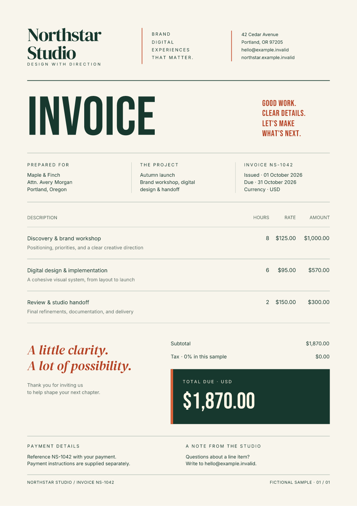
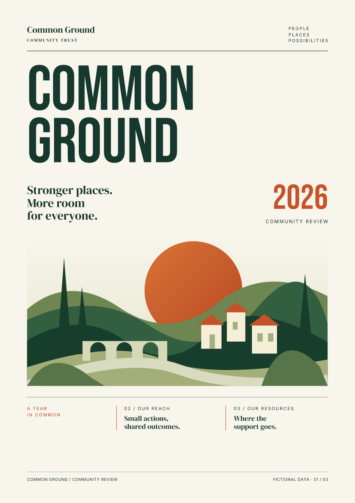
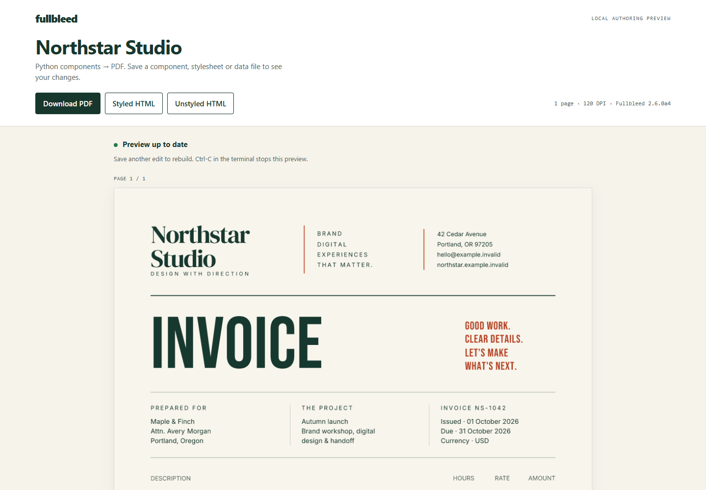
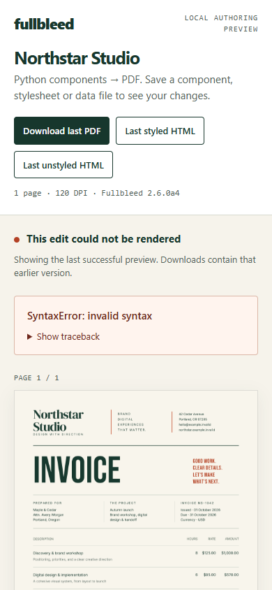

# One design, two authoring paths

The Northstar invoice and Common Ground report now have two source versions:
editable HTML templates and reusable Python components. They share the same data,
CSS, fonts and artwork. **All four PDF pages match pixel for pixel** in the
same-runtime checks described below.

Use the [live local preview](#edit-with-a-live-pdf-preview) to see PDF pages
refresh while you edit Python, CSS or data.

[Download both source versions](../assets/showcase-authoring/project.zip){ .md-button .md-button--primary }
[Northstar component PDF](../assets/showcase-authoring/invoice-components.pdf){ .md-button }
[Common Ground component PDF](../assets/showcase-authoring/report-components.pdf){ .md-button }

!!! info "Component alpha 2.6.0a4"
    These examples use `fullbleed.ui.experimental` from the explicitly pinned
    **2.6.0a4** prerelease. The API may change before stabilization. The original
    [2.4.0 showcase downloads](../examples.md#styled-invoice) remain available;
    this comparison renders both authoring paths on 2.6.0a4.

## Keep the design, choose the source

| Document | HTML/CSS output | Component output | Pages |
| --- | --- | --- | --- |
| Northstar Studio | [HTML-authored PDF](../assets/showcase-authoring/invoice-html.pdf) | [Component-authored PDF](../assets/showcase-authoring/invoice-components.pdf) | 1 |
| Common Ground | [HTML-authored PDF](../assets/showcase-authoring/report-html.pdf) | [Component-authored PDF](../assets/showcase-authoring/report-components.pdf) | 3 |

<div class="showcase-entry" markdown>
<figure markdown>
[](../assets/showcase-authoring/invoice-components.pdf)
</figure>
<div markdown>

### Northstar Studio

`InvoiceField` groups a label and several lines. `InvoiceItems` maps records to
typed table columns. `AmountDue` owns the total panel and exposes its label and
amount as named styling parts. The full document composes these pieces and
calculates totals with `Decimal`.

[Read the component source](https://github.com/fullbleed-engine/fullbleed-official/blob/b105ad61ceac0cc693be6fb29320dd76e228b173/examples/design_showcase/invoice_components.py)

</div>
</div>

The recipient block can be written either way:

=== "Python components"

    ```python
    from fullbleed.ui.experimental import Strong
    from invoice_components import InvoiceField

    recipient = InvoiceField(
        "Prepared for",
        Strong("Maple & Finch"),
        "Attn. Avery Morgan",
        "Portland, Oregon",
    )
    ```

=== "HTML"

    ```html
    <div>
      <h2 class="kicker">Prepared for</h2>
      <p><strong>Maple &amp; Finch</strong><br>
         Attn. Avery Morgan<br>Portland, Oregon</p>
    </div>
    ```

The component supplies the tags, line breaks, text escaping and internal styling
targets. Call it again with different values to create another field.

<div class="showcase-entry" markdown>
<figure markdown>
[](../assets/showcase-authoring/report-components.pdf)
</figure>
<div markdown>

### Common Ground

`ReportPage` provides the masthead and folio. The cover, reach and resources pages
compose metrics, a participation chart and an allocation table. The illustration
uses the original local SVG asset; chart heights and allocation shares come from
the data.

[Read the component source](https://github.com/fullbleed-engine/fullbleed-official/blob/b105ad61ceac0cc693be6fb29320dd76e228b173/examples/design_showcase/report_components.py)

[Reach page](../assets/showcase-authoring/report-2.png) ·
[Resources page](../assets/showcase-authoring/report-3.png)

</div>
</div>

## Where the styling lives

These are custom document designs built with the component primitives; they do
not need Bootstrap's default appearance. Both source versions use `common.css`
and their existing `invoice.css` or `report.css`.

`class_name="kicker"` emits the literal class `kicker`. It has an appearance because
`design_document()` loads the shared `.kicker` CSS rule into `Document(styles=...)`.
The class name itself does not register a style or find a stylesheet automatically.

| Styling choice | What it controls here |
| --- | --- |
| `class_name="metric-caption"` | Selects an existing rule in the shared CSS |
| `style=style(margin_top=pt(12))` | Applies a value to that node's root |
| `.with_parts(value=style(...))` | Changes the internal value advertised by `Metric` |
| `Page(size="A4", margin=mm(0))` | Owns the component document's paper geometry |

For example, customize a metric without knowing its internal tags:

```python
from fullbleed.ui.experimental import pt, style
from report_components import Metric

reach = Metric(1240, "households took part", "across four neighborhoods")
accented = reach.with_parts(
    value=style(color="#b74624", font_size=pt(44)),
)
```

The examples also customize `DataTable`'s header and cell parts to match the
existing ruled tables. A small selector rule supplies the original numeric
columns' `white-space: nowrap` behavior.

## Run and compare

Extract the download, then run from its root in a fresh Python environment:

```sh
python -m pip install -r requirements.txt
python examples/design_showcase/compare_authoring.py --out output
```

Open `output/html/invoice/invoice.pdf` and
`output/components/invoice/invoice.pdf`, then the equivalent `report` files.
`output/comparison.json` records the comparison. Use `--only invoice` or
`--only report` to check one document.

## Edit with a live PDF preview

The same download includes a local viewer that rerenders after a save:

```sh
python examples/design_showcase/preview.py
```

Open the `http://127.0.0.1:...` URL printed in the terminal. Edit
`invoice_components.py`, `component_primitives.py`, `invoice.css`, or `data.json`
in your editor and save. The viewer refreshes the finalized PDF pages, with
downloads for the PDF, styled HTML and unstyled HTML.



Choose the report or the original HTML/CSS path:

```sh
python examples/design_showcase/preview.py --document report
python examples/design_showcase/preview.py --document invoice --authoring html
```

The HTML path watches the original template and shared CSS/data. It offers the
PDF and separate HTML/CSS source downloads. Both paths use a fresh Python process
for every rebuild, including imported component modules, fonts and artwork.

When an edit fails, the viewer shows the error and keeps the last successful
preview. Its download buttons explicitly refer to that earlier version. Correct
the source and save to retry. A shorter document removes old pages from the
current view; a save during a render schedules another rebuild before publishing
the result.

<details markdown>
<summary>What an authoring error looks like</summary>

{ width="390" }

</details>

The helper watches the example directory, excluding `output`, `target`, virtual
environments and caches. Add `--watch-path path` for dependencies outside it.
`--port 0` selects a free loopback port, `--dpi` defaults to 120, and `--timeout`
defaults to 60 seconds per rebuild. Press **Ctrl-C** to stop. Download artifacts
you want to keep before closing the session.

This is a local development example that executes your Python source and uses
only the installed Fullbleed wheel and standard library. It is not a hosted
rendering service or a delivery gate. Use `compare_authoring.py` for the explicit
matching-output and font/overflow checks. The component API remains an opt-in
alpha; no new engine version is required for this helper.

## Render and export directly

To render directly, run this from `examples/design_showcase/`:

```python
from pathlib import Path
from fullbleed.ui.experimental import Renderer
from invoice_components import northstar_invoice
from render import DATA, FONTS

invoice = northstar_invoice(DATA["invoice"])
renderer = Renderer(font_files=[str(path) for path in FONTS])
Path("invoice.pdf").write_bytes(invoice.render_pdf(renderer))
Path("invoice.html").write_text(invoice.to_html(include_styles=True), encoding="utf-8")
Path("invoice.unstyled.html").write_text(invoice.to_html(include_styles=False), encoding="utf-8")
```

Styled HTML embeds CSS. Unstyled HTML retains the authored classes and content
while omitting styles. Both exports are static. For browser use, make the named
fonts available through your application's font setup; PDF font registration
does not install fonts in a browser.

These are fixed A4 compositions with one and three page budgets. Review the
layout after substantial content growth. The quarterly chart keeps the original
980-household scale unless you explicitly change it.

## What the matching-output check proves

- Both paths pass the CLI's overflow, missing-glyph and font-substitution gates,
  expected page counts, required-text checks and deterministic render/verify replay.
- All four native page PNGs are byte-identical at **120 DPI**.
- All four saved PDF pages have identical pixels in **PDFium at 144 DPI** and
  the same extracted text.
- Northstar's two PDF files are byte-identical. Common Ground's component SVG
  introduces additional graphics-state scopes, so its PDF bytes differ while
  its rendered page appearance matches.
- Direct component rendering and embedded-style HTML produce the same component
  PDF bytes. Unstyled exports omit CSS and preserve authored classes.

[Native comparison](../assets/showcase-authoring/comparison.json) ·
[Independent-reader comparison](../assets/showcase-authoring/independent-reader.json) ·
[Source and download hashes](../assets/showcase-authoring/source.json)

These checks cover these two designs on the pinned runtime. They do not imply
that arbitrary HTML, CSS or browser layout has complete parity.
