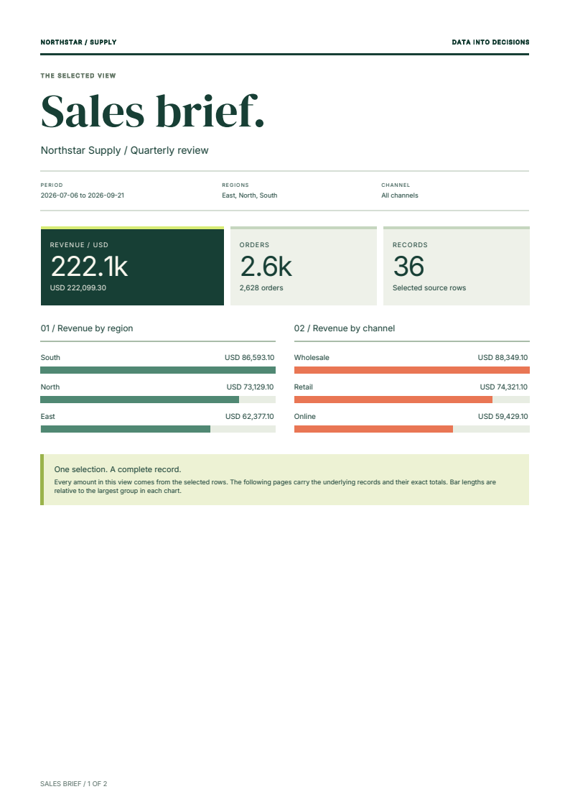
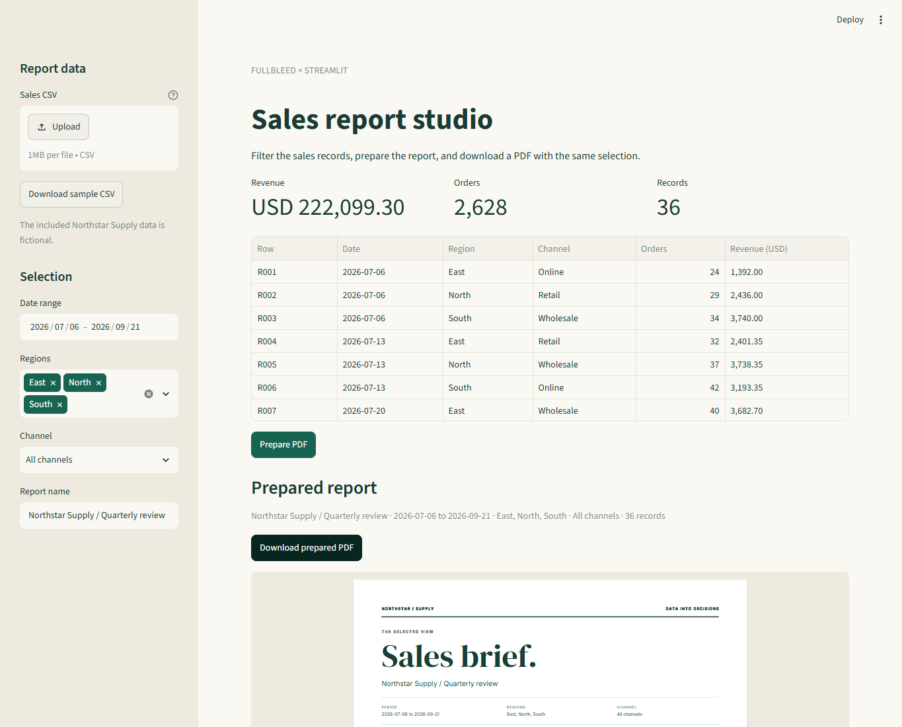

# Export Streamlit data to a PDF report

Turn a filtered data view into a report someone can read, print, or share.
This Streamlit app accepts a small sales CSV, filters dates and groups, and
generates a PDF with summary figures, revenue bars, and the selected records.
Fullbleed runs in Streamlit's Python server; HTML/CSS controls the print design.

[Download the complete app](../assets/streamlit-report/project.zip){ .md-button .md-button--primary }
[Open the sample PDF](../assets/streamlit-report/report.pdf){ .md-button }

[](../assets/streamlit-report/report.pdf)

The fictional Northstar Supply sample contains **36 records, 2,628 orders and
USD 222,099.30**. Its two-page PDF includes every source row and exact totals.
[Preview the ledger](../assets/streamlit-report/page-2.png) or inspect the
[source and download hashes](../assets/streamlit-report/source.json).

## Run the app

Use Python 3.11. Extract the ZIP, open `fullbleed-streamlit-report`, and create
a virtual environment:

```sh
python -m venv .venv
```

Activate it with `source .venv/bin/activate` on macOS/Linux or
`.venv\Scripts\Activate.ps1` in Windows PowerShell. Then run:

```sh
python -m pip install -r requirements.txt
python -m streamlit run app.py --server.address 127.0.0.1
```

Open `http://127.0.0.1:8501`. The requirements pin Fullbleed **2.5.23**,
Streamlit **1.65.0**, and the first-party Streamlit PDF viewer **2.1.0**.
The app needs no system-font setup or separate rendering service.

1. Choose dates, regions and a channel in the sidebar, or upload a CSV.
2. Select **Prepare PDF**.
3. Check the prepared selection and scroll through the PDF viewer.
4. Select **Download prepared PDF** to save `sales-brief.pdf`.

[](../assets/streamlit-report/app.png)

The PDF viewer displays the same bytes as the download. Its scrolling and zoom
controls preserve the prepared report. Changing a committed input clears the
download; select **Prepare PDF** again for the new selection. A new CSV starts
with its own complete date range and group choices.

## Add a PDF download to your Streamlit code

After preparing the PDF, pass its bytes directly to the download widget:

```python
st.download_button(
    "Download prepared PDF",
    data=prepared["pdf"],
    file_name="sales-brief.pdf",
    mime="application/pdf",
    on_click="ignore",
)
st.pdf(prepared["pdf"], height=720, alt="Sales report for the prepared selection")
```

`on_click="ignore"` prevents the download button itself from rerunning the app.
Finish editing fields before preparing a report: another input with a pending
change can still trigger a rerun. The prepared-selection caption identifies
the snapshot being downloaded. See Streamlit's
[download-button behavior](https://docs.streamlit.io/develop/api-reference/widgets/st.download_button)
and [PDF viewer](https://docs.streamlit.io/develop/api-reference/media/st.pdf).

The complete app stores prepared bytes in
[`st.session_state`](https://docs.streamlit.io/develop/api-reference/caching-and-state/st.session_state).
A fingerprint of the expanded HTML and CSS detects a changed document, and
input callbacks clear the previous result. Prepared reports are not stored in
a shared application cache. A browser reload or disconnection can reset the session.

## Supply your own records

Download the sample CSV from the sidebar to start with the correct columns:

```csv
date,region,channel,orders,revenue_usd
2026-07-06,East,Online,24,1392.00
```

Dates use `YYYY-MM-DD`; the selected range includes both endpoints. Order counts
are nonnegative integers, and revenue is a nonnegative USD decimal with at most
two decimal places. The app sums integer cents, displays exact amounts beneath
abbreviated headline figures, and repeats the exact total after the ledger.

The example accepts up to **250 records, 64 KiB, six regions and six channels**.
Names have at most 24 characters after trimming. Each record allows up to 100,000
orders and USD 1,000,000 in revenue; the prepared PDF is capped at 8 MiB.
Invalid data displays an error and clears the old download. No-match selections
also leave the download unavailable. The app does not calculate tax, convert
currencies, or deduplicate records.

Rows are sorted by date, region and channel. Labels such as `R015` identify the
original CSV record after filtering, so a PDF row can be traced back to its input.

## Make the report your own

Edit `report.html` for structure and `report.css` for print styling, then prepare
the PDF again. The example uses explicit fonts, a separate summary page, grid
panels, CSS bars, striped ledger rows and repeated table headers. Longer ledgers
continue onto additional pages. Streamlit's interface styles do not determine
the printed layout.

The template uses Python `string.Template` placeholders such as `$name`, `$rows`
and `$revenue`. Use `$$` for a literal dollar sign. Text is escaped before
substitution, including labels that resemble HTML or template syntax.

Inter comes from the Fullbleed wheel. The ZIP includes DM Serif Display and its
SIL Open Font License. Register another suitable font in `render_report` when
your data needs characters these fonts do not cover. Missing glyphs stop report
preparation instead of silently offering a damaged document.

To render the complete dataset without opening Streamlit:

```sh
python report.py --out output
```

Open `output/report.pdf`; `output/report.html` contains the expanded markup.
Pass `--csv your-data.csv` to use another complete dataset. The same `report.py`
functions can be called from an existing application.

## What is checked

The [verification record](../assets/streamlit-report/verification.json) covers
the actual extracted ZIP. Independent PDF readers check the sample, date/channel
filters, literal markup, zero values and a 250-record ledger. They inspect every
row, exact totals, page geometry and selectable text. Repeated renders must
produce identical PDF bytes for these fixtures.

Real browser checks exercise preparation, download headers and bytes, changed
inputs, date controls, two separate sessions, invalid-upload recovery and a
390-pixel viewport. The PDF viewer is checked on its second page, including the
repeated masthead. These are finite example checks, not production-capacity or
PDF standards-conformance claims.

The starter runs locally by default. A hosted Streamlit app receives uploaded
data on its server. Add your application's access, capacity and retention
controls before connecting private records. The app keeps prepared PDFs in its
session memory and does not write generated reports to disk; the explicit CLI
command above writes to the requested output directory.

[Source](https://github.com/fullbleed-engine/docs/tree/main/examples/streamlit-report) ·
[pandas reports](pandas-to-pdf.md) · [Matplotlib charts](matplotlib-pdf.md) ·
[Python API](../engine/pdf-engine.md)
