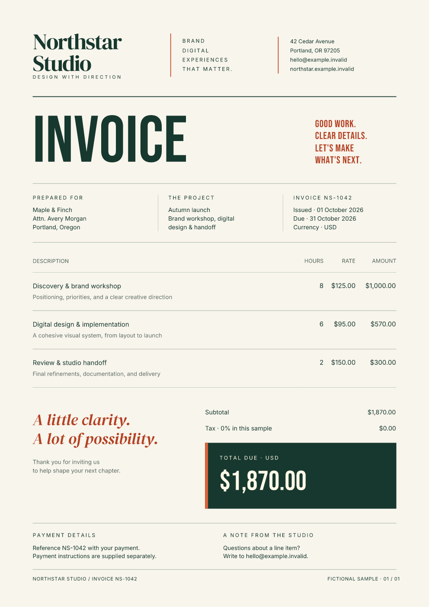

<div class="hero" markdown>
<div markdown>
<p class="eyebrow">Components + HTML/CSS to PDF · MIT licensed</p>

# Your data. Your design. Your PDF.

<p class="lead">Compose invoices, reports, and print documents with <a href="guides/python-components/">Python components</a>, <a href="guides/javascript-components/">JavaScript and JSX</a>, <a href="guides/csharp-components/">C# components</a>, or existing HTML/CSS templates. One Rust print engine, in your application.</p>

[Try PDF components](assets/react-demo/index.html){ .md-button .md-button--primary }
[Choose your language](#choose-your-language){ .md-button }

Python, Rust, Node.js, C#, and browser JavaScript. One print engine.
</div>
<figure markdown>
[](assets/showcase/invoice.pdf)
<figcaption>A real generated PDF. <a href="assets/showcase/invoice.pdf">Open it</a> · <a href="examples/">Explore the designed showcase</a></figcaption>
</figure>
</div>

<p class="facts">Reusable components &nbsp; / &nbsp; Explicit fonts and assets &nbsp; / &nbsp; Repeatable output &nbsp; / &nbsp; Free for commercial use under MIT</p>

Building a store? [Try the WooCommerce editor in a sample store](guides/woocommerce.md),
then [evaluate an automated order workflow](guides/woocommerce.md#evaluate-an-automated-workflow)
for email attachments or customer downloads.

<span id="a-small-first-step"></span>

## Compose PDFs with Python components

Functions, props, children, lists and conditionals—familiar building blocks for
your print documents. Use named elements and Python style mappings to build a
complete invoice without writing HTML strings.
The component workflow below requires Fullbleed 2.5.25 or later.

```python
from importlib.resources import files
from pathlib import Path
import fullbleed
from fullbleed.ui import Document, Heading, Paragraph, Stack, Strong, component

@component
def Line(label, amount):
    return Paragraph(Strong(label), ": ", amount)

@Document(title="Invoice", styles={
    "@page": {"size": "A4", "margin": "18mm"},
    "body": {"font_family": "Inter"},
})
def Invoice():
    return Stack(Heading("Made for you", level=1), Line("Design", "$120"), gap="12pt")

font = files("fullbleed_assets").joinpath("fonts/Inter-Variable.ttf")
engine = fullbleed.PdfEngine(font_files=[str(font)])
Path("component-invoice.pdf").write_bytes(Invoice().render_pdf(engine))
```

[Build with Python components](guides/python-components.md){ .md-button .md-button--primary }
[Download the designed invoice](assets/components/project.zip){ .md-button }

Prefer JavaScript? [Compose the same kind of document with functions or JSX/TSX](guides/javascript-components.md).
Named components, typed props and reusable styles work with the Node and browser
renderers. [Try the live component invoice](assets/react-demo/index.html) or
[connect it to your React application](guides/react-pdf.md). Ordinary JavaScript functions need no build step or React runtime.

Using C#? [Compose PDFs with typed methods, LINQ and style objects](guides/csharp-components.md),
or [download the component invoice](assets/dotnet-components/project.zip).

Want to try the next Python authoring API? The
[2.6.0a1 Bootstrap component alpha](guides/bootstrap-components-preview.md) includes
cards, data tables, forms and static component states, with PDF and styled or
unstyled HTML output. Install the alpha explicitly to try it.

Building a web application? [Render PDFs in a browser worker](guides/browser-pdf.md) with
editable templates, previews, and downloads. [Try the live starter](assets/browser-demo/index.html).

## Choose your language

Pick your application stack. Generate a PDF locally or download one from the browser app.

=== "Browser"

    Render an invoice or report in a Web Worker with `fullbleed/browser`. Edit its
    HTML/CSS, generate a preview, and download the PDF. The app loads the engine
    and fonts from its static host and renders the document in your browser.

    [Open the live editor](assets/browser-demo/index.html){ .md-button .md-button--primary }
    [Edit source online](assets/browser-starter/edit-online.html){ .md-button }
    [Download the project](assets/browser-starter/project.zip){ .md-button }

    Choose **Edit source online**, then **Open in StackBlitz**, to edit the complete
    JavaScript project in your browser. It includes the same files as the ZIP.

    Extract the ZIP and open a terminal in `fullbleed-browser-starter`. Use Node.js
    22.12 or newer for the development tools:

    ```sh
    npm ci
    npm run dev
    ```

    Open the localhost URL printed by Vite. The starter includes a designed invoice
    and report, editable templates, previews, cancellation, and PDF downloads.
    Build it with `npm run build` and serve the result as a static site.

    Using React? [Edit the complete React project online](assets/react-starter/edit-online.html)
    in StackBlitz, with TypeScript and automatic PDF previews.

    Using Vue? [Edit the complete Vue project online](assets/vue-starter/edit-online.html)
    with reactive form fields, automatic previews, and a reusable composable.

    [Browser SDK and hosting guide →](guides/browser-pdf.md)
    [React and TypeScript starter →](guides/react-pdf.md)
    [Vue and TypeScript starter →](guides/vue-pdf.md)

=== "Python"

    Use Python 3.10–3.14. The wheel includes the engine, CLI, and fonts.

    ```bash
    python -m pip install fullbleed
    ```

    Save as `hello.py`:

    ```python
    from importlib.resources import files
    from pathlib import Path
    import fullbleed

    font = files("fullbleed_assets").joinpath("fonts/Inter-Variable.ttf")
    engine = fullbleed.PdfEngine(font_files=[str(font)])
    html = "<h1>Invoice INV-1042</h1><p>Consulting: USD 1,200.00</p>"
    css = """
    @page { size: A4; margin: 20mm; }
    body { font-family: Inter; color: #203a36; }
    h1 { color: #175c52; }
    """
    pdf = engine.render_pdf(html, css)
    Path("invoice.pdf").write_bytes(pdf)
    ```

    Run:

    ```bash
    python hello.py
    ```

    Open `invoice.pdf`. This example embeds the bundled Inter font.

    [Python quickstart →](getting-started/quickstart.md) · [FastAPI, Flask, and Django](guides/web-frameworks.md)

    Building a data app? [Export filtered Streamlit data to a designed PDF](guides/streamlit-pdf.md),
    with a complete app, editable print template and interactive PDF viewer.

=== "Node.js"

    Use Node.js 22 or newer. The npm package includes the WebAssembly engine, fonts, and TypeScript declarations.

    ```bash
    npm install fullbleed
    ```

    Save as `invoice.mjs`:

    ```javascript
    import { writeFile } from 'node:fs/promises';
    import { renderPdf } from 'fullbleed';

    const result = await renderPdf({
      html: '<h1>Invoice NS-1042</h1><p>Consulting: USD 1,200.00</p>',
      css: '@page { size: A4; margin: 20mm } h1 { color: #175c52 }',
      previewDpi: 96,
    });

    await writeFile('invoice.pdf', result.pdf);
    await writeFile('invoice.png', result.previews[0]);
    console.log(`${result.pages} page; engine ${result.engineVersion}`);
    ```

    Run:

    ```bash
    node invoice.mjs
    ```

    Open `invoice.pdf` or its `invoice.png` preview. This API covers ordinary PDF rendering and previews.

    [Node.js quickstart →](getting-started/node.md) · [Next.js PDF downloads](guides/nextjs-pdf.md)

=== "Rust"

    Use a native Rust toolchain and the published crate.

    [Download the styled Rust project](assets/rust-starter/project.zip){ .md-button .md-button--primary }

    The ZIP includes editable invoice/report templates, fonts, and a Cargo
    lockfile. [Run the project](getting-started/rust.md#render-a-designed-invoice-or-report),
    or start with the smaller example below.

    ```bash
    cargo new invoice-demo
    cd invoice-demo
    cargo add fullbleed@=2.5.24 --features svg_raster
    ```

    Replace `src/main.rs` with:

    ```rust
    use fullbleed::FullBleed;

    fn main() -> Result<(), Box<dyn std::error::Error>> {
        let html = "<h1>Invoice INV-1042</h1><p>Consulting: USD 1,200.00</p>";
        let css = "@page { size: A4; margin: 20mm; } h1 { color: #175c52; }";
        let engine = FullBleed::builder().build()?;
        let pdf = engine.render_to_buffer(html, css)?;
        std::fs::write("invoice.pdf", pdf)?;
        Ok(())
    }
    ```

    Run:

    ```bash
    cargo run --release
    ```

    Open `invoice.pdf`. This first example uses standard PDF fonts; the guide adds explicit fonts and a designed invoice.

    [Rust quickstart →](getting-started/rust.md) · [Latest hosted Rust API reference](https://docs.rs/fullbleed/latest/fullbleed/)

    Building an HTTP endpoint? [Download the Axum invoice starter](guides/axum-pdf.md)
    with JSON input, editable templates, and a browser download form.

=== "C# / .NET"

    Start a new application with the .NET 10 SDK. The NuGet package includes native rendering libraries.

    ```bash
    dotnet new console -n InvoiceDemo --framework net10.0
    cd InvoiceDemo
    dotnet add package FullBleed.DotNet --version 0.2.0
    ```

    Replace `Program.cs` with:

    ```csharp
    using FullBleed.DotNet;
    using FullBleed.DotNet.UI;
    using static FullBleed.DotNet.UI.Components;

    var invoice = new Document(
        Heading(1, "Invoice INV-1042").WithClass("invoice-title"),
        Paragraph("Consulting: USD 1,200.00")
    )
    {
        Styles = new StyleSheet
        {
            ["@page"] = new Style { ["size"] = "A4", ["margin"] = "20mm" },
            [".invoice-title"] = new Style { ["color"] = "#175c52" },
        },
    };
    using var engine = new FullBleedEngine(new FullBleedEngineOptions
    {
        DocumentLanguage = "en-US",
        DocumentTitle = "Invoice INV-1042",
    });
    invoice.RenderPdfToFile(engine, "invoice.pdf");
    var inspection = FullBleedEngine.InspectPdf("invoice.pdf");
    Console.WriteLine($"Created invoice.pdf: {inspection.PageCount} page(s).");
    ```

    Run:

    ```bash
    dotnet run
    ```

    Open `invoice.pdf`. This first example uses standard PDF fonts. Existing .NET 8 and 9 applications can use the same package; see the guide for platform support and explicit fonts.

    [C# and .NET quickstart →](getting-started/dotnet.md) · [Components and styles](guides/csharp-components.md) · [LINQ and variable data](https://github.com/fullbleed-engine/fullbleed-dotnet/tree/v0.2.0/samples/FullBleed.DotNet.LinqVdp)

## Pick a document to build

<div class="grid cards" markdown>

- **Invoices from your data**

    Turn JSON or CSV into itemized invoices. Keep data, layout, and font assets explicit.

    [Invoice guide →](guides/invoices.md) · [Arabic and English example](guides/arabic-pdf.md)

- **Reports that flow across pages**

    Use headings, tables, page margins, headers, and footers for a document that grows with its content.

    [DataFrame to PDF →](guides/pandas-to-pdf.md) · [Matplotlib chart reports](guides/matplotlib-pdf.md) · [See the illustrated report →](examples.md#business-report)

- **One template, many records**

    Bind stable fields or let changing content reflow through a compiled template.

    [Variable-data guide →](guides/bank-statements.md)

- **Tagged and print-oriented output**

    Author semantic content, inspect the output, and retain evidence for the profile checks you run.

    [Accessibility →](accessibility/overview.md) · [Print output →](guides/print-output.md)

</div>

## Built for a document pipeline

Keep document structure in HTML and design in CSS, then generate PDF bytes in your application. The language guides explain each integration’s fonts, previews, API coverage, and deployment requirements.

Using PHP? The [Laravel Blade and queue starter](guides/laravel-pdf.md) connects
business events to styled PDFs, with retries, private downloads and expiry cleanup.

For command-line document workflows, the Python wheel includes the engine, CLI, and fonts with no required third-party Python runtime packages. Use it to render, preview, inspect, and verify your output.

While editing HTML and CSS, [watch mode](guides/render-watch.md) rebuilds your
PDF and PNG previews after saves. It is available in Fullbleed 2.5.0 and newer.
Use the [PDF regression starter](guides/pdf-regression-ci.md) to compare a new
render with a reviewed baseline in GitHub Actions and retain previews on failure.

Fullbleed uses static HTML/CSS as its layout language. Read the [CSS coverage](css-coverage.md) for your templates, and the [tool selection guide](guides/comparison.md) when you also need live browser rendering or general PDF editing.

## Open source, with inspectable evidence

Fullbleed is [MIT licensed](https://github.com/fullbleed-engine/fullbleed-official/blob/master/LICENSE). The [2.5.24 release](https://github.com/fullbleed-engine/fullbleed-official/releases/tag/v2.5.24) links the published engine packages and retained engineering evidence. See the [smaller-PDF before/after check](guides/pdf-size.md) and the [performance report](guides/performance.md) for specific measured workloads and their limits.

[Browse the CSS comparison](guides/css-explorer.md) to inspect printed pages and
download PDFs from all 1,662 fixtures, including failures and disputed references.

[Read the Python API](engine/pdf-engine.md) · [Set up a coding agent](guides/ai-agents.md) · [Report an issue](https://github.com/fullbleed-engine/fullbleed-official/issues) · [Support Fullbleed](support.md)
